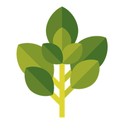
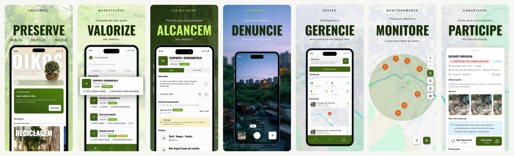
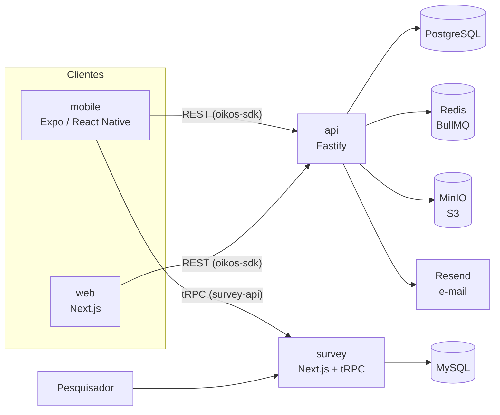

<p align="center">
  
</p>

<h1 align="center">Oikos Mobile</h1>

<p align="center">
  
  
  
  <a href="https://apps.apple.com/br/app/oikos-economia-circular/id6786017565"></a>
  <a href="https://play.google.com/store/apps/details?id=com.oikos"></a>
</p>

<p align="center">
  <strong>Preserve, reduza, reutilize e recicle.<br>
  Aplicativo da plataforma Oikos para encontrar quem recebe o seu resíduo e denunciar descarte irregular.</strong>
</p>

<p align="center">
  <picture>
    <source media="(prefers-color-scheme: dark)" srcset=".github/assets/mobile-screens-dark.jpg">
    
  </picture>
</p>

<p align="center">
  <a href="https://oikos.company">Site</a> ·
  <a href="https://apps.apple.com/br/app/oikos-economia-circular/id6786017565">App Store</a> ·
  <a href="https://play.google.com/store/apps/details?id=com.oikos">Google Play</a>
</p>

## Sobre o Oikos

O Oikos é uma plataforma de economia circular de resíduos sólidos. Ela conecta quem gera resíduo (moradores, empresas e órgãos públicos) a quem transforma esse resíduo em recurso: cooperativas, recicladoras, ecopontos e coletores.

O produto tem três frentes:

- **Pontos de coleta e mercado.** Mapa de empresas e ecopontos com os resíduos que cada um aceita, horários de funcionamento e preço pago por quilo.
- **Denúncias ambientais.** Registro de descarte irregular com foto, vídeo e localização. A comunidade vota se a denúncia foi resolvida e a moderação acompanha o andamento.
- **Modo pesquisa.** Teste de usabilidade aplicado dentro do próprio aplicativo, usado na avaliação da dissertação de mestrado que originou o projeto.

Este repositório é o aplicativo iOS e Android, que reúne as três frentes.

## Ecossistema

| Repositório | Papel | Stack principal |
|---|---|---|
| [api](https://github.com/oikos-circular-environment/api) | API REST, regras de negócio, autenticação, filas e armazenamento | Fastify, Prisma, PostgreSQL, Redis, MinIO |
| [web](https://github.com/oikos-circular-environment/web) | Site institucional e painel web para organizações e moderação | Next.js, Tailwind CSS, MapLibre |
| **mobile** (este) | Aplicativo iOS e Android | Expo, React Native |
| [survey](https://github.com/oikos-circular-environment/survey) | Instrumento e painel do teste de usabilidade | Next.js, tRPC, Drizzle, MySQL |
| devops (privado) | Infraestrutura, deploy e observabilidade | Terraform, Docker Compose, Nginx, Grafana |

## Arquitetura



O app conversa com dois backends. As funções do produto usam a API do Oikos pelo pacote `@oikos-circular-environment/oikos-sdk`, gerado a partir do OpenAPI. O modo pesquisa usa o `survey` por tRPC, com o cliente `@oikos-circular-environment/survey-api`. As respostas da pesquisa ficam primeiro em um banco SQLite local e são enviadas quando há conexão, então o teste continua mesmo com a rede instável.

## Stack

| Área | Tecnologia |
|---|---|
| Base | Expo 57, React Native 0.86 e React 19, com React Compiler e New Architecture |
| Navegação | Expo Router (abas de mercado, início e denúncias) |
| Estilo | NativeWind 5 e gluestack-ui 5 |
| Dados | TanStack Query para estado do servidor, Zustand e Context para estado local |
| Banco local | SQLite com Drizzle (modo pesquisa e dados do app) |
| Autenticação | Better Auth, com a sessão guardada no `expo-secure-store` |
| Mapas e localização | `react-native-maps` com Google Maps e `expo-location` |
| Mídia | `expo-camera`, `expo-image-picker` e `expo-video` |
| Formulários | React Hook Form com Zod |
| Observabilidade | `expo-observe` |
| Testes | Jest e React Native Testing Library |
| Publicação | EAS Build, Submit e Update |

## Estrutura

```
src/
  app/
    (tabs)/market       pontos de coleta e mercado
    (tabs)/(home)       início, conta, login e cadastro
    (tabs)/complaints   denúncias
    survey/             fluxo do modo pesquisa (consentimento, caracterização, tarefas, questionário)
  components/           componentes de interface
  contexts/ stores/     estado da aplicação
  libs/                 cliente da API, autenticação, banco local e pesquisa
  tests/                testes de componente, integração e unidade
store/                  textos, novidades e screenshots das lojas
docs/                   publicação, arquitetura e design system
specs/                  padrões de UI e UX
```

## Rodando localmente

Pré-requisitos: Node.js 24, Android Studio (para Android) ou Xcode em um Mac (para iOS), e uma instância da [api](https://github.com/oikos-circular-environment/api) rodando.

O app usa módulos nativos, então roda em um development build, não no Expo Go. Os pacotes `@oikos-circular-environment/*` estão no GitHub Packages, que exige um token do GitHub com escopo `read:packages` mesmo para leitura.

```bash
cp .env.example .env
export GH_TOKEN_PERSONAL_TOKEN=<seu-token>
npm install

npm run android   # gera e instala o development build no emulador ou aparelho
npm run ios       # o mesmo para o simulador do iOS, só em macOS
npm start         # inicia o Metro para um build já instalado
```

No `.env`, aponte `EXPO_PUBLIC_BASE_URL` para a API e `EXPO_PUBLIC_SURVEY_BASE_URL` para o survey. Em aparelho físico, use o IP da sua máquina na rede (por exemplo `http://192.168.0.10:3333`) em vez de `localhost`. O mapa precisa de uma chave do Google Maps em `EXPO_PUBLIC_GOOGLE_MAPS_API_KEY`.

## Testes e qualidade

```bash
npm test               # Jest
npm run test:coverage  # Jest com cobertura
npm run lint           # Biome
```

## Colaboração

Contribuições são bem-vindas. O fluxo é o mesmo em todos os repositórios do Oikos:

1. **Comece por uma issue.** Descreva o problema ou a proposta antes de abrir código.
2. **Crie a branch a partir de `development`**, com o nome `<número-da-issue>-<descrição-curta>`, por exemplo `142-filtro-por-residuo`. Quem não faz parte da organização trabalha a partir de um fork.
3. **Faça commits pequenos** no padrão [Conventional Commits](https://www.conventionalcommits.org/pt-br/), como `feat(market): ...` ou `fix(survey): ...`.
4. **Abra o pull request para `development`.** A descrição tem duas seções: `## Contexto` e `## O que foi feito`. O que ficou pendente vira uma nova issue.
5. **`production` só recebe código vindo de `development`**, também por pull request.

Os hooks do Lefthook rodam lint e formatação no `pre-commit` e os testes no `pre-push`. Não pule os hooks com `--no-verify`.

## Licença

O código é disponibilizado sob a [PolyForm Noncommercial 1.0.0](LICENSE). Você pode estudar, usar, modificar e redistribuir o Oikos para fins não comerciais: uso pessoal, pesquisa, ensino e uso por instituições de ensino, organizações beneficentes, de pesquisa ou de proteção ambiental e órgãos públicos. Ao redistribuir, mantenha o arquivo `LICENSE` com o aviso de copyright.

Uso comercial, como vender o software, oferecê-lo como serviço pago ou usá-lo como base de um produto, exige uma licença comercial à parte com o titular. Para tratar disso, escreva para christian.cesar@oikos.company.

Por restringir o uso comercial, esta licença não é open source na definição da OSI. O código é aberto para leitura, estudo e uso não comercial.

Ao enviar uma contribuição, você concorda que ela seja distribuída sob esta mesma licença e possa ser incluída nas licenças comerciais do projeto, com o crédito de autoria preservado.

O Oikos é registrado no INPI como programa de computador, processo BR 51 2026 008392-3.
