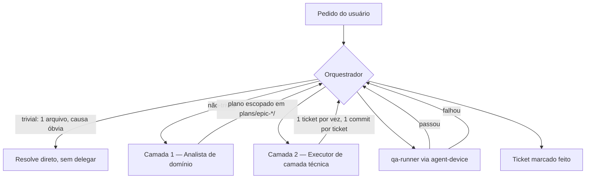

# Arquitetura de Agents Especializados — Oikos Mobile

> **Status: experimental.** Este documento define a *especificação* de um conjunto de subagents
> especializados para trabalhar neste repositório. Hoje (2026-08-26) já existem as **skills** que
> esses agents vão consumir (`.agents/skills/`, ver seção 6), mas os arquivos `.claude/agents/*.md`
> em si ainda não foram criados — implementá-los é o próximo passo, não coberto por este documento.
> Ver seção 8.
>
> Público-alvo: qualquer pessoa (ou agente) que vá rodar este projeto e programar usando Claude Code.

## 1. Problema que isso resolve

Hoje, um único agent generalista lida com qualquer pedido no repo — desde um typo em `market-list-header.tsx`
até uma investigação de bug de safe area envolvendo config plugin nativo. Isso tem dois custos:

1. **Redundância de contexto.** O agent generalista tem ~38 skills disponíveis (ver seção 6) e o
   catálogo inteiro do projeto (Market, Complaints, Survey, Auth, EAS, design system...) sempre
   presentes, mesmo quando a tarefa toca só um canto específico. Cada invocação "reconstrói" esse
   entendimento do zero.
2. **Scope creep.** Um agent com acesso amplo a arquivos e sem um contrato de escopo tende a abrir
   mais frentes do que o pedido original — refatorar código adjacente, tocar em módulos não
   relacionados, gerar mais diff do que o necessário para resolver o problema.

A proposta: trocar "um generalista faz tudo" por "um orquestrador aciona especialistas de escopo
estreito", cada um carregando só o contexto (skills, arquivos, convenções) da sua área.

## 2. Modelo mental: Orquestrador → Analistas → Executores → QA



**O orquestrador não é um agent novo.** É a própria sessão principal do Claude Code — quem já tem a
tool `Agent`/Task e decide quando delegar. Não faz sentido criar um "agent orquestrador" separado:
isso só adicionaria uma chamada de LLM redundante em cima de uma decisão que a sessão principal já
toma de graça.

Regras do protocolo:

- **Só o orquestrador aciona agents.** Nenhum Analista ou Executor tem a tool `Agent` no seu
  `tools:` — evita árvores de subagents descontroladas (elas mesmas um vetor de scope creep).
- **Agents frescos, não fork.** Analistas e Executores devem ser instâncias novas (`Agent` sem
  `subagent_type: "fork"`), não forks da sessão principal. O ganho de isolamento de contexto —
  o motivo de existir essa arquitetura — some se o agent herda todo o histórico da sessão que o
  chamou.
- **Pular o pipeline para tarefas triviais.** Typo, fix de uma linha com causa óbvia, pergunta
  factual sobre o código: a sessão principal resolve direto. O pipeline existe para reduzir o custo
  de tarefas não-triviais, não para burocratizar tudo — isso ecoa a regra geral do Claude Code de
  não invocar subagent sem necessidade real.

## 3. Camada 1 — Analistas (leitura, análise, proposta)

Analistas **não escrevem código**. Consomem o estado atual do domínio, analisam o pedido, e produzem
um plano escopado — sem abrir o leque para além do problema determinado. O contrato de tools espelha
os agents builtin `Explore`/`Plan` deste harness (mesmo padrão, não uma invenção nova):

```
tools: Read, Grep, Glob, Bash (somente leitura/diagnóstico — git log, npm test --listTests, graphify query), Skill
# Excluídos deliberadamente: Edit, Write, NotebookEdit, Agent, Artifact, ExitPlanMode
```

| Agent | Domínio | Arquivos-chave | Aciona quando |
|---|---|---|---|
| `market-analyst` | Marketplace de resíduos/serviços | `src/app/(tabs)/market/`, `src/contexts/market-context.tsx`, `src/components/market/` | Mudança de comportamento/feature no Market |
| `complaints-analyst` | Denúncia + câmera | `src/app/(tabs)/complaints/`, `src/contexts/complaint-creation-context.tsx`, `src/contexts/complaints-context.tsx`, `src/components/camera/` | Fluxo de denúncia, captura de foto, geolocalização anexada à denúncia |
| `survey-analyst` | Modo pesquisa (TCLE, SQLite, outbox) | `src/app/survey/`, `src/libs/survey/`, `src/components/survey/` | Qualquer mudança no subsistema de pesquisa — é o mais isolado e complexo do repo (persistência local, consentimento, outbox de sincronização) |
| `auth-session-analyst` | Auth, sessão, perfil, tab Home | `src/contexts/auth-context.tsx`, `src/libs/session-bus.ts`, `src/app/(home)/`, `src/libs/api/oikos-api.ts` | Login, refresh de token, logout, reset de sessão, tela inicial |
| `design-system-analyst` | Consistência visual | `src/components/ui/`, uso de `gluestack-ui`/NativeWind em qualquer tela | Auditoria de drift visual, decisão de criar/alterar um componente compartilhado |
| `data-layer-analyst` | Camada de dados cross-cutting | `src/libs/oikos-sdk/` (consumo, nunca edição), React Query em geral, padrões de cache/refetch | Mudança que atravessa múltiplos domínios pelo lado dos dados (ex.: `roundCoord`+`keepPreviousData` do epic-7 foi um caso desses) |
| `observability-analyst` | Interpretação de erro/crash/performance | Dados do EAS Observe (métricas de cold/warm start, TTI), issues do Sentry quando existir, `plans/epic-2-eas-observe/`, `plans/epic-3-observability/` | Diagnosticar um erro/crash já reportado, triar prioridade, decidir causa raiz **antes** de qualquer instrumentação nova ser escrita — hoje o observer é incompleto (epic-3 aguarda decisão de ferramenta), então grande parte do trabalho aqui é "o que está faltando observar", não só "o que os dados já dizem" |

**Saída esperada de um Analista:** este repo já tem um formato de plano maduro em `plans/epic-*/`
(`epic-brief.md` → `tech-plan.md` → `tickets.md`, ver `plans/README.md` e qualquer epic existente
como referência de forma). Um Analista deve:

- Para algo do tamanho de um epic: criar/atualizar essa estrutura de 3 arquivos.
- Para algo menor (um ticket avulso): devolver ao orquestrador um plano inline no mesmo formato de
  `tickets.md` (checkboxes `[ ]`, escopo explícito, "Fora:" listando o que **não** é para tocar).

Nos dois casos, o plano deve declarar explicitamente o que fica **fora** do escopo — esse "Fora:" é o
principal mecanismo anti scope-creep na saída do Analista.

> Nota: as skills globais `brief`/`tech-plan`/`tickets` (workflow `agile`, ver
> `~/.claude/CLAUDE.md`) já automatizam esse formato, mas hoje são globais da máquina — não
> reproduzíveis por qualquer pessoa que clone o repo. Formalizar esse fluxo em nível de projeto
> (skill própria, ou pelo menos um template em `plans/`) é um gap em aberto (seção 8).

### Exemplo completo — `survey-analyst`

```markdown
---
name: survey-analyst
description: >
  Use when the request touches the survey mode subsystem: TCLE consent, SQLite persistence,
  outbox sync, task/suite flow, or anything under src/app/survey/, src/libs/survey/,
  src/components/survey/. Analyzes the current state and proposes a scoped plan; does not
  write code.
tools: Read, Grep, Glob, Bash, Skill
model: sonnet
---

Você é o analista do subsistema de pesquisa (survey mode) do Oikos Mobile.

## Escopo
- `src/app/survey/**`, `src/libs/survey/**`, `src/components/survey/**`.
- Fora do seu escopo: qualquer tela fora de `survey/`, o design system genérico
  (`src/components/ui/`) — para essas, o orquestrador aciona outro analista.

## O que você faz
1. Lê o código relevante e o(s) ticket(s)/epic(s) já existentes em `plans/` que tocam survey.
2. Entende exatamente o problema pedido — não amplie para "enquanto isso, também poderíamos...".
3. Produz um plano no formato `tickets.md` deste repo: checkboxes de escopo, seção "Fora:"
   explícita, e uma nota se o ticket depende de outro domínio (ex.: geolocalização vem de
   `geospatial-context`, não é survey).
4. Nunca edita código. Devolve o plano para o orquestrador decidir qual executor aciona.

## Convenções do domínio a respeitar na análise
- Persistência é SQLite isolada do resto do app (ver M01 em `plans/`), com outbox de sync.
- Fluxo de consentimento (TCLE) tem exigências éticas de pesquisa com seres humanos — qualquer
  mudança de texto ou fluxo de consentimento deve ser sinalizada como sensível no plano.
- Estado de sessão de pesquisa é resetado via `sessionBus` no logout, como qualquer outro
  contexto — verifique se o ticket proposto preserva isso.
```

## 4. Camada 2 — Executores e QA (escrevem código, rodam o app)

Diferente dos Analistas (organizados por domínio de produto), os Executores são organizados por
**camada técnica** — porque é aí que "boas práticas de Expo/TypeScript/React Native" realmente
diferem. Um ticket de UI do Market e um ticket de UI de Complaints usam exatamente as mesmas regras
de `gluestack-ui`/NativeWind; não faz sentido duplicar esse conhecimento por domínio.

```
tools (executores de código): Read, Grep, Glob, Edit, Write, Bash, Skill
tools (qa-runner):            Read, Grep, Glob, Bash, Skill  (sem Edit/Write — é verificador, não escritor)
# Excluído de todos: Agent (só o orquestrador encadeia agents)
```

| Agent | Escopo de escrita | Skills principais | Boas práticas que aplica |
|---|---|---|---|
| `ui-executor` | Telas, componentes, layouts (`src/app/**`, `src/components/**` exceto `camera/` nativo) | `expo-router`, `expo-native-ui`, `expo-design-system`, `gluestack-ui-v4`, `expo-tailwind-setup`, `expo-animation`, `copywriting`/`copy-editing` | `cn()` para className condicional, formulários em `KeyboardAvoidingView`+`ScrollView`, ícones só `lucide-react-native`, cor primária `lime-800`, gluestack-ui v5 antes de RN cru |
| `data-executor` | Hooks de dados, formulários, consumo do `oikos-sdk`, mutations/queries | `expo-data-fetching`, `native-data-fetching`, `dinero-*` (valores monetários do Market) | React Query para todo estado de servidor, `react-hook-form`+`zod`, nunca editar `src/libs/oikos-sdk/` à mão (regenerar via `npm run generate:api`) |
| `native-executor` | Módulos nativos, permissões, config plugins (`plugins/`, `app.config.ts`, `expo-camera`/`expo-location`) | `expo-module`, `expo-native-ui`, `eas-workflows` | Preferir config plugin a edição manual de `android/`/`ios/` (que são gerados e gitignored — ver `plugins/withAndroidSplashWindowBackground.js` como referência real deste repo) |
| `release-executor` | Publicação, EAS, release notes, ASC/Play (`store/`, `.eas/`, `eas.json`) | `eas-app-stores`, `eas-workflows`, `eas-update-insights`, `copywriting`/`copy-editing` | Release notes ≤500 caracteres (`wc -m` antes de commitar, ver `docs/publishing-path.md`), nunca pular validação de char limit |
| `observability-executor` | Instrumentação de erro/performance (SDK setup, releases, alertas) | `sentry-get-started`, `sentry-react-native-sdk`, `sentry-instrument`, `sentry-setup-releases`, `posthog-instrumentation`, `eas-observe` | Implementa o que o `observability-analyst` apontar como faltando — hoje isso é literalmente o escopo do `plans/epic-3-observability` (decisão de ferramenta ainda em aberto: Sentry/BugSnag para crash, PostHog/Amplitude/Firebase para analytics) |
| `performance-executor` | Qualquer camada, quando o pedido é otimização (não feature nova) | `argent-react-native-optimization`, `expo-react-native-performance`, `react-native-architecture`, `react-state-management`, `typescript-refactor` | Ver nota abaixo — é a exceção deliberada ao padrão Analista/Executor |
| `qa-runner` | **Não escreve código.** Roda o app, verifica, coleta evidência | `agent-device`, `android-emulator`, `ios-simulator`, `dogfood`, `expo-dev-client` | Fluxo `open → snapshot -i → act → re-snapshot → verify → close`; app já precisa estar rodando (`npm run android`/`ios`); reporta pass/fail + screenshots/logs ao orquestrador — não corrige o que encontrar, devolve para o executor certo |

> **Por que `performance-executor` quebra o padrão "Analista propõe, Executor implementa":**
> otimização é um ciclo medir → corrigir → remedir, não uma feature com escopo fixo de antemão —
> a própria skill `argent-react-native-optimization` (Software Mansion, mesma equipe do Reanimated)
> formaliza isso: scan rápido de re-renders, sweep semântico (memoização, listas, animações,
> cleanup de efeitos, fetch waterfalls), *então* perfil, corrige o maior gargalo, remede, decide se
> manteve ou reverteu. Forçar um plano por escrito antes de cada correção individual travaria o
> ciclo sem ganho real. O guardrail aqui não é "sem Edit/Write" — é **um alvo por invocação**:
> `performance-executor` recebe uma métrica e um limiar do orquestrador (ex.: "reduzir re-renders
> da lista do Market", não "otimizar o app"), corrige o que for necessário para aquele alvo, e para.
>
> **Limite conhecido:** essa skill assume as tools MCP live do `argent` (`react-profiler-*`,
> `debugger-evaluate`) pra fases de profiling/verificação. Não instalamos o CLI/MCP do `argent`
> neste repo — ele se sobrepõe ao `agent-device` já adotado (os dois automatizam
> device/simulador/emulador, e manter dois ecossistemas de automação ativos ao mesmo tempo é
> exatamente o tipo de redundância que este documento tenta evitar). Sem o MCP live, o
> `performance-executor` ainda aproveita o Phase 1 (lint sweep) e Phase 2 (sweep semântico) da
> skill — que não dependem de dispositivo — e usa `qa-runner`/`agent-device` como substituto pro
> Phase 3/4 (perfil visual e verificação em device). Se no futuro o profiling ficar insuficiente
> assim, migrar pro `argent` inteiro (e possivelmente aposentar `agent-device`) é uma decisão a
> avaliar — não algo pra fazer hoje sem necessidade concreta.

Regra herdada do próprio fluxo de trabalho do repo (`plans/epic-*/tickets.md`): **um ticket por vez,
um commit por ticket.** Isso vale também para os Executores — um Executor recebe um ticket do
Analista/orquestrador, não o epic inteiro. Limita o raio de ação de cada invocação individual.

### Exemplo completo — `ui-executor`

```markdown
---
name: ui-executor
description: >
  Use to implement a single, already-scoped UI ticket (screen, component, layout) in
  React Native + Expo Router + gluestack-ui v5 + NativeWind. Does not decide product scope —
  expects a ticket with explicit boundaries from an Analyst or the orchestrator.
tools: Read, Grep, Glob, Edit, Write, Bash, Skill
model: sonnet
---

Você implementa UI neste app Expo/React Native. Você recebe UM ticket já escopado — não amplie
o pedido, não refatore código adjacente que não foi pedido.

## Regras obrigatórias (não são sugestões)
- Componentes: `gluestack-ui v5` antes de primitivos RN crus. Wrappers vivem em `src/components/ui/`.
- Estilo: `NativeWind` (`className`). `className` com lógica condicional SEMPRE via `cn()` de
  `@/libs/utils` — nunca template literal.
- Cor primária: `lime-800`. Não introduza paleta concorrente.
- Ícones: só `lucide-react-native`.
- Formulários: sempre `KeyboardAvoidingView behavior="padding"` + `ScrollView` com
  `contentContainerClassName` para padding.
- Zero comentários explicativos por padrão no código.

## Antes de escrever
1. Confirme os limites do ticket (arquivos que pode tocar). Se o ticket exigir tocar fora
   desses limites, pare e devolva ao orquestrador em vez de expandir sozinho.
2. Use as skills `expo-router`, `expo-native-ui`, `expo-design-system`, `gluestack-ui-v4`,
   `expo-tailwind-setup` para padrões atualizados — não confie só em memória de treino.
3. Se o ticket envolve texto voltado ao usuário (copy de UI, mensagens de erro, empty states),
   use a skill `copywriting` ou `copy-editing`.

## Depois de escrever
Rode `npm run lint` e, se o ticket tiver testes associados, `npm test`. Não marque o ticket como
concluído — isso é decisão do orquestrador após o `qa-runner` validar.
```

### Exemplo completo — `observability-executor`

```markdown
---
name: observability-executor
description: >
  Use to implement error/crash/performance instrumentation (Sentry, PostHog, or EAS Observe)
  from a scoped ticket produced by observability-analyst. Does not decide which vendor to
  adopt — that decision belongs to plans/epic-3-observability and is made by a human.
tools: Read, Grep, Glob, Edit, Write, Bash, Skill
model: sonnet
---

Você instrumenta observabilidade neste app Expo/React Native. Você recebe um ticket já
escopado — qual sinal instrumentar (erro, trace, evento de produto), não qual ferramenta
adotar em definitivo.

## Contexto do repo
- `plans/epic-2-eas-observe/` — performance (cold/warm start, TTI) já implementado via EAS
  Observe, todos os 5 tickets concluídos.
- `plans/epic-3-observability/` — crash reporting + product analytics, **decisão de
  ferramenta ainda em aberto** (candidatos: Sentry/BugSnag para crash, PostHog/Amplitude/
  Firebase Analytics para produto). Se o ticket não especificar a ferramenta, pare e
  pergunte ao orquestrador — não escolha sozinho.

## Ao instrumentar
1. Use `sentry-get-started`/`sentry-react-native-sdk` (setup Expo+RN) ou
   `posthog-instrumentation` (eventos/feature flags) conforme a ferramenta do ticket.
2. `sentry-instrument` para sinais além de erro (tracing, profiling, session replay) — só se
   o ticket pedir explicitamente, não adicione sinais "por completude".
3. `sentry-setup-releases` quando o ticket envolver rastrear qual release introduziu um
   problema — isso cruza com `release-executor` (EAS build/submit); coordene via
   orquestrador em vez de tocar `eas.json`/workflows você mesmo.
4. Nunca capture PII sem necessidade (e-mail, nome completo, localização exata) nos eventos —
   este app lida com denúncias e dados de pesquisa com seres humanos (survey/TCLE).

## Ao investigar (não instrumentar)
Se o ticket for "por que esse erro está acontecendo" em vez de "adicionar esse sinal", isso é
trabalho do `observability-analyst` (`sentry-debug-issue`, `sentry-fix-stack-traces`) — devolva
ao orquestrador se receber esse tipo de pedido por engano.
```

### Exemplo completo — `qa-runner`

```markdown
---
name: qa-runner
description: >
  Use to verify a completed ticket by actually driving the running app via agent-device —
  screenshots, interaction, logs. Does not write code; reports pass/fail and evidence back
  to the orchestrator.
tools: Read, Grep, Glob, Bash, Skill
model: sonnet
---

Você verifica mudanças rodando o app de verdade — não lê só o diff.

## Pré-condição
O app já precisa estar rodando (`npm run android` ou `npm run ios` ou `npm start`). Você não
inicia build; se não houver processo rodando, pare e informe o orquestrador.

## Fluxo
1. `agent-device open <app> --platform <android|ios> --foreground`
2. `agent-device snapshot -i` para capturar refs interativos.
3. Execute o roteiro do ticket (toques, digitação, navegação) usando os refs.
4. Re-snapshot para verificar o resultado esperado.
5. Capture screenshot/log só quando agregar evidência real (não em todo passo).
6. `agent-device close` ao final.

## Ao encontrar um problema
Não corrija. Descreva o sintoma, o passo que reproduz, e devolva ao orquestrador — ele decide
qual executor (`ui-executor`, `data-executor`, `native-executor`) aciona para o fix.

## Skills de apoio
`android-emulator` / `ios-simulator` para o alvo específico; `dogfood` se o pedido for
exploratório ("será que tem mais alguma coisa quebrada por aqui") em vez de verificação de um
ticket específico.
```

## 5. Guardrails contra scope creep

Mecanismos concretos, não só disciplina de prompt:

1. **Estrutural — Analistas não têm `Edit`/`Write`.** Código só nasce depois de passar por um
   plano revisável. Isso é reforçado pelo `tools:` do agent, não só pedido no texto.
2. **Um ticket por invocação de Executor**, nunca o epic inteiro — limita o raio de ação de cada
   chamada individual (convenção já usada em `plans/epic-*/tickets.md`).
3. **Seção "Fora:" obrigatória** em todo plano de Analista — declara o que não deve ser tocado.
4. **Nenhum agent encadeia outro agent.** Só o orquestrador usa `Agent`. Evita árvores de
   delegação descontroladas, que são elas mesmas um jeito de o escopo crescer sem supervisão.
5. **Sem refatoração de carona.** Herda a regra geral do projeto: bug fix não leva refactor
   adjacente, tarefa pontual não leva abstração nova "pra generalizar".
6. **Gate de verificação antes de marcar ticket como feito.** `qa-runner` roda o app de verdade;
   só o orquestrador fecha o ticket depois disso.

**Limite honesto:** hoje não existe no Claude Code um jeito de restringir tecnicamente *em quais
arquivos* um agent pode escrever (o `tools:` restringe *quais ações* — Edit, Write, Bash — não
*em quais paths*). O confinamento por domínio dos Executores é convenção de prompt, reforçada pelo
escopo explícito do ticket que ele recebe — não um sandbox técnico. Vale lembrar disso ao avaliar
o quanto confiar num Executor sem revisão.

## 6. Inventário de skills instaladas (nível de projeto)

Todas em `.agents/skills/`, com symlink em `.claude/skills/` — ver `skills-lock.json`.

| Categoria | Skills | Consumidas por |
|---|---|---|
| Expo framework (OSS) | `expo-overview`, `expo-router`, `expo-native-ui`, `expo-design-system`, `expo-ui`, `expo-animation`, `expo-data-fetching`, `expo-tailwind-setup`, `expo-dom`, `expo-web-to-native`, `expo-module`, `expo-brownfield`, `expo-project-structure`, `expo-examples`, `expo-app-clip` | `ui-executor`, `data-executor`, `native-executor` |
| EAS (pago) | `eas-app-stores`, `eas-workflows`, `eas-hosting`, `eas-observe`, `eas-simulator`, `eas-update-insights`, `expo-dev-client`, `expo-upgrade` | `release-executor`, `qa-runner`, `observability-analyst`/`observability-executor` (`eas-observe`) |
| Automação de app/dispositivo | `agent-device`, `android-emulator`, `ios-simulator`, `dogfood` | `qa-runner` |
| Design/UI de terceiros | `gluestack-ui-v4`, `building-native-ui`, `vercel-react-native-skills` | `design-system-analyst`, `ui-executor` |
| Dados/dinheiro | `native-data-fetching`, `dinero-best-practices`, `dinero-currency-patterns`, `dinero-formatting` | `data-layer-analyst`, `data-executor` |
| Escrita | `copywriting`, `copy-editing` | `ui-executor`, `release-executor` (e qualquer um escrevendo texto pro usuário) |
| Performance/otimização | `argent-react-native-optimization`, `expo-react-native-performance`, `react-native-architecture`, `react-state-management`, `typescript-refactor`, `typescript-advanced-patterns` | `performance-executor` |
| Observabilidade (erro/crash/analytics) | `sentry-get-started`, `sentry-react-native-sdk`, `sentry-instrument`, `sentry-debug-issue`, `sentry-fix-stack-traces`, `sentry-setup-releases`, `posthog-instrumentation` | `observability-analyst` (as de `sentry-debug-issue`/`sentry-fix-stack-traces`), `observability-executor` (as demais) |
| Meta | `expo-skill-feedback` | Qualquer agent, para reportar falha/lacuna de uma skill |

> **Sentry e PostHog cobrem os dois candidatos citados no `plans/epic-3-observability`** (Sentry
> para crash, PostHog para product analytics) — instalar as skills não decide a ferramenta, só
> arma quem for executar o epic com conhecimento atualizado dos dois caminhos possíveis. A decisão
> em si continua em aberto e cabe a uma pessoa, não ao `observability-executor`.

> **Gap conhecido:** as 23 skills `expo-*`/`eas-*` foram instaladas copiando o conteúdo do plugin
> oficial (`expo@claude-plugins-official`) manualmente, não via `npx skills add expo/skills`. Por
> isso elas não aparecem em `skills-lock.json` (só `expo-tailwind-setup`, que já existia antes por
> esse caminho, está lá). Reinstalar via `skills add` no futuro destravaria `skills update`
> automático para elas.

## 7. Como isso se conecta ao fluxo de trabalho existente

- **Planejamento:** saída dos Analistas alimenta `plans/epic-*/` (`epic-brief.md` → `tech-plan.md`
  → `tickets.md`), o mesmo formato já usado nos 8 epics existentes.
- **Branch/commit:** segue as regras já em vigor neste repo — nunca commit direto em
  `development`/`production`, uma branch por tarefa (não fragmentar), um commit por ticket, PR sem
  checklist de pendências (pendência vira ticket, não texto de PR).
- **Verificação:** `qa-runner` é o primeiro uso real do `agent-device` instalado nesta sessão — fecha
  o ciclo "escreveu código → rodou de verdade no emulador/simulador" sem depender de validação manual
  humana para todo ticket.
- **Escrita:** `copywriting`/`copy-editing` (instaladas nesta sessão) cobrem tanto texto de produto
  (UI, `ui-executor`) quanto texto de release (`release-executor`, release notes com limite de 500
  caracteres).
- **Observabilidade:** `observability-analyst`/`observability-executor` são a materialização do
  `plans/epic-3-observability`, hoje travado em "aguarda decisão de ferramenta" — esses agents
  não destravam a decisão sozinhos, mas ficam prontos pra executar qualquer um dos dois caminhos
  (Sentry ou PostHog) assim que alguém decidir.
- **Performance:** `performance-executor` não nasce de um epic específico — é acionado ad-hoc
  quando o pedido é "isso está lento"/"otimiza isso", não uma feature planejada.

## 8. Status atual e próximos passos

O que já existe:
- [x] Skills de automação de app (`agent-device` + 3 companheiras) instaladas e documentadas em
      `CLAUDE.md`.
- [x] Skills de copywriting instaladas.
- [x] Skills de performance/TypeScript moderno e de observabilidade (Sentry + PostHog)
      instaladas.
- [x] Este documento — a especificação da arquitetura de agents (6 Analistas, 6 Executores,
      contando `performance-executor` e `observability-executor`).

O que **não** existe ainda (próximo passo natural, fora do escopo deste documento):
- [ ] Os arquivos `.claude/agents/*.md` de fato (os 6 Analistas + 6 Executores/QA descritos
      aqui).
- [ ] Uma skill de projeto (não global) para gerar `epic-brief.md`/`tech-plan.md`/`tickets.md` no
      formato deste repo — hoje esse fluxo depende de skills globais de uma máquina específica.
- [ ] A decisão de ferramenta do `plans/epic-3-observability` em si (Sentry vs. BugSnag,
      PostHog vs. Amplitude/Firebase) — este documento arma o `observability-executor` pra
      qualquer um dos caminhos, mas não escolhe por ninguém.
- [ ] Validação prática: rodar esse pipeline em uma tarefa real e medir se de fato reduz consumo de
      contexto/token frente ao agent generalista atual — é isso que o pedido original chamou de
      "testar essa prática".

Quando for a hora de implementar os arquivos `.claude/agents/*.md`, os exemplos completos das
seções 3 e 4 já são o template — os demais agents da tabela seguem a mesma forma, trocando domínio,
skills e regras específicas.
