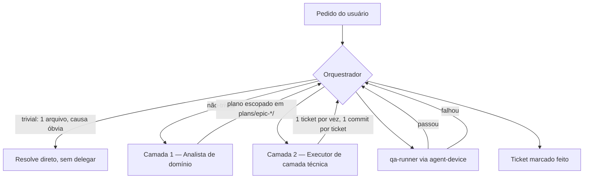

# Arquitetura de Agents Especializados — Oikos Mobile

> **Status: implementado, em teste prático.** Os 13 agents descritos aqui existem de fato em
> `.claude/agents/*.md`, consumindo as skills de `.agents/skills/` (seção 6). `observability-executor`
> é a única peça da spec original que ficou só no papel — por decisão explícita, sem instrumentar
> ferramenta nova enquanto `plans/epic-3-observability` não decidir o vendor. Ver seção 8 pro que
> falta validar na prática.
>
> Público-alvo: qualquer pessoa (ou agente) que vá rodar este projeto e programar usando Claude Code
> e/ou OpenCode — ver seção 9 pra como os dois se encaixam.

## 1. Problema que isso resolve

Hoje, um único agent generalista lida com qualquer pedido no repo — desde um typo em `market-list-header.tsx`
até uma investigação de bug de safe area envolvendo config plugin nativo. Isso tem dois custos:

1. **Redundância de contexto.** O agent generalista tem ~38 skills disponíveis (ver seção 6) e o
   catálogo inteiro do projeto (Market, Complaints, Survey, Auth, EAS, design system...) sempre
   presentes, mesmo quando a tarefa toca só um canto específico. Cada invocação "reconstrói" esse
   entendimento do zero.
2. **Scope creep.** Um agent com acesso amplo a arquivos e sem um contrato de escopo tende a abrir
   mais frentes do que o pedido original — refatorar código adjacente, tocar em módulos não
   relacionados, gerar mais diff do que o necessário para resolver o problema.

A proposta: trocar "um generalista faz tudo" por "um orquestrador aciona especialistas de escopo
estreito", cada um carregando só o contexto (skills, arquivos, convenções) da sua área.

## 2. Modelo mental: Orquestrador → Analistas → Executores → QA



**O orquestrador não é um agent novo.** É a própria sessão principal do Claude Code — quem já tem a
tool `Agent`/Task e decide quando delegar. Não faz sentido criar um "agent orquestrador" separado:
isso só adicionaria uma chamada de LLM redundante em cima de uma decisão que a sessão principal já
toma de graça.

Regras do protocolo:

- **Só o orquestrador aciona agents.** Nenhum Analista ou Executor tem a tool `Agent` no seu
  `tools:` — evita árvores de subagents descontroladas (elas mesmas um vetor de scope creep).
- **Agents frescos, não fork.** Analistas e Executores devem ser instâncias novas (`Agent` sem
  `subagent_type: "fork"`), não forks da sessão principal. O ganho de isolamento de contexto —
  o motivo de existir essa arquitetura — some se o agent herda todo o histórico da sessão que o
  chamou.
- **Pular o pipeline para tarefas triviais.** Typo, fix de uma linha com causa óbvia, pergunta
  factual sobre o código: a sessão principal resolve direto. O pipeline existe para reduzir o custo
  de tarefas não-triviais, não para burocratizar tudo — isso ecoa a regra geral do Claude Code de
  não invocar subagent sem necessidade real.

## 3. Camada 1 — Analistas (leitura, análise, proposta)

Analistas **não escrevem código**. Consomem o estado atual do domínio, analisam o pedido, e produzem
um plano escopado — sem abrir o leque para além do problema determinado. O contrato de tools espelha
os agents builtin `Explore`/`Plan` deste harness (mesmo padrão, não uma invenção nova):

```
tools: Read, Grep, Glob, Bash (somente leitura/diagnóstico — git log, npm test --listTests, graphify query), Skill
# Excluídos deliberadamente: Edit, Write, NotebookEdit, Agent, Artifact, ExitPlanMode
```

| Agent | Domínio | Arquivos-chave | Aciona quando |
|---|---|---|---|
| `market-analyst` | Marketplace de resíduos/serviços | `src/app/(tabs)/market/`, `src/contexts/market-context.tsx`, `src/components/market/` | Mudança de comportamento/feature no Market |
| `complaints-analyst` | Denúncia + câmera | `src/app/(tabs)/complaints/`, `src/contexts/complaint-creation-context.tsx`, `src/contexts/complaints-context.tsx`, `src/components/camera/` | Fluxo de denúncia, captura de foto, geolocalização anexada à denúncia |
| `survey-analyst` | Modo pesquisa (TCLE, SQLite, outbox) | `src/app/survey/`, `src/libs/survey/`, `src/components/survey/` | Qualquer mudança no subsistema de pesquisa — é o mais isolado e complexo do repo (persistência local, consentimento, outbox de sincronização) |
| `auth-session-analyst` | Auth, sessão, perfil, tab Home | `src/contexts/auth-context.tsx`, `src/libs/session-bus.ts`, `src/app/(home)/`, `src/libs/api/oikos-api.ts` | Login, refresh de token, logout, reset de sessão, tela inicial |
| `design-system-analyst` | Consistência visual | `src/components/ui/`, uso de `gluestack-ui`/NativeWind em qualquer tela | Auditoria de drift visual, decisão de criar/alterar um componente compartilhado |
| `data-layer-analyst` | Camada de dados cross-cutting | `src/libs/oikos-sdk/` (consumo, nunca edição), React Query em geral, padrões de cache/refetch | Mudança que atravessa múltiplos domínios pelo lado dos dados (ex.: `roundCoord`+`keepPreviousData` do epic-7 foi um caso desses) |
| `observability-analyst` | Interpretação de erro/crash/performance | Dados do EAS Observe (métricas de cold/warm start, TTI), issues do Sentry quando existir, `plans/epic-2-eas-observe/`, `plans/epic-3-observability/` | Diagnosticar um erro/crash já reportado, triar prioridade, decidir causa raiz **antes** de qualquer instrumentação nova ser escrita — hoje o observer é incompleto (epic-3 aguarda decisão de ferramenta), então grande parte do trabalho aqui é "o que está faltando observar", não só "o que os dados já dizem" |

**Saída esperada de um Analista:** este repo já tem um formato de plano maduro em `plans/epic-*/`
(`epic-brief.md` → `tech-plan.md` → `tickets.md`, ver `plans/README.md` e qualquer epic existente
como referência de forma). Um Analista deve:

- Para algo do tamanho de um epic: criar/atualizar essa estrutura de 3 arquivos.
- Para algo menor (um ticket avulso): devolver ao orquestrador um plano inline no mesmo formato de
  `tickets.md` (checkboxes `[ ]`, escopo explícito, "Fora:" listando o que **não** é para tocar).

Nos dois casos, o plano deve declarar explicitamente o que fica **fora** do escopo — esse "Fora:" é o
principal mecanismo anti scope-creep na saída do Analista.

> Nota: as skills globais `brief`/`tech-plan`/`tickets` (workflow `agile`, hoje em
> `/media/ccrs/development/software-engineer/workflows/`) automatizam esse formato, mas são
> globais da máquina — não reproduzíveis por quem clona só este repo. **Resolvido em
> 2026-08-27:** `.agents/skills/{brief,tech-plan,tickets}/SKILL.md` (symlinked em
> `.claude/skills/`) reproduzem o mesmo fluxo (mesma filosofia de alinhamento por entrevista,
> mesma disciplina de "artefato só depois de entendimento compartilhado"), mas com o
> **template real já praticado nos 9 epics deste repo** (que expande um pouco o esqueleto
> genérico — ex.: "Riscos/atenção" e "Validação" no tech-plan, "Status geral" no tickets) em vez
> do esqueleto mínimo das skills globais. Por terem o mesmo nome (`brief`/`tech-plan`/`tickets`),
> a resolução de skill deste harness já prioriza a versão local quando você está neste repo —
> não precisa desinstalar nem desativar as globais.

### Exemplo completo — `survey-analyst`

```markdown
---
name: survey-analyst
description: >
  Use when the request touches the survey mode subsystem: TCLE consent, SQLite persistence,
  outbox sync, task/suite flow, or anything under src/app/survey/, src/libs/survey/,
  src/components/survey/. Analyzes the current state and proposes a scoped plan; does not
  write code.
tools: Read, Grep, Glob, Bash, Skill
model: sonnet
---

Você é o analista do subsistema de pesquisa (survey mode) do Oikos Mobile.

## Escopo
- `src/app/survey/**`, `src/libs/survey/**`, `src/components/survey/**`.
- Fora do seu escopo: qualquer tela fora de `survey/`, o design system genérico
  (`src/components/ui/`) — para essas, o orquestrador aciona outro analista.

## O que você faz
1. Lê o código relevante e o(s) ticket(s)/epic(s) já existentes em `plans/` que tocam survey.
2. Entende exatamente o problema pedido — não amplie para "enquanto isso, também poderíamos...".
3. Produz um plano no formato `tickets.md` deste repo: checkboxes de escopo, seção "Fora:"
   explícita, e uma nota se o ticket depende de outro domínio (ex.: geolocalização vem de
   `geospatial-context`, não é survey).
4. Nunca edita código. Devolve o plano para o orquestrador decidir qual executor aciona.

## Convenções do domínio a respeitar na análise
- Persistência é SQLite isolada do resto do app (ver M01 em `plans/`), com outbox de sync.
- Fluxo de consentimento (TCLE) tem exigências éticas de pesquisa com seres humanos — qualquer
  mudança de texto ou fluxo de consentimento deve ser sinalizada como sensível no plano.
- Estado de sessão de pesquisa é resetado via `sessionBus` no logout, como qualquer outro
  contexto — verifique se o ticket proposto preserva isso.
```

## 4. Camada 2 — Executores e QA (escrevem código, rodam o app)

Diferente dos Analistas (organizados por domínio de produto), os Executores são organizados por
**camada técnica** — porque é aí que "boas práticas de Expo/TypeScript/React Native" realmente
diferem. Um ticket de UI do Market e um ticket de UI de Complaints usam exatamente as mesmas regras
de `gluestack-ui`/NativeWind; não faz sentido duplicar esse conhecimento por domínio.

```
tools (executores de código): Read, Grep, Glob, Edit, Write, Bash, Skill
tools (qa-runner):            Read, Grep, Glob, Bash, Skill  (sem Edit/Write — é verificador, não escritor)
# Excluído de todos: Agent (só o orquestrador encadeia agents)
```

| Agent | Escopo de escrita | Skills principais | Boas práticas que aplica |
|---|---|---|---|
| `ui-executor` | Telas, componentes, layouts (`src/app/**`, `src/components/**` exceto `camera/` nativo) | `expo-router`, `expo-native-ui`, `expo-design-system`, `gluestack-ui-v4`, `expo-tailwind-setup`, `expo-animation`, `react-composition-2026`, `copywriting`/`copy-editing` | `cn()` para className condicional, formulários em `KeyboardAvoidingView`+`ScrollView`, ícones só `lucide-react-native`, cor primária `lime-800`, gluestack-ui v5 antes de RN cru, composição em vez de prop-drilling excessivo |
| `data-executor` | Hooks de dados, formulários, consumo do `oikos-sdk`, mutations/queries, estado global | `expo-data-fetching`, `native-data-fetching`, `dinero-*` (valores monetários do Market), `react-state-management`, `zustand` | React Query para todo estado de servidor, `react-hook-form`+`zod`, nunca editar `src/libs/oikos-sdk/` à mão (regenerar via `npm run generate:api`); Zustand está instalado mas sem uso real hoje — só introduzir se Context API deixar de bastar para um caso concreto, não preventivamente |
| `native-executor` | Módulos nativos, permissões, config plugins (`plugins/`, `app.config.ts`, `expo-camera`/`expo-location`) | `expo-module`, `expo-native-ui`, `eas-workflows` | Preferir config plugin a edição manual de `android/`/`ios/` (que são gerados e gitignored — ver `plugins/withAndroidSplashWindowBackground.js` como referência real deste repo) |
| `release-executor` | Publicação, EAS, release notes, ASC/Play (`store/`, `.eas/`, `eas.json`) | `eas-app-stores`, `eas-workflows`, `eas-update-insights`, `copywriting`/`copy-editing` | Release notes ≤500 caracteres (`wc -m` antes de commitar, ver `docs/publishing-path.md`), nunca pular validação de char limit |
| `observability-executor` **(não implementado)** | Instrumentação de erro/performance (SDK setup, releases, alertas) | `sentry-get-started`, `sentry-react-native-sdk`, `sentry-instrument`, `sentry-setup-releases`, `posthog-instrumentation`, `eas-observe` | Ficaria pronto pra implementar o que `observability-analyst` apontar como faltando, mas por decisão explícita não construímos esse arquivo agora — sem instrumentar ferramenta nova antes do `plans/epic-3-observability` decidir o vendor |
| `performance-executor` | Qualquer camada, quando o pedido é otimização (não feature nova) | `argent-react-native-optimization`, `expo-react-native-performance`, `react-native-architecture`, `react-state-management`, `typescript-refactor` | Ver nota abaixo — é a exceção deliberada ao padrão Analista/Executor |
| `qa-runner` | **Não escreve código.** Roda o app, verifica, coleta evidência | `agent-device`, `android-emulator`, `ios-simulator`, `dogfood`, `expo-dev-client` | Fluxo `open → snapshot -i → act → re-snapshot → verify → close`; app já precisa estar rodando (`npm run android`/`ios`); reporta pass/fail + screenshots/logs ao orquestrador — não corrige o que encontrar, devolve para o executor certo |

> **Por que `performance-executor` quebra o padrão "Analista propõe, Executor implementa":**
> otimização é um ciclo medir → corrigir → remedir, não uma feature com escopo fixo de antemão —
> a própria skill `argent-react-native-optimization` (Software Mansion, mesma equipe do Reanimated)
> formaliza isso: scan rápido de re-renders, sweep semântico (memoização, listas, animações,
> cleanup de efeitos, fetch waterfalls), *então* perfil, corrige o maior gargalo, remede, decide se
> manteve ou reverteu. Forçar um plano por escrito antes de cada correção individual travaria o
> ciclo sem ganho real. O guardrail aqui não é "sem Edit/Write" — é **um alvo por invocação**:
> `performance-executor` recebe uma métrica e um limiar do orquestrador (ex.: "reduzir re-renders
> da lista do Market", não "otimizar o app"), corrige o que for necessário para aquele alvo, e para.
>
> **Limite conhecido:** essa skill assume as tools MCP live do `argent` (`react-profiler-*`,
> `debugger-evaluate`) pra fases de profiling/verificação. Não instalamos o CLI/MCP do `argent`
> neste repo — ele se sobrepõe ao `agent-device` já adotado (os dois automatizam
> device/simulador/emulador, e manter dois ecossistemas de automação ativos ao mesmo tempo é
> exatamente o tipo de redundância que este documento tenta evitar). Sem o MCP live, o
> `performance-executor` ainda aproveita o Phase 1 (lint sweep) e Phase 2 (sweep semântico) da
> skill — que não dependem de dispositivo — e usa `qa-runner`/`agent-device` como substituto pro
> Phase 3/4 (perfil visual e verificação em device). Se no futuro o profiling ficar insuficiente
> assim, migrar pro `argent` inteiro (e possivelmente aposentar `agent-device`) é uma decisão a
> avaliar — não algo pra fazer hoje sem necessidade concreta.

Regra herdada do próprio fluxo de trabalho do repo (`plans/epic-*/tickets.md`): **um ticket por vez,
um commit por ticket.** Isso vale também para os Executores — um Executor recebe um ticket do
Analista/orquestrador, não o epic inteiro. Limita o raio de ação de cada invocação individual.

### Exemplo completo — `ui-executor`

```markdown
---
name: ui-executor
description: >
  Use to implement a single, already-scoped UI ticket (screen, component, layout) in
  React Native + Expo Router + gluestack-ui v5 + NativeWind. Does not decide product scope —
  expects a ticket with explicit boundaries from an Analyst or the orchestrator.
tools: Read, Grep, Glob, Edit, Write, Bash, Skill
model: sonnet
---

Você implementa UI neste app Expo/React Native. Você recebe UM ticket já escopado — não amplie
o pedido, não refatore código adjacente que não foi pedido.

## Regras obrigatórias (não são sugestões)
- Componentes: `gluestack-ui v5` antes de primitivos RN crus. Wrappers vivem em `src/components/ui/`.
- Estilo: `NativeWind` (`className`). `className` com lógica condicional SEMPRE via `cn()` de
  `@/libs/utils` — nunca template literal.
- Cor primária: `lime-800`. Não introduza paleta concorrente.
- Ícones: só `lucide-react-native`.
- Formulários: sempre `KeyboardAvoidingView behavior="padding"` + `ScrollView` com
  `contentContainerClassName` para padding.
- Zero comentários explicativos por padrão no código.

## Antes de escrever
1. Confirme os limites do ticket (arquivos que pode tocar). Se o ticket exigir tocar fora
   desses limites, pare e devolva ao orquestrador em vez de expandir sozinho.
2. Use as skills `expo-router`, `expo-native-ui`, `expo-design-system`, `gluestack-ui-v4`,
   `expo-tailwind-setup` para padrões atualizados — não confie só em memória de treino.
3. Se o ticket envolve texto voltado ao usuário (copy de UI, mensagens de erro, empty states),
   use a skill `copywriting` ou `copy-editing`.

## Depois de escrever
Rode `npm run lint` e, se o ticket tiver testes associados, `npm test`. Não marque o ticket como
concluído — isso é decisão do orquestrador após o `qa-runner` validar.
```

### Exemplo (não implementado) — `observability-executor`

> Este arquivo `.claude/agents/observability-executor.md` **não existe no repo** — o resto dos
> 13 agents desta spec já foi implementado, esse ficou de fora por decisão explícita (ver
> status no topo do documento). O exemplo abaixo continua valendo como template pra quando
> `plans/epic-3-observability` decidir a ferramenta.

```markdown
---
name: observability-executor
description: >
  Use to implement error/crash/performance instrumentation (Sentry, PostHog, or EAS Observe)
  from a scoped ticket produced by observability-analyst. Does not decide which vendor to
  adopt — that decision belongs to plans/epic-3-observability and is made by a human.
tools: Read, Grep, Glob, Edit, Write, Bash, Skill
model: sonnet
---

Você instrumenta observabilidade neste app Expo/React Native. Você recebe um ticket já
escopado — qual sinal instrumentar (erro, trace, evento de produto), não qual ferramenta
adotar em definitivo.

## Contexto do repo
- `plans/epic-2-eas-observe/` — performance (cold/warm start, TTI) já implementado via EAS
  Observe, todos os 5 tickets concluídos.
- `plans/epic-3-observability/` — crash reporting + product analytics, **decisão de
  ferramenta ainda em aberto** (candidatos: Sentry/BugSnag para crash, PostHog/Amplitude/
  Firebase Analytics para produto). Se o ticket não especificar a ferramenta, pare e
  pergunte ao orquestrador — não escolha sozinho.

## Ao instrumentar
1. Use `sentry-get-started`/`sentry-react-native-sdk` (setup Expo+RN) ou
   `posthog-instrumentation` (eventos/feature flags) conforme a ferramenta do ticket.
2. `sentry-instrument` para sinais além de erro (tracing, profiling, session replay) — só se
   o ticket pedir explicitamente, não adicione sinais "por completude".
3. `sentry-setup-releases` quando o ticket envolver rastrear qual release introduziu um
   problema — isso cruza com `release-executor` (EAS build/submit); coordene via
   orquestrador em vez de tocar `eas.json`/workflows você mesmo.
4. Nunca capture PII sem necessidade (e-mail, nome completo, localização exata) nos eventos —
   este app lida com denúncias e dados de pesquisa com seres humanos (survey/TCLE).

## Ao investigar (não instrumentar)
Se o ticket for "por que esse erro está acontecendo" em vez de "adicionar esse sinal", isso é
trabalho do `observability-analyst` (`sentry-debug-issue`, `sentry-fix-stack-traces`) — devolva
ao orquestrador se receber esse tipo de pedido por engano.
```

### Exemplo completo — `qa-runner`

```markdown
---
name: qa-runner
description: >
  Use to verify a completed ticket by actually driving the running app via agent-device —
  screenshots, interaction, logs. Does not write code; reports pass/fail and evidence back
  to the orchestrator.
tools: Read, Grep, Glob, Bash, Skill
model: sonnet
---

Você verifica mudanças rodando o app de verdade — não lê só o diff.

## Pré-condição
O app já precisa estar rodando (`npm run android` ou `npm run ios` ou `npm start`). Você não
inicia build; se não houver processo rodando, pare e informe o orquestrador.

## Fluxo
1. `agent-device open <app> --platform <android|ios> --foreground`
2. `agent-device snapshot -i` para capturar refs interativos.
3. Execute o roteiro do ticket (toques, digitação, navegação) usando os refs.
4. Re-snapshot para verificar o resultado esperado.
5. Capture screenshot/log só quando agregar evidência real (não em todo passo).
6. `agent-device close` ao final.

## Ao encontrar um problema
Não corrija. Descreva o sintoma, o passo que reproduz, e devolva ao orquestrador — ele decide
qual executor (`ui-executor`, `data-executor`, `native-executor`) aciona para o fix.

## Skills de apoio
`android-emulator` / `ios-simulator` para o alvo específico; `dogfood` se o pedido for
exploratório ("será que tem mais alguma coisa quebrada por aqui") em vez de verificação de um
ticket específico.
```

## 5. Guardrails contra scope creep

Mecanismos concretos, não só disciplina de prompt:

1. **Estrutural — Analistas não têm `Edit`/`Write`.** Código só nasce depois de passar por um
   plano revisável. Isso é reforçado pelo `tools:` do agent, não só pedido no texto.
2. **Um ticket por invocação de Executor**, nunca o epic inteiro — limita o raio de ação de cada
   chamada individual (convenção já usada em `plans/epic-*/tickets.md`).
3. **Seção "Fora:" obrigatória** em todo plano de Analista — declara o que não deve ser tocado.
4. **Nenhum agent encadeia outro agent.** Só o orquestrador usa `Agent`. Evita árvores de
   delegação descontroladas, que são elas mesmas um jeito de o escopo crescer sem supervisão.
5. **Sem refatoração de carona.** Herda a regra geral do projeto: bug fix não leva refactor
   adjacente, tarefa pontual não leva abstração nova "pra generalizar".
6. **Gate de verificação antes de marcar ticket como feito.** `qa-runner` roda o app de verdade;
   só o orquestrador fecha o ticket depois disso.

**Limite honesto:** hoje não existe no Claude Code um jeito de restringir tecnicamente *em quais
arquivos* um agent pode escrever (o `tools:` restringe *quais ações* — Edit, Write, Bash — não
*em quais paths*). O confinamento por domínio dos Executores é convenção de prompt, reforçada pelo
escopo explícito do ticket que ele recebe — não um sandbox técnico. Vale lembrar disso ao avaliar
o quanto confiar num Executor sem revisão.

## 6. Inventário de skills instaladas (nível de projeto)

Todas em `.agents/skills/`, com symlink em `.claude/skills/` — ver `skills-lock.json`.

| Categoria | Skills | Consumidas por |
|---|---|---|
| Expo framework (OSS) | `expo-overview`, `expo-router`, `expo-native-ui`, `expo-design-system`, `expo-ui`, `expo-animation`, `expo-data-fetching`, `expo-tailwind-setup`, `expo-dom`, `expo-web-to-native`, `expo-module`, `expo-brownfield`, `expo-project-structure`, `expo-examples`, `expo-app-clip` | `ui-executor`, `data-executor`, `native-executor` |
| EAS (pago) | `eas-app-stores`, `eas-workflows`, `eas-hosting`, `eas-observe`, `eas-simulator`, `eas-update-insights`, `expo-dev-client`, `expo-upgrade` | `release-executor`, `qa-runner`, `observability-analyst`/`observability-executor` (`eas-observe`) |
| Automação de app/dispositivo | `agent-device`, `android-emulator`, `ios-simulator`, `dogfood` | `qa-runner` |
| Design/UI de terceiros | `gluestack-ui-v4`, `building-native-ui`, `vercel-react-native-skills` | `design-system-analyst`, `ui-executor` |
| Dados/dinheiro | `native-data-fetching`, `dinero-best-practices`, `dinero-currency-patterns`, `dinero-formatting` | `data-layer-analyst`, `data-executor` |
| Escrita | `copywriting`, `copy-editing` | `ui-executor`, `release-executor` (e qualquer um escrevendo texto pro usuário) |
| Planejamento (autoral, não copiada de fonte externa) | `brief`, `tech-plan`, `tickets` | Orquestrador e qualquer Analista, ao levantar/planejar um epic novo em `plans/epic-*/` — ver nota da seção 3 |
| Performance/otimização | `argent-react-native-optimization`, `expo-react-native-performance`, `react-native-architecture`, `react-state-management`, `typescript-refactor`, `typescript-advanced-patterns` | `performance-executor` |
| Arquitetura e princípios de design | `solid`, `domain-driven-design`, `clean-architecture`, `clean-code` | Julgamento de qualquer Analista ao propor um plano; `data-layer-analyst` em especial (DDD mapeia direto pros `src/contexts/*` do app — cada context já é, na prática, um bounded context informal) |
| Estado/componentes React | `react-state-management`, `zustand`, `react-composition-2026` | `data-layer-analyst`/`data-executor` (estado), `design-system-analyst`/`ui-executor` (composição de componente) |
| Observabilidade (erro/crash/analytics) | `sentry-get-started`, `sentry-react-native-sdk`, `sentry-instrument`, `sentry-debug-issue`, `sentry-fix-stack-traces`, `sentry-setup-releases`, `posthog-instrumentation` | `observability-analyst` (as de `sentry-debug-issue`/`sentry-fix-stack-traces`), `observability-executor` (as demais) |
| Meta | `expo-skill-feedback` | Qualquer agent, para reportar falha/lacuna de uma skill |

> **Sentry e PostHog cobrem os dois candidatos citados no `plans/epic-3-observability`** (Sentry
> para crash, PostHog para product analytics) — instalar as skills não decide a ferramenta, só
> arma quem for executar o epic com conhecimento atualizado dos dois caminhos possíveis. A decisão
> em si continua em aberto e cabe a uma pessoa, não ao `observability-executor`.

> **MVVM não tem skill instalada de propósito.** As opções disponíveis no catálogo são todas de
> Kotlin/Android, SwiftUI ou WPF/MAUI — plataformas erradas pra este stack. MVVM não é como React
> pensa (não existe um "ViewModel" observável separado do componente — o hook já cumpre esse
> papel). `clean-architecture` cobre o problema real por trás do pedido (separar regra de negócio
> de apresentação) de um jeito que faz sentido aqui.

> **Gap conhecido:** as 23 skills `expo-*`/`eas-*` foram instaladas copiando o conteúdo do plugin
> oficial (`expo@claude-plugins-official`) manualmente, não via `npx skills add expo/skills`. Por
> isso elas não aparecem em `skills-lock.json` (só `expo-tailwind-setup`, que já existia antes por
> esse caminho, está lá). Reinstalar via `skills add` no futuro destravaria `skills update`
> automático para elas.

> **`brief`/`tech-plan`/`tickets` também não aparecem em `skills-lock.json`, mas por motivo
> diferente**: não vieram de `skills add` de fonte alguma — foram escritas do zero pra este repo
> em 2026-08-27, adaptando a filosofia dos workflows globais do usuário
> (`/media/ccrs/development/software-engineer/workflows/agile/`) ao formato real já praticado
> aqui. Não há "fonte" externa a rastrear; `skills-lock.json` não se aplica.

## 7. Como isso se conecta ao fluxo de trabalho existente

- **Planejamento:** saída dos Analistas alimenta `plans/epic-*/` (`epic-brief.md` → `tech-plan.md`
  → `tickets.md`), o mesmo formato já usado nos 9 epics existentes — agora com skills de projeto
  próprias (`brief`/`tech-plan`/`tickets`, seção 6) em vez de depender só do julgamento do
  Analista ou de skills globais da máquina.
- **Branch/commit:** segue as regras já em vigor neste repo — nunca commit direto em
  `development`/`production`, uma branch por tarefa (não fragmentar), um commit por ticket, PR sem
  checklist de pendências (pendência vira ticket, não texto de PR).
- **Verificação:** `qa-runner` é o primeiro uso real do `agent-device` instalado nesta sessão — fecha
  o ciclo "escreveu código → rodou de verdade no emulador/simulador" sem depender de validação manual
  humana para todo ticket.
- **Escrita:** `copywriting`/`copy-editing` (instaladas nesta sessão) cobrem tanto texto de produto
  (UI, `ui-executor`) quanto texto de release (`release-executor`, release notes com limite de 500
  caracteres).
- **Observabilidade:** `observability-analyst` materializa a metade "entender o que já existe e
  o que falta" do `plans/epic-3-observability`, lendo o EAS Observe (epic-2, já implementado) —
  sem instrumentar nada novo. A metade "implementar" (`observability-executor`) fica só como
  template até alguém decidir Sentry vs. PostHog (ou outro).
- **Performance:** `performance-executor` não nasce de um epic específico — é acionado ad-hoc
  quando o pedido é "isso está lento"/"otimiza isso", não uma feature planejada.

## 8. Status atual e próximos passos

O que já existe:
- [x] Skills de automação de app (`agent-device` + 3 companheiras), copywriting,
      performance/TypeScript moderno, observabilidade (Sentry + PostHog) e arquitetura
      (SOLID/DDD/clean-architecture/clean-code, zustand, react-composition-2026) instaladas.
- [x] Os 13 arquivos `.claude/agents/*.md` (7 Analistas + 6 Executores/QA) implementados.
- [x] Integração com o pipeline OpenCode do repo `api` (`.opencode/prompt/*.md` desta mobile) —
      ver seção 9.
- [x] Este documento.
- [x] Skill de projeto (não global) pra gerar `epic-brief.md`/`tech-plan.md`/`tickets.md` no
      formato deste repo — `.agents/skills/{brief,tech-plan,tickets}/SKILL.md` (2026-08-27),
      reproduz o fluxo sem depender de skills globais da máquina. Ver seção 6/7.

O que **não** existe ainda:
- [ ] `observability-executor` (decisão explícita — ver seção 7).
- [ ] A decisão de ferramenta do `plans/epic-3-observability` em si (Sentry vs. BugSnag,
      PostHog vs. Amplitude/Firebase) — não é algo que este documento resolve.
- [ ] Validação prática: rodar esse pipeline numa tarefa real e medir se de fato reduz consumo de
      contexto/token frente ao agent generalista — é isso que o pedido original chamou de "testar
      essa prática", e é o próximo passo real agora que os agents existem de verdade.

## 9. Modelo híbrido: Claude Code + OpenCode

Dois motores diferentes, cada um no papel que faz sentido pro custo dele — não dois jeitos
concorrentes de fazer a mesma coisa.

### Claude Code — orquestração, julgamento e revisão (nunca a primeira tentativa de execução)

O **Orquestrador**, todo **Analista** e o **`qa-runner`** sempre rodam em Claude — são papéis de
julgamento (escopo, arquitetura, verificação), não de escrever o diff em si. Analistas seguem em
`model: sonnet`; `qa-runner` segue em `model: haiku` (protocolo fixo, pouca ambiguidade — só
promover pra `sonnet` se um caso concreto mostrar Haiku errando leitura de snapshot).

**Os 5 Executores (`ui-executor`, `data-executor`, `native-executor`, `release-executor`,
`performance-executor`) não são mais "Claude por padrão, OpenCode como economia opcional".**
Desde 2026-08-26, todo Executor tenta a cadeia de modelos gratuitos primeiro — sem exceção pra
native/release — e só escreve o código ele mesmo (em Claude) se a cadeia inteira falhar. A revisão
obrigatória (ver "Rede de segurança" abaixo) é o que torna isso seguro mesmo pra native/release,
que antes eram exceção por causa de blast radius alto (native só valida depois de build real,
release lida com credencial/char-limit exato) — antes essa cautela vinha de nunca delegar; agora
vem de sempre revisar antes de aceitar, delegado ou não.

### Cadeia de execução (por ticket, nesta ordem)

| # | Tier | Agent OpenCode | Modelo | Custo | Quando passa pro próximo |
|---|---|---|---|---|---|
| 1 | T1 free | `oikos-exec` | `opencode/big-pickle` | grátis | erro de cota/rate-limit |
| 2 | T1 free | `oikos-exec-alt` | `opencode/muse-spark-1.2-contributor-free` | grátis | erro de cota/rate-limit |
| 3 | T1 free | `oikos-exec-alt2` | `opencode/mimo-v2.5-free` | grátis | erro de cota/rate-limit |
| 4 | T1 free | `oikos-exec-alt3` | `opencode/hy3-free` | grátis | erro de cota/rate-limit |
| 5 | T1 free | `oikos-exec-omni` | `omniroute/omini-free-tier` | grátis | falha de conexão ou timeout — ver nota sobre o combo custom abaixo |
| 6 | T2 pago | `oikos-exec-go` | `opencode-go/kimi-k2.7-code` | pago (crédito curto — **já bateu o limite em 2026-08-27, pular por ora**) | falha ou diff ruim na revisão |
| 7 | Claude | Executor Claude, `model: haiku` (override do orquestrador na chamada `Agent`) | `claude-haiku-4-5` | pago (Anthropic) | diff ruim na revisão |
| 8 | Claude | Executor Claude, `model: sonnet` (default do agent, sem override) | `claude-sonnet-5` | pago (Anthropic) | — é o último tier, sempre funciona |

`oikos-exec-gemini` (`google/gemini-3.6-flash`) continua fora dessa cadeia linear — é uma escolha
por **formato da task** (muito contexto de leitura), não um degrau de fallback por custo; o
Executor Claude escolhe ele diretamente quando a task pedir isso, em vez de entrar na sequência
acima.

**Passos 1-4 expandidos em 2026-08-27: `oikos-exec-alt` trocou de modelo, dois agents novos.**
`opencode/deepseek-v4-flash-free` (modelo original do passo 2) apareceu **vermelho/quebrado** no
dashboard do OmniRoute (`OpenCode Free` → Available Models) nesta sessão — substituído por
`muse-spark-1.2-contributor-free` (confirmado funcionando, 4s de latência). Dos 64 modelos listados
pro provider `opencode` (no-auth, ver nota abaixo), só 4 passam no teste hoje:
`big-pickle`, `muse-spark-1.2-contributor-free`, `mimo-v2.5-free`, `hy3-free` — os 4 agora têm um
agent dedicado cada (`oikos-exec` → `oikos-exec-alt3`), todos testados individualmente com sucesso
antes de entrar na config.

**Nota sobre cota compartilhada — resolvida, é "no-auth" (não é conta com login).** Pesquisei no
repo `diegosouzapw/OmniRoute` ([#7622](https://github.com/diegosouzapw/OmniRoute/issues/7622)): o
provider `opencode` (Zen) é classificado explicitamente como **no-auth** — não existe
login/API-key, o acesso é anônimo. Confirmado batendo os dois lados: `~/.local/share/opencode/auth.json`
(CLI local) não tem entrada `opencode` nenhuma, e a conexão do OmniRoute pro `opencode`
(`connectionId 04f022d4...`) tem `authType: "apikey"` mas sem chave real — só um campo
`providerSpecificData.fingerprints`, um identificador sintético que o OmniRoute gera pra se
apresentar como um cliente diferente da CLI local. Como a conexão do OmniRoute também tem
`proxyEnabled: true`, o tráfego dela provavelmente sai por um IP diferente do da CLI local também.
**Conclusão prática (inferência forte, não confirmada por doc do Zen):** os dois caminhos
(CLI local vs. OmniRoute) provavelmente não competem pela mesma cota, já que nenhum dos dois usa
conta de verdade e ambos têm fingerprint+IP distintos — mas como o algoritmo de rate-limit do Zen é
fechado, não dá pra garantir 100%. **Se e como o rate-limit do Zen é por modelo ou por
sessão/dispositivo dentro de um mesmo caminho (ex.: usar `big-pickle` afeta `hy3-free` na mesma
CLI?) continua em aberto** — decidimos testar isso via uso real (dogfooding a cadeia acima numa
task de verdade) em vez de um teste sintético de stress, porque um teste sintético leve (1 chamada
por modelo) não teria revelado nada mesmo.

**OmniRoute** (`http://127.0.0.1:20128`, container Docker local, ver `docker ps` → `omniroute`)
agrega dezenas de provedores gratuitos por trás de um único endpoint compatível com OpenAI (GitHub
Copilot, Groq, NVIDIA NIM, Ollama Cloud, Kiro, OpenRouter free tier, e mais). Em vez de cadastrar
provedor por provedor no `opencode.json` (frágil — cada provedor tem limites próprios), usamos um
**combo custom criado no dashboard do OmniRoute**, `omini-free-tier` (`/api/combos`, `id
ef4ee986-7b43-4f2f-a387-47a8ae9360f7`, strategy `round-robin`) — em vez do combo genérico
`auto/coding:free` que o OmniRoute já expõe por padrão. A diferença: o combo custom só roteia entre
os providers que o usuário escolheu manualmente adicionar (controle explícito sobre quais
provedores participam), enquanto `auto/coding:free` tenta todos os providers gratuitos conectados
sem curadoria. Sem autenticação necessária pro endpoint de chat (o container só escuta em
`127.0.0.1`); o management API (`/api/combos`, CRUD completo — GET/POST/PUT/DELETE/PATCH) aceita a
mesma chave Bearer usada no MCP — **confirmado na prática**: a IA consegue listar, adicionar,
remover e testar providers dentro de um combo diretamente via `PUT /api/combos/{id}` (mandando o
objeto completo com o array `models` atualizado), sem precisar do dashboard. Só a criação do combo
em si e a chave Bearer continuam sendo setup humano inicial.

**Achados reais testando esse tier (sessão de 2026-08-26/27, incompleta — retomar):**

1. **Cap de 128 tools do Groq.** OpenCode manda no `tools` da request toda capacidade de todo MCP
   habilitado globalmente pro agent — não só os builtins. Neste repo isso somava ~137 tools
   (`metro-mcp`: 88, `chrome-devtools-mcp`: 29, builtins do OpenCode: 12, `pencil`: 4, `context7`:
   2), e o Groq rejeita requests com mais de 128. **Corrigido**: restrição por agent via
   `permission` com wildcard (`"chrome-devtools_*": "deny"`, `"metro-mcp_*": "deny"` em cada agent
   `oikos-*` no `opencode.json` global) — a doc oficial do OpenCode confirma que `deny` remove a
   tool da descrição mandada pro modelo, não só bloqueia a execução. `Framelink_Figma_MCP` foi
   removido do config global por não ser mais necessário.
2. **TPM (tokens/minuto) do tier free do Groq.** Com só `groq/qwen/qwen3.6-27b` no combo, uma task
   real (dispatch de commit via `oikos-exec-omni`, ~17-44k tokens de contexto) bateu em
   `[413] tokens per minute (TPM): Limit 8000` — estrutural do tier gratuito daquele
   provider/modelo, não contornável via config. Só serve pra prompts pequenos (testado: chat
   simples de 16 tokens respondeu em 1.4s).
3. **Kiro — confirmado como cota de créditos grátis (usuário confirmou), não cobrança real.** Testei
   adicionar `kiro/claude-haiku-4.5` ao combo — funcionou tecnicamente (roteou certo, aguentou 24k
   tokens sem erro de TPM, 3.5s de latência); o header `x-omniroute-response-cost` mostra um valor
   não-zero (~$0.012 numa chamada de 24k tokens), mas isso é o OmniRoute reportando o valor de
   mercado do que foi consumido dentro da cota mensal grátis do plano Kiro/AWS — não uma cobrança
   real. Confirmado pelo usuário. **Mantido no combo.**
4. **`opencode/mimo-v2.5-free` — 429 confirmado persistente, não transitório.** Reteste em
   2026-08-27 ~12:08 UTC (horas depois da sessão anterior, sem chamadas de teste no meio) bateu de
   novo em `[429] Error from provider (Console): Rate limit exceeded`. `check_quota` da conta
   OpenCode no mesmo instante mostrou `quotaUsed: 0`, `percentRemaining: 100`, `tokenStatus: valid`
   — ou seja, não é cota da conta esgotada, é rate-limit estrutural do backend "Console" desse
   modelo específico no tier free, igual em espécie ao TPM de 8k do Groq (achado 2). **Descartado
   como candidato — não vale reteste futuro sem mudança de tier/conta.**
5. **Groq com erro novo, não visto na sessão anterior.** No mesmo teste de 2026-08-27, o
   `groq/qwen/qwen3.6-27b` (que antes batia em TPM 8k) passou a falhar antes de processar:
   `[400]: property 'x-provider' is unsupported`. Parece o OmniRoute mandando um campo `x-provider`
   que a API do Groq passou a rejeitar — regressão de infra do combo/OmniRoute, não do free tier em
   si. Não investigado a fundo ainda.

6. **GitHub Copilot — causa raiz achada e corrigida.** Conta reconectada duas vezes sem efeito
   (100% dos modelos batendo `[400] The requested model is not supported`, inclusive fallback de
   alias) — não era problema de token/plano (Copilot Student ativo, 200 créditos, confirmado por
   screenshot). Causa real, confirmada via `gh issue`/`gh pr` no repo `diegosouzapw/OmniRoute`:
   [#8926](https://github.com/diegosouzapw/OmniRoute/issues/8926) — catálogo estático compilado
   (`model-metadata-v1:static`) desatualizado em relação à lista live real do Copilot; o router
   confiava no estático. Fix da camada de reconciliação **existe** na v3.8.50 (container estava em
   3.8.49) mas vem **desligada por padrão** — precisa habilitar **"Auto-fetch upstream models"** na
   conexão (não só "Auto-Sync", que é outro toggle). Depois de atualizar o container
   (`docker pull` + recriar preservando o volume `omniroute-data`) e ligar o toggle certo, catálogo
   passou a vir `source: "api"` (live). Da lista live (~48 modelos), só 3 funcionam de fato no plano
   Student (testado manualmente pelo usuário via "Test all models"): `gpt-4o-2024-11-20`,
   `gpt-4o-mini`, `gpt-5.4-nano` — resto (Claude/Gemini/Kimi/GPT-5.x maiores) aparece "available" no
   catálogo mas não é servido pro plano (gap de entitlement conhecido, não coberto pelo #8926).
7. **Antigravity — não estava "sem funcionar", o slug é `agy`, não `antigravity`.** `check_quota`/
   `list_models_catalog` pra `antigravity` sempre voltavam vazio; a conexão real está registrada sob
   o provider id `agy` (login via conta Google, `christiancnp@gmail.com`). Com isso resolvido,
   catálogo já vem live (`source: "api"`) com 14 modelos — Gemini 3.1/3.6/3.7 (várias variantes),
   Claude Opus 4-6/Sonnet 4-6, GPT-OSS-120b. Testado `agy/gemini-3-flash` com sucesso (1.8s, custo 0).
8. **`qwen-web` — beco sem saída confirmado, não vale reteste.** `list_models_catalog` só expõe
   `qwen3.7-plus`; testar retorna `Provider returned empty content`. Reproduz exatamente
   [#9991](https://github.com/diegosouzapw/OmniRoute/issues/9991) (fechado como *invalid*/limitação
   upstream, não bug do OmniRoute): `chat.qwen.ai` está atrás de CAPTCHA anti-bot da Alibaba
   (`x5sec`/`RGV587`/`FAIL_SYS_USER_VALIDATE`), que a conexão por cookie não consegue resolver — os
   mantenedores decidiram explicitamente não contornar isso (contornar = derrubar proteção anti-bot,
   fora de escopo do projeto). `test_status` mostra `active` de forma enganosa; completions nunca
   funcionam. **Não usar, não vale retestar sem uma mudança de arquitetura no OmniRoute.**
9. **OpenRouter conectado, 20 modelos free no catálogo.** Pra código, testados dois candidatos:
   `z-ai/glm-5.2:free` bateu timeout e depois `429 model_cooldown` (pool free do OpenRouter pra esse
   modelo está saturado — comum em modelo free popular, não confiável pra fallback);
   `cohere/north-mini-code:free` respondeu limpo (6s, código Python correto e bem estruturado) —
   candidato viável.

10. **Groq não estava morto — só `qwen/qwen3.6-27b` (o do achado 5) que ficou com o bug do
    `x-provider`.** Dashboard mostrou `groq/openai/gpt-oss-120b` e `groq/openai/gpt-oss-20b` com
    status verde; os demais (`llama-4-scout`, `llama-3.3-70b`, `qwen3-32b`, `gpt-oss-safeguard-20b`)
    seguem com erro. Testado `groq/openai/gpt-oss-120b` com prompt de código real: **553ms–1.7s**,
    de longe o mais rápido do combo (infra LPU do Groq), código correto e bem estruturado. **Voltou
    pro combo**, só que como `openai/gpt-oss-120b` em vez do `qwen` quebrado.
11. **Ollama Cloud conectado, mas só 2/12 modelos passam no teste do dashboard** (`gemma4:31b` e
    `nemotron-3-super`, resto vermelho). Testado `ollama-cloud/nemotron-3-super` com o mesmo prompt
    de código: funcionou, mas em **41 segundos** — outlier de latência muito acima do resto do combo
    (o próximo mais lento, Cohere, ficou em 6-7s). Tarefas reais têm bem mais contexto que o teste,
    tende a piorar. **Não entrou no combo** por esse motivo, mas fica confirmado como candidato de
    último recurso se algum dia faltar opção.

12. **`opencode/mimo-v2.5-free` reteste — o 429 do achado 4 era mesmo transitório.** Retestado
    ~50min depois (chat simples e prompt de código real): os dois passaram limpo (2.7s e 14.1s,
    resposta de qualidade — três abordagens + tabela de complexidade). Contradiz o achado 4
    ("não vale reteste"); a causa mais provável é saturação temporária da conta durante os testes
    intensos daquela sessão, não um limite estrutural do modelo (diferente do TPM 8k do Groq ou do
    CAPTCHA do qwen-web, que são estruturais). **Voltou pro combo**, priorizado (ver nota de cota
    no achado dos agents locais, acima).
13. **NVIDIA NIM — todos os modelos travando, causa identificada mas não é bug corrigível daqui.**
    Toda chamada trava até o teto de 600s do OmniRoute. Não é o bug clássico de socket morto
    (#3884, já corrigido na v3.8.50) nem hang de proxy SOCKS5 (#8575 — testei desligando o proxy da
    conexão, mesmo resultado). O log mostra a real causa: a segunda tentativa (retry automático)
    chega a *streamar de verdade* por 12-30s antes de ser abortada — ou seja, o NVIDIA está
    genuinamente lento agora (faixa do Ollama lento, achado 11), e um deadline interno do OmniRoute
    (`resilienceSettings.requestQueue.maxWaitMs=15000ms`, rotulado "legacy" no próprio código) mata
    a primeira tentativa aos 15s com erro sintético antes de sequer saber se o NVIDIA ia responder,
    piorando o tempo total. **Não é candidato hoje** — nem por bug (não é), nem por velocidade
    (não está rápido o suficiente).

**Estado do combo `omini-free-tier` (2026-08-27, ~13:12 UTC) — 11 membros, todos testados com
sucesso, modelos do OpenCode Zen priorizados primeiro:**

| # | Modelo | Provider | Latência (teste) | Papel |
|---|---|---|---|---|
| 1 | `opencode/mimo-v2.5-free` | OpenCode Zen | 2.7-14s | priorizado a pedido — mesmo caminho de fallback que os agents locais (achado acima) |
| 2 | `opencode/muse-spark-1.2-contributor-free` | OpenCode Zen | 4s | idem |
| 3 | `opencode/hy3-free` | OpenCode Zen | 2.8s | idem |
| 4 | `kiro/claude-haiku-4.5` | Kiro (AWS) | 1.2s | já provado com carga real (24k tokens) |
| 5 | `agy/claude-sonnet-4-6` | Antigravity | 1.9s | melhor modelo de código do lote — Sonnet sem o peso do Opus-thinking |
| 6 | `github/gpt-4o-2024-11-20` | GitHub Copilot | 1.6s | GPT-4o completo, o mais forte dos 3 que funcionam no plano Student |
| 7 | `github/gpt-4o-mini` | GitHub Copilot | 1.2s | backup leve/rápido do Copilot |
| 8 | `openrouter/cohere/north-mini-code:free` | OpenRouter | 747ms | modelo dedicado a código |
| 9 | `groq/openai/gpt-oss-120b` | Groq | 553ms | mais rápido de longe (LPU) |
| 10 | `ollama-cloud/gemma4:31b` | Ollama Cloud | — | por último a pedido do usuário (só os 2/12 que passam no teste do dashboard) |
| 11 | `ollama-cloud/nemotron-3-super` | Ollama Cloud | 41s | idem — mais lento do combo, propositalmente por último |

Removidos permanentemente: `groq/qwen/qwen3.6-27b` (`400 x-provider unsupported`, achado 5 — o
Groq em si funciona, substituído por `openai/gpt-oss-120b` no achado 10), `nvidia` (achado 13, lento
demais + trava). Deliberadamente fora: `claude-opus-4-6-thinking` (mais pesado, sem ganho real sobre
o Sonnet pra esse tier), `gpt-5.4-nano` (tier fraco demais pra código real), `z-ai/glm-5.2:free`
(rate-limit não confiável), `qwen-web` (achado 8, beco sem saída), demais modelos do Copilot fora do
plano Student, e os modelos do OpenRouter/Antigravity/OpenCode Zen fora do foco de código.

**Config local espelhada (2026-08-27, ~13:12 UTC):** `~/.config/opencode/opencode.json` recebeu os
mesmos 3 modelos novos do OpenCode Zen como agents dedicados (`oikos-exec-alt2` = `mimo-v2.5-free`,
`oikos-exec-alt3` = `hy3-free`), e `oikos-exec-alt` trocou de `deepseek-v4-flash-free` (quebrado) pra
`muse-spark-1.2-contributor-free`. Isso expande a cadeia de execução da seção anterior de 6 pra 8
degraus — ver tabela atualizada lá. `oikos-exec-go` (T2 pago) já bateu o limite de crédito nesta
sessão — pular ele até renovar, não insistir.

**Próximos passos (retomar em sessão futura):**
- Rodar uma task real de programação usando a cadeia expandida (`oikos-exec` → `oikos-exec-alt3` →
  `oikos-exec-omni`) — é o teste ponta-a-ponta que estava pendente, e de quebra observa na prática
  se o rate-limit do OpenCode Zen é por modelo ou por sessão/dispositivo dentro do mesmo caminho
  (pergunta que ficou em aberto na nota de cota da seção anterior).
- Reavaliar `nvidia` se um dia o time do OmniRoute destravar o timeout de 15s (achado 13) ou a
  latência deles melhorar — hoje não vale.

`.opencode/prompt/{oikos-exec,oikos-review,oikos-text}.md` **neste repo** dão a cada tier as
convenções da mobile (gluestack-ui/NativeWind, `android/`/`ios/` gerados, `oikos-sdk` gerado) —
os agents em si (modelo, permissão, fallback, provider `omniroute`) continuam definidos
globalmente (`~/.config/opencode/opencode.json`), então o mesmo pipeline atende `api`, `mobile`, e
qualquer outro repo do org que ganhar seu próprio `.opencode/prompt/`.

**Como um Executor Claude despacha pro OpenCode:** via Bash, não via tool `Agent` (são processos
completamente separados) —

```
opencode run --agent oikos-exec --format json "<task totalmente especificada>"
```

A task só deve ser despachada quando **não sobra nenhuma decisão de design** pro worker —
arquivos exatos, padrão exato, exemplo já escrito pelo Executor Claude. O worker executa, não
julga escopo.

### Rede de segurança: code review obrigatório em toda saída, de qualquer tier

Isso é o que viabiliza usar gratuito por padrão até em native/release: **nenhuma saída de
Executor — de qualquer um dos 6 tiers acima, inclusive quando o próprio Sonnet escreveu — é
aceita sem passar pelo `/code-review` do orquestrador antes do ticket ser marcado concluído.**
Não é uma sugestão do Executor "reviso se achar necessário" — é um portão que o orquestrador
sempre aciona. Erro de um tier barato custa uma rodada de revisão + nova tentativa no próximo
tier; sem essa rede, custaria descobrir o erro em produção (native) ou numa loja (release), que é
exatamente o motivo que antes justificava excluir esses dois da delegação.

### Por que não mais provedores gratuitos, nem modelo local mais pesado

Documentado aqui porque foi decisão explícita, não omissão: fora do que já está configurado
(`big-pickle`, `deepseek-v4-flash-free`, `gemini-3.6-flash`, e agora o combo do OmniRoute, que por
si só cobre a maior parte do espaço de "mais um provedor gratuito"), modelos locais
(`qwen2.5-coder:3b` via Ollama) não têm reasoning suficiente pra código real neste projeto — por
isso ficam restritos a T0 (texto puro). Se isso mudar (hardware melhor, modelo local mais forte),
revisar essa restrição é razoável — não é um limite permanente, é o estado real de hoje
(2026-08-26).
