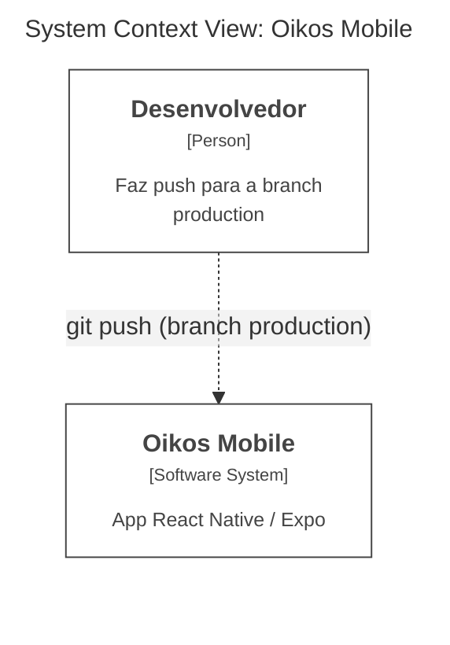
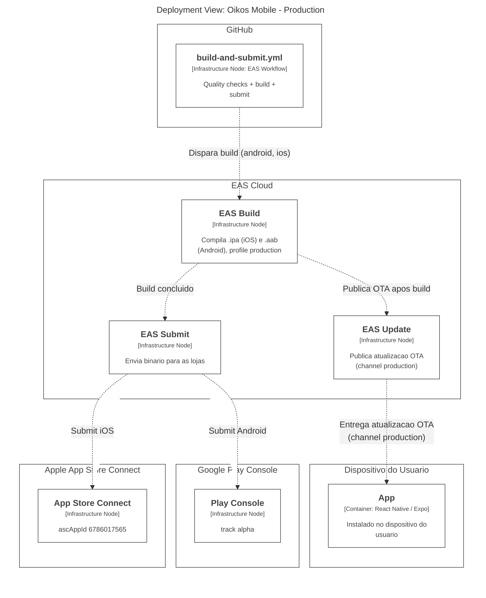

# Oikos Mobile — Diagramas C4 (Deploy)

Diagramas gerados a partir da DSL do Structurizr (`devops/docker/structurizr/data/workspace.dsl`), validados e exportados para Mermaid via o MCP self-hospedado (`structurizr/mcp`, ver `devops/docker/docker-compose.structurizr.yml`). Referem-se ao pipeline descrito em [`publishing-path.md`](./publishing-path.md), `eas.json` e `.eas/workflows/build-and-submit.yml`.

Para regenerar após mudar o pipeline: edite a DSL e rode as tools `validate` e `export-mermaid` do MCP (`http://127.0.0.1:3210/mcp`, viewKeys `MobileContext` e `MobileDeploy`).

## System Context

## Deployment (EAS Build → Submit → Update)

Pipeline de build, submissão às lojas e distribuição OTA, disparado por push na branch `production`.

