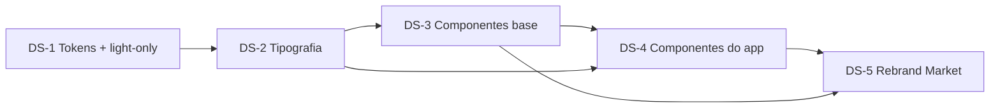

# Tickets — Design System Oikos

Specs: [Epic Brief](01-epic-brief.md) · [Tech Plan](04-tech-plan.md)

## DS-1 — Fundação de tokens e remoção do tema dark

**Escopo**
- Auditar usos de `theme: {mode: dark}` em nós do documento (pré-condição da remoção)
- Achatar as 6 variáveis temáticas para o valor light e remover `themes.mode`
- Corrigir `$primary` → `#333c12` (lime-800) e verificar visualmente as telas afetadas (TabBar, complaints)
- Criar `$font-heading`, `$font-body` e os 12 tokens `$text-*`
- Seção "Tokens" na zona DS: amostras de cor semântica, spacing e radius

**Fora**: qualquer master ou tela.
**Spec**: Tech Plan §Modelo de Dados, §Abordagem (decisões 7 e riscos).
**Dependências**: nenhuma.

## DS-2 — Escala tipográfica (seção Typography)

**Escopo**
- Redesign in-place dos masters `H1` (vAz8z) e `Body` (M975zK) para a nova espec
- Criar os 10 masters restantes (Display, H2–H4, Overline, Body-lg, Body-sm, Label, Button, Caption)
- Seção "Typography" na zona DS com a tabela de uso anotada (estilo, família, tamanho/peso, lineHeight, quando usar)
- `context` em cada master tipográfico

**Fora**: aplicação nas telas.
**Spec**: Tech Plan §Modelo de Dados (tabela da escala).
**Dependências**: DS-1 (tokens `$font-*`/`$text-*`).

## DS-3 — Componentes base (shadcn adaptado)

**Escopo**
- Novos masters a partir da lib shadcn: Badge (`r:UjXug`), Card (`r:pcGlv`), Avatar (`r:DpPVg`/`r:HWTb9`), Select (`r:w5c1O`), Switch (`r:c8fiq`/`r:fcMl6`) — checklist de adaptação mobile (toque ≥44px, tokens Oikos, tipografia da escala)
- Skeleton (manual) e BottomSheet (promovido do sheet de complaints)
- Redesign in-place: Button `J7k5q`, Input `PYFm3`, FilterChip `HJWAT`
- Showcase de variantes por componente (recipe book de overrides) e `context` em cada master

**Fora**: componentes de domínio (CompanyCard, Complaint*, TabBar).
**Spec**: Tech Plan §Arquitetura de Componentes (inventário, decisões 4–6).
**Dependências**: DS-2 (tipografia dos componentes).

## DS-4 — Componentes do app (re-skin de domínio)

**Escopo**
- Re-skin in-place: TabBar `Cp47z` (labels → Caption), Status Bar `fxxWe`, CompanyCard `E1RsmG` (nome → H4, metadados → Caption, badge/avatar internos → masters DS-3), ComplaintStatus/TypeTag/TypeOption (tipografia apenas)
- Atualizar showcase de complaint components; seção "Components / App" organizada
- Verificação visual das telas que os instanciam (reflow automático)

**Fora**: mudanças estruturais nos componentes de complaint; telas em si.
**Spec**: Tech Plan §Arquitetura de Componentes (inventário).
**Dependências**: DS-3 (Badge/Avatar usados no CompanyCard).

## DS-5 — Rebrand do Market Flow (prova do sistema)

**Escopo**
- `market/index`: trocar Inter → tokens da escala, badges/chips ad-hoc → masters, conferir grid pós-reflow
- Validação fim-a-fim do flow: screenshot + `snapshot_layout problemsOnly` limpos
- Atualizar memória/plan (`plans/market-listing-redesign.md`) com o resultado

**Fora**: telas de auth e complaints (épico posterior); tela `market/[companyId]` nova (continua no épico de market).
**Spec**: Tech Plan §Integração e fluxo; Epic Brief §Resumo.
**Dependências**: DS-2, DS-3, DS-4.

## Dependências

Ordem de execução: DS-1 → DS-2 → DS-3 → DS-4 → DS-5 (linear; DS-3 e DS-4 têm paralelismo parcial, mas o CompanyCard depende de Badge/Avatar).

## Status (2026-06-10): 5/5 concluídos ✅

Validados via impl-validate (screenshots + `snapshot_layout problemsOnly` limpos em `Lr9gv` e `KXfuR`).

**Desvios aceitos**: lib shadcn do Pencil inacessível via MCP (componentes construídos manualmente nas convenções shadcn); badges internos do CompanyCard mantidos como frames próprios (substituir quebraria overrides das instâncias); StatusBar mantém Inter (simula SF Pro).

## Follow-ups (para o épico "Rebrand telas legadas")

- Corrigir colapsos `fit_content(398)` em `complaints/list` (nós `tPD7T`, `H6qJq`, `c6oDm9`) e 2 grupos de ícones vetoriais com aviso de layout (`d0AGq`, `h9hlVf`) — pré-existentes, fora do escopo do DS
- Aplicar tipografia/tokens nas telas de auth e complaints
- Conferir remoção do eixo residual `themes.mode` (replace aplicado em 2026-06-10; verificação pendente por queda do MCP)
