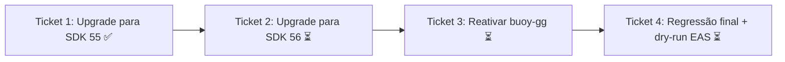

# Ticket Breakdown — Epic 1: Upgrade Expo SDK 54 → 55 → 56

Sem ticket de cobertura de testes nova — só roda a suíte Jest existente a cada
etapa. Validação funcional fica a cargo do usuário testando o app manualmente
entre uma versão e outra.

Cada item de escopo abaixo é uma checkbox: `[x]` feito, `[ ]` pendente. Ao retomar
o trabalho, este arquivo é a fonte de verdade de onde paramos.

---

## Ticket 1 — Upgrade para SDK 55

**Status:** 🔄 Em andamento — parte automatizada concluída, falta confirmação de
teste manual do usuário para fechar o ticket.

**Escopo:**
- [x] `npx expo install expo@^55.0.0` + `npx expo install --fix`.
- [x] Corrigir conflito de versão `@react-navigation/native`/`bottom-tabs`/`elements`
  (expo-router 55 exigia `^7.3.7`, projeto tinha `^7.1.8` — causava crash
  `createScreenFactory is not a function`).
- [x] Corrigir mock de `react-native-worklets`/`react-native-reanimated` no Jest
  (`src/tests/setup.ts`) — faltava mockar `react-native-worklets` antes do
  reanimated, causava `WorkletsError` em 14 suítes de teste.
- [x] Adicionar `expo-font`, `expo-image`, `expo-web-browser` aos plugins do
  `app.config.ts` (exigido pelo config plugin desses pacotes na v55).
- [x] Validar `@expo/vector-icons`, plugins nativos (`expo-camera`, `expo-video`,
  `expo-location`, `expo-splash-screen`, `expo-secure-store`) — todos ok via
  `expo install --fix` + `expo-doctor`.
- [x] `react-native-compressor` (não verificado pelo React Native Directory) —
  bump de versão aplicado sem erro no `expo-doctor`; **teste funcional do fluxo de
  compressão de mídia em denúncias ainda depende do teste manual do usuário**.
- [x] `npx expo-doctor` limpo (19/19 checks).
- [x] `npm test` verde (23/23 suítes, 201/201 testes, suíte existente sem testes novos).
- [x] `npx biome ci .` limpo (0 erros, só warnings pré-existentes).
- [ ] **Smoke test manual do usuário** (auth, câmera/mídia, mapa/geolocalização,
  gestures/teclado/safe-area/guards) — em andamento pelo usuário, sem confirmação
  ainda.
- Fora: qualquer mudança do SDK 56 (codemod de router, Hermes V1 default).

**Referências de spec:** tech-plan.md → Abordagem Arquitetural, tabela de breaking
changes (linhas SDK 55).

**Dependências:** nenhuma.

---

## Ticket 2 — Upgrade para SDK 56

**Status:** ⏳ Não iniciado — bloqueado até o usuário confirmar que o app está
estável na 55 (Ticket 1).

**Escopo:**
- [ ] `npx expo install expo@56` + `npx expo install --fix`.
- [ ] Rodar `npx expo-codemod sdk-56-expo-router-react-navigation-replace src` (sem
  imports diretos de `@react-navigation/*` em `src/`, não deve alterar nada — roda
  como rede de segurança).
- [ ] Remover `@expo/vector-icons` do `package.json` (dependência direta não usada em
  nenhum lugar do `src/` — confirmado via grep; o projeto usa `lucide-react-native`
  exclusivamente).
- [ ] Housekeeping cosmético: remover `newArchEnabled`/`edgeToEdgeEnabled` de
  `app.config.ts` (schema não aceita mais como configurável, viram mandatórios;
  hoje são aceitos silenciosamente mas não fazem mais nada).
- [ ] Validar deployment target iOS (16.4) não quebra build EAS.
- [ ] **Confirmar com o usuário que dropar suporte a iPhone 7/7+, 6s/6s+, SE 1ª
  geração, iPad mini 4, iPad Air 2 é aceitável** — decisão de produto pendente.
- [ ] Observar `react-native-reanimated`/`react-native-worklets` sob Hermes V1 (novo
  default) — atenção a valores numéricos soltos em arrays de `style` (gotcha
  documentado no Reanimated 4.2.1+).
- [ ] Confirmar Node da imagem EAS Build atende mínimo 20.19.4 (local já é v24.15.0).
- [ ] `npx expo-doctor` limpo, `npm test` verde.
- Fora: reativação do buoy-gg (ticket separado, testado só contra o 56 final).

**Referências de spec:** tech-plan.md → Abordagem Arquitetural, tabela de breaking
changes (linhas SDK 56).

**Dependências:** Ticket 1, e confirmação manual do usuário de que o app está
estável na 55.

---

## Ticket 3 — Reativar `@buoy-gg/*` (devtools em modo dev)

**Status:** ⏳ Não iniciado — bloqueado pelo Ticket 2.

**Escopo:**
- [ ] Em `src/app/_layout.tsx`: restaurar `import { FloatingDevTools } from "@buoy-gg/core"`
  e descomentar `{isDevelopmentMode && <FloatingDevTools />}`; remover a linha
  comentada duplicada (variante `userRole`) deixada do commit original (`1ba2b1a`).
- [ ] Validar que funciona em build de desenvolvimento e que **não** aparece/roda em
  build de produção (`isDevelopmentMode` gate).
- Fora: mudanças de produto/config no próprio buoy-gg além de religar o que já existia.

**Referências de spec:** epic-brief.md → Escopo (dentro); tech-plan.md →
Arquitetura de Componentes.

**Dependências:** Ticket 2 (testar direto contra Hermes V1 / SDK 56, evita retestar).

---

## Ticket 4 — Regressão final + dry-run de build/submit EAS

**Status:** ⏳ Não iniciado — bloqueado pelo Ticket 3.

**Escopo:**
- [ ] Rodar a suíte de testes uma última vez.
- [ ] Smoke test manual completo (Android + iOS) das áreas críticas com o buoy-gg
  ativo em dev.
- [ ] Dry-run de build nos 3 profiles (`development`, `preview`, `production`) via
  `.eas/workflows/build-and-submit.yml` / `eas.json`.
- Fora: submit real às lojas (fica a critério do usuário decidir quando submeter).

**Referências de spec:** epic-brief.md → Critérios de sucesso.

**Dependências:** Ticket 3.
