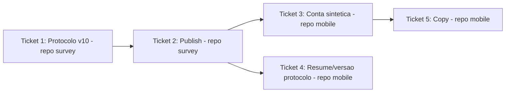

# Ticket Breakdown — Epic 10: Consolidação do survey mode (5 suítes → 1)

Cada item de escopo é uma checkbox: `[x]` feito, `[ ]` pendente. Ao retomar o
trabalho, este arquivo é a fonte de verdade de onde paramos.

**Cross-repo**: Tickets 1-2 vivem no repo `survey`, branch `feat/survey-suite-consolidation`
(criada a partir de `origin/development` desse repo). Tickets 3-5 vivem no repo
`mobile`, branch `feat/survey-suite-consolidation` (criada a partir de
`origin/development` deste repo). Sem issue formal — decisão do usuário
(branch direta). Um commit por ticket.

**Agentes**: Ticket 1 não tem Executor especializado pro repo `survey` (os Executors
listados em `docs/agent-architecture.md` são todos escopados ao `mobile`) — roda via
agente `general-purpose` isolado no repo `survey`, ou o orquestrador direto. Tickets 3
e 4 → `data-executor` (SDK, Context, SQLite). Ticket 5 → `ui-executor` (copy de tela).
Ticket 2 tem passos que **não devem ser delegados a um agente autônomo** — merge até
`production` e rodar `db:seed` contra o ambiente alvo são ações de blast radius alto,
pedem confirmação explícita do usuário no momento de executar.

---

## Ticket 1 — Protocolo v10 (repo `survey`)

**Status:** ⬜ Pendente.

**Escopo:**
- [ ] `packages/db/src/protocol/data.ts`: remover tasks `T1`-`T7`, `T20`.
- [ ] `T12` ("Visualizar o mapa de denúncias"): trocar `success` para `mode: "any"`
  com o sinal `api` existente **+** novo `{ kind: "screen", route: "/complaints" }`.
- [ ] Reaproveitar código `T8` para task única "Usar os filtros de Pontos de Coleta"
  (`mode: "any"`, juntando os sinais hoje em `T8`+`T9`+`T10`).
- [ ] Reaproveitar código `T13` para task única "Usar os filtros de Denúncias"
  (`mode: "any"`, juntando os sinais hoje em `T13`+`T14`+`T15`).
- [ ] `T9`, `T10`, `T14`, `T15` removidas como códigos próprios; `T11`, `T16`-`T19`
  sem alteração.
- [ ] `suites[]`: substituir as 5 entradas por uma única, código `S1`, título
  `"Teste de Usabilidade"`, objetivo (sugestão no tech-plan.md, ajustável),
  `task_codes: ["T8","T11","T12","T13","T16","T17","T18","T19"]`.
- [ ] `personas[]`: cada uma das 5 personas com `suites: [{ suite_code: "S1",
  specific_objectives: [...] }]` — reaproveitar bullets existentes de S1/S6 (e S3/S5
  quando fizer sentido sem cadastro), descartando bullets sobre cadastro de
  empresa/órgão.
- [ ] Bump `version: 10`.
- [ ] Regenerar `route-signals.generated.json` (`generate-route-signals.ts`).
- [ ] Rodar `db:generate` (drizzle-kit) local — confirmar que não gera migration nova.

**Testes:**
- [ ] `data.test.ts`, `route-signals.test.ts` (fixture regenerada),
  `testing/fixtures.ts` (conferir se ainda bate com o protocolo de 1 suíte),
  `get-suites.test.ts`, `get-protocol.test.ts`, `get-tester-detail.test.ts`,
  `send-usability-checkpoint.test.ts`, `finish-and-abandon-usability-session.test.ts`,
  `usability-test-helpers.ts` (helper CITIZEN "S1,S2,S6" → "S1").

**Validação:** `bun test` em `packages/db` limpo; `db:generate` sem migration nova;
`bun run db:seed` local, conferir no dashboard/DB que v9 vira `isActive: false` e v10
`isActive: true`, sessão antiga (v9) ainda navegável em `get-tester-detail`.

**Commit:** _(preencher após feito)_

**Referências de spec:** tech-plan.md → "1. Protocolo v10"; epic-brief.md → "Estrutura
atual", "Bug de sinal em T12", "Micro-tarefas de filtro".

**Dependências:** nenhuma.

---

## Ticket 2 — Publish: PR até `production` + seed (repo `survey`)

**Status:** ⬜ Pendente.

**Escopo:**
- [ ] Commit do Ticket 1 na branch `feat/survey-suite-consolidation`.
- [ ] ⚠️ **Confirmar com o usuário antes de**: abrir PR para `development`, mergear;
  abrir PR de `development` para `production`, mergear. Ações em branch
  compartilhada — não autônomas.
- [ ] Confirmar no GitHub Actions que `publish-packages.yml` rodou e publicou
  `@oikos-circular-environment/survey-db` e `survey-api` (versão nova, formato
  `major.minor.<run_number>`).
- [ ] ⚠️ **Confirmar com o usuário antes de**: rodar `bun run db:seed` contra o banco
  do ambiente alvo (staging/produção) — ativa o protocolo v10 de verdade, afeta
  participantes reais a partir desse momento.

**Testes:** nenhum novo — cobertos no Ticket 1.

**Validação:** Action verde; versão nova visível em
`https://github.com/orgs/oikos-circular-environment/packages`; protocolo v10
`isActive: true` no ambiente alvo após o seed.

**Commit:** _(preencher após feito — PRs, não commit direto)_

**Referências de spec:** tech-plan.md → "Ordem de execução (obrigatória)".

**Dependências:** Ticket 1.

---

## Ticket 3 — Conta sintética automática (repo `mobile`)

**Status:** ⬜ Pendente.

**Escopo:**
- [ ] `package.json`: atualizar `"@oikos-circular-environment/survey-api"` para a
  versão publicada no Ticket 2; mover `@faker-js/faker` de `devDependencies` para
  `dependencies`.
- [ ] Novo `src/libs/survey/synthetic-participant.ts`:
  `provisionSyntheticParticipant()` — email `oikos-survey-<uuid>@participant.invalid`
  + senha via `fakerPT_BR`, `postV1UsersRegister` → `postV1AuthLogin` (tokens via
  `setAuthToken`/`setRefreshToken`) → `putV1Profiles({ full_name, display_name,
  phone })` (sem endereço, sem avatar).
- [ ] `src/contexts/auth-context.tsx`: expor `refreshSession` (wrapper do `refetch`
  interno); `signOut(options?: { silent?: boolean })` — `silent` pula toast +
  `router.navigate`, mantém revogação de token e limpeza de estado.
- [ ] `src/app/survey/consent.tsx` (`handleAccept`): vira `async`; se autenticado,
  `await signOut({ silent: true })`; `await provisionSyntheticParticipant()`;
  `await refreshSession()`; só então navega. Estado `isProvisioning` desabilita botão
  + spinner (`ButtonSpinner`, padrão de `profile.tsx`). Erro: toast, mantém na tela.

**Testes:**
- [ ] Cobertura para `provisionSyntheticParticipant` (mock das chamadas SDK, feliz +
  409 duplicate email).
- [ ] Ajustar/mockar `signOut`/`refreshSession` nos testes existentes de
  `consent.tsx` que dependem do fluxo atual (visitante).

**Validação:** `npx tsc --noEmit` e `npm run lint` limpos; `npm test` verde;
verificação manual via `agent-device` (ver Ticket 4/5, fluxo feliz completo).

**Commit:** _(preencher após feito)_

**Referências de spec:** tech-plan.md → "2. Conta sintética automática (repo
`mobile`)"; epic-brief.md → "Restrição inegociável".

**Dependências:** Ticket 2 (precisa da versão publicada de `survey-api`).

---

## Ticket 4 — Sessão em andamento presa a versão antiga (repo `mobile`)

**Status:** ⬜ Pendente.

**Escopo:**
- [ ] `src/libs/survey/restore-session.ts`: `RestoredSession` ganha
  `protocolVersion: number` (coluna já existe em `survey_session`).
- [ ] `restoreSurveySessionIfNeeded()`: se `status === "IN_PROGRESS"`, buscar
  protocolo preferindo rede (grava no cache em caso de sucesso, cache só como
  fallback offline); se `status !== "IN_PROGRESS"`, manter cache-primeiro atual.
- [ ] Se versão buscada ≠ `protocolVersion` da sessão **e** `IN_PROGRESS`:
  `deleteLocalSurveyData(sessionId)` (já existe) e retornar `null` em vez de
  `restoreSurveyExecution`.

**Testes:**
- [ ] Sessão `IN_PROGRESS` com versão desatualizada → dados locais apagados, `null`
  retornado.
- [ ] Sessão `IN_PROGRESS` com versão atual → resume normalmente (regressão).
- [ ] Sessão `COMPLETED`/`ABANDONED` → não dispara fetch de rede extra, não é tocada.

**Validação:** `npx tsc --noEmit`, `npm run lint`, `npm test` limpos; manual: iniciar
sessão, não terminar, forçar versão nova (mudar cache local ou usar o protocolo v10
já publicado), reabrir o app e confirmar que a sessão some sem crash/tela travada.

**Commit:** _(preencher após feito)_

**Referências de spec:** tech-plan.md → "3. Sessão em andamento presa a versão antiga
(repo `mobile`)".

**Dependências:** Ticket 2 (precisa de uma versão nova de verdade pra testar o
mismatch; o código em si não depende do conteúdo do Ticket 3).

---

## Ticket 5 — Copy (repo `mobile`)

**Status:** ⬜ Pendente.

**Escopo:**
- [ ] `src/app/survey/index.tsx` (aviso amarelo): trocar "a pesquisa começa como
  visitante" por texto refletindo o login automático de conta de teste.
- [ ] `src/app/survey/consent-ended.tsx`: mesmo ajuste.
- [ ] `src/app/survey/persona.tsx` (subtítulo "Isso define quais etapas você vai
  realizar"): trocar por texto que reflita persona como caracterização, não seleção
  de conteúdo.

**Testes:**
- [ ] Ajustar snapshots/queries de texto nos testes que dependem da copy antiga
  dessas 3 telas, se houver.

**Validação:** `npm run lint` e `npm test` limpos; conferência visual via
`agent-device`.

**Commit:** _(preencher após feito)_

**Referências de spec:** tech-plan.md → "4. Copy (repo `mobile`)".

**Dependências:** Ticket 3 (a copy descreve o comportamento que o Ticket 3
implementa).

---

## Ordem sugerida de execução

1. **Ticket 1** (protocolo v10) — sem dependências, desbloqueia tudo.
2. **Ticket 2** (publish) — gate obrigatório antes de qualquer coisa no mobile;
   contém os dois pontos que pedem confirmação explícita do usuário.
3. **Ticket 3** (conta sintética) e **Ticket 4** (resume/versão) — independentes
   entre si, podem rodar em paralelo depois do Ticket 2.
4. **Ticket 5** (copy) — depende do Ticket 3 estar pronto pra descrever o
   comportamento certo.

## Status geral

Nenhum ticket iniciado. Próximo passo: Ticket 1, repo `survey`.
