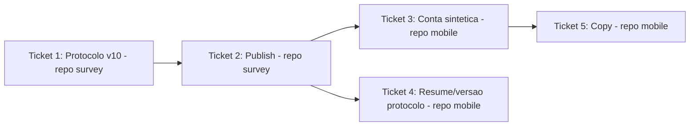

# Ticket Breakdown — Epic 10: Consolidação do survey mode (5 suítes → 1)

Cada item de escopo é uma checkbox: `[x]` feito, `[ ]` pendente. Ao retomar o
trabalho, este arquivo é a fonte de verdade de onde paramos.

**Cross-repo**: Tickets 1-2 vivem no repo `survey`, branch `feat/survey-suite-consolidation`
(criada a partir de `origin/development` desse repo). Tickets 3-5 vivem no repo
`mobile`, branch `feat/survey-suite-consolidation` (criada a partir de
`origin/development` deste repo). Sem issue formal — decisão do usuário
(branch direta). Um commit por ticket.

**Agentes**: Ticket 1 não tem Executor especializado pro repo `survey` (os Executors
listados em `docs/agent-architecture.md` são todos escopados ao `mobile`) — roda via
agente `general-purpose` isolado no repo `survey`, ou o orquestrador direto. Tickets
3 e 4 foram implementados via `general-purpose` (arquitetura de agentes antiga,
vigente quando esses tickets começaram); `data-executor`/`ui-executor` foram
descontinuados desde então em favor de um único agente `executor` genérico (ver
`docs/agent-architecture.md`) — Ticket 5, ainda não iniciado, deve usar `executor`.
Ticket 2 tem passos que **não devem ser delegados a um agente autônomo** — merge até
`production` e rodar `db:seed` contra o ambiente alvo são ações de blast radius alto,
pedem confirmação explícita do usuário no momento de executar.

---

## Ticket 1 — Protocolo v10 (repo `survey`)

**Status:** ✅ Concluído.

**Escopo:**
- [ ] `packages/db/src/protocol/data.ts`: remover tasks `T1`-`T7`, `T20`.
- [ ] `T12` ("Visualizar o mapa de denúncias"): trocar `success` para `mode: "any"`
  com o sinal `api` existente **+** novo `{ kind: "screen", route: "/complaints" }`.
- [ ] Reaproveitar código `T8` para task única "Usar os filtros de Pontos de Coleta"
  (`mode: "any"`, juntando os sinais hoje em `T8`+`T9`+`T10`).
- [ ] Reaproveitar código `T13` para task única "Usar os filtros de Denúncias"
  (`mode: "any"`, juntando os sinais hoje em `T13`+`T14`+`T15`).
- [ ] `T9`, `T10`, `T14`, `T15` removidas como códigos próprios; `T11`, `T16`-`T19`
  sem alteração.
- [ ] `suites[]`: substituir as 5 entradas por uma única, código `S1`, título
  `"Teste de Usabilidade"`, objetivo (sugestão no tech-plan.md, ajustável),
  `task_codes: ["T8","T11","T12","T13","T16","T17","T18","T19"]`.
- [ ] `personas[]`: cada uma das 5 personas com `suites: [{ suite_code: "S1",
  specific_objectives: [...] }]` — reaproveitar bullets existentes de S1/S6 (e S3/S5
  quando fizer sentido sem cadastro), descartando bullets sobre cadastro de
  empresa/órgão.
- [ ] Bump `version: 10`.
- [ ] Regenerar `route-signals.generated.json` (`generate-route-signals.ts`).
- [ ] Rodar `db:generate` (drizzle-kit) local — confirmar que não gera migration nova.

**Testes:**
- [ ] `data.test.ts`, `route-signals.test.ts` (fixture regenerada),
  `testing/fixtures.ts` (conferir se ainda bate com o protocolo de 1 suíte),
  `get-suites.test.ts`, `get-protocol.test.ts`, `get-tester-detail.test.ts`,
  `send-usability-checkpoint.test.ts`, `finish-and-abandon-usability-session.test.ts`,
  `usability-test-helpers.ts` (helper CITIZEN "S1,S2,S6" → "S1").

**Validação:** `bun test` em `packages/db` (99 pass) e `packages/api` (101 pass) limpos;
`tsc --noEmit` limpo; `db:generate` confirmou "No schema changes, nothing to
migrate"; `bun run db:seed` local, conferido no DB que v9 virou `isActive: false` e
v10 `isActive: true`, sessão antiga (v9) `COMPLETED` ainda navegável em
`get-tester-detail` com seu roteiro original (S1/S2/S3, T8-T15/T1-T3/T4-T7+T20)
intacto.

**Commit:** `58f7846` — "feat(protocol): consolida protocolo de usabilidade em suíte
única (v10)"; `5622bda` — fix de copy na persona GOVERNMENT (menção a "sem login"
ficaria incorreta com a conta sintética do Ticket 3).

**Referências de spec:** tech-plan.md → "1. Protocolo v10"; epic-brief.md → "Estrutura
atual", "Bug de sinal em T12", "Micro-tarefas de filtro".

**Dependências:** nenhuma.

---

## Ticket 2 — Publish: PR até `production` + seed (repo `survey`)

**Status:** ✅ Concluído.

**Escopo:**
- [x] Commit do Ticket 1 na branch `feat/survey-suite-consolidation`.
- [x] PR #65 (`feat/survey-suite-consolidation` → `development`) aberto e mergeado.
- [x] PR #66 (`development` → `production`) aberto e mergeado, com confirmação
  explícita do usuário antes de cada merge.
- [x] Confirmado no GitHub Actions que `publish-packages.yml` rodou (run
  `33086054110`) e publicou `@oikos-circular-environment/survey-db` e `survey-api`
  na versão `0.1.24`.
- [x] `bun run db:seed` rodado contra o banco de produção (TiDB Cloud, credenciais
  de `apps/web/.env.prod`, via `bun run --env-file=...` para evitar mangling de
  aspas do shell na string de conexão SSL) — autorizado explicitamente pelo
  usuário. Versão 10 publicada (UUID `8866360b-a9a1-4989-ac3b-4f92c38e0511`).

**Testes:** nenhum novo — cobertos no Ticket 1.

**Validação:** Action verde (35s); pacotes em `0.1.24` no GitHub Packages;
confirmado direto no banco de produção via query `SELECT` na tabela
`protocol_versions`: v10 `isActive: true`, v9 `isActive: false`.

**Commit:** PRs #65 e #66 (sem commit direto — merge via GitHub).

**Referências de spec:** tech-plan.md → "Ordem de execução (obrigatória)".

**Dependências:** Ticket 1.

---

## Ticket 3 — Conta sintética automática (repo `mobile`)

**Status:** ✅ Concluído (código escrito por agente `general-purpose` em worktree
isolado numa sessão anterior; validado, revisado via `code-review` e commitado
nesta sessão).

**Escopo:**
- [x] `package.json`: atualizar `"@oikos-circular-environment/survey-api"` para a
  versão publicada no Ticket 2 (`^0.1.24`); mover `@faker-js/faker` de
  `devDependencies` para `dependencies`. `package-lock.json` regenerado
  (`npm install --package-lock-only`, exigiu `GH_TOKEN_PERSONAL_TOKEN` do
  `.env.eas` — não estava disponível no shell por padrão).
- [x] Novo `src/libs/survey/synthetic-participant.ts`:
  `provisionSyntheticParticipant()` — email `oikos-survey-<uuid>@participant.invalid`
  + senha via `fakerPT_BR`, `postV1UsersRegister` → `postV1AuthLogin` (tokens via
  `setAuthToken`/`setRefreshToken`) → `putV1Profiles({ full_name, display_name,
  phone })` (sem endereço, sem avatar).
- [x] `src/contexts/auth-context.tsx`: expõe `refreshSession` (wrapper do `refetch`
  interno, com `throwOnError: true` — fix pós-review, ver abaixo); `signOut(options?:
  { silent?: boolean })` — `silent` pula toast + `router.navigate`, mantém revogação
  de token e limpeza de estado.
- [x] `src/app/survey/consent.tsx` (`handleAccept`): vira `async`; se autenticado,
  `await signOut({ silent: true })`; `await provisionSyntheticParticipant()`;
  `await refreshSession()`; só então navega. Estado `isProvisioning` desabilita botão
  + spinner (`ButtonSpinner`, padrão de `profile.tsx`). Erro: toast, mantém na tela.

**Testes:**
- [x] Cobertura para `provisionSyntheticParticipant` (mock das chamadas SDK, feliz +
  409 duplicate email) — `src/tests/unit/survey/synthetic-participant.test.ts`.
- [x] Ajustado/mockado `signOut`/`refreshSession` nos testes existentes de
  `consent.tsx` e nos demais que consomem `auth-context` (auth, home, market,
  profile — 17 suites/132 testes verdes no total).

**Achados do `code-review` corrigidos antes do commit:**
- `refreshSession()` chamava `refetch()` sem `throwOnError: true` — React Query só
  rejeita a promise com essa opção explícita, então uma falha no fetch de perfil
  pós-provisionamento não acionava o `catch` de `handleAccept`: nenhum toast de erro,
  navegação seguia com `isAuthenticated`/`user` desincronizados do token sintético já
  salvo. Corrigido: `refetch({ throwOnError: true })`.
- `package-lock.json` não tinha sido regenerado após o bump do `package.json` (bloquearia
  `npm ci` em CI/EAS build). Corrigido via `npm install --package-lock-only`.

**Validação:** `npx tsc --noEmit` limpo (mesma baseline de erros pré-existentes do
projeto, nenhum novo); `npx biome lint` limpo nos arquivos do ticket; `npm test`
(suítes tocadas) 17 suites / 132 testes, todos verdes. Verificação manual via
`agent-device` ainda pendente — planejada junto do Ticket 5 (fluxo feliz completo).

**Commit:** `067f8ff` — "feat(survey): provisiona participante sintético no
consentimento".

**Referências de spec:** tech-plan.md → "2. Conta sintética automática (repo
`mobile`)"; epic-brief.md → "Restrição inegociável".

**Dependências:** Ticket 2 (precisa da versão publicada de `survey-api`).

---

## Ticket 4 — Sessão em andamento presa a versão antiga (repo `mobile`)

**Status:** ✅ Concluído (código escrito por agente `general-purpose` em worktree
isolado numa sessão anterior; validado, revisado via `code-review` e commitado
nesta sessão).

**Escopo:**
- [x] `src/libs/survey/restore-session.ts`: `RestoredSession` ganha
  `protocolVersion: number` (coluna já existe em `survey_session`). Como efeito
  colateral, corrigiu um erro de tipo pré-existente na baseline do projeto
  (`protocolVersion` não cobria `"COMPLETED"`).
- [x] `restoreSurveySessionIfNeeded()`: se `status === "IN_PROGRESS"`, buscar
  protocolo preferindo rede (grava no cache em caso de sucesso, cache só como
  fallback offline); se `status !== "IN_PROGRESS"`, mantém cache-primeiro atual.
- [x] Se versão buscada ≠ `protocolVersion` da sessão **e** `IN_PROGRESS`:
  `deleteLocalSurveyData(sessionId)` (já existia) e retorna `null` em vez de
  `restoreSurveyExecution`.

**Testes:**
- [x] Sessão `IN_PROGRESS` com versão desatualizada → dados locais apagados, `null`
  retornado.
- [x] Sessão `IN_PROGRESS` com versão atual → resume normalmente (regressão).
- [x] Sessão `COMPLETED`/`ABANDONED` → não dispara fetch de rede extra, não é tocada.
- [x] Sessão `IN_PROGRESS` offline (rede falha) → cai pro cache e resume se a versão
  bater.

**Achado do `code-review` corrigido antes do commit:** `deleteLocalSurveyData` era
chamado sem `try/catch`; uma falha nele (I/O do SQLite, por exemplo) rejeitava a
promise de `restoreSurveySessionIfNeeded()`, e o único call site
(`survey-migrations-runner.tsx`) não tem `.catch()` — vira unhandled rejection no
boot do app em vez do fallback gracioso que o resto da função pratica. Corrigido com
`try/catch` ao redor do delete, seguido de `console.warn` e `return null` de
qualquer forma.

**Validação:** `npx tsc --noEmit` limpo (mesma baseline do projeto, nenhum erro
novo); `npx biome lint` limpo; `npm test` (suíte tocada) 6/6 testes verdes. Manual
via `agent-device` ainda pendente — planejada junto do Ticket 5.

**Commit:** `c5812e7` — "fix(survey): descarta sessão local presa a versão antiga do
protocolo".

**Referências de spec:** tech-plan.md → "3. Sessão em andamento presa a versão antiga
(repo `mobile`)".

**Dependências:** Ticket 2 (precisa de uma versão nova de verdade pra testar o
mismatch; o código em si não depende do conteúdo do Ticket 3).

---

## Ticket 5 — Copy (repo `mobile`)

**Status:** ✅ Concluído (código escrito por agente `executor`, revisado via
`code-review`, commitado). Falta só a verificação manual via `agent-device`.

**Escopo:**
- [x] `src/app/survey/index.tsx` (aviso amarelo): "A pesquisa começa como
  visitante" → "O app faz login automático em uma conta de teste para a pesquisa."
- [x] `src/app/survey/consent-ended.tsx`: mesmo ajuste ("A pesquisa começa do zero,
  como visitante" → "O app faz login automático em uma conta de teste").
- [x] `src/app/survey/persona.tsx` (subtítulo): "Isso define quais etapas você vai
  realizar" → "Isso ajuda a caracterizar sua participação na pesquisa" (persona não
  seleciona etapas no protocolo v10 — suíte única pra todas as personas).

**Testes:**
- [x] Nenhum ajuste necessário — os testes diretos das 3 telas
  (`survey-presentation-screen.test.tsx`, `survey-consent-ended-screen.test.tsx`,
  `survey-persona-screen.test.tsx`) não faziam assert na parte trocada do texto.

**Nota de execução:** o `executor` rodou em worktree isolado criado a partir de
`origin/development` (comportamento padrão da ferramenta), não da branch
`feat/survey-suite-consolidation` — divergiam (development já tinha PRs #171/#172
mergeados que não fazem parte deste epic). O diff foi extraído e reaplicado
manualmente na branch correta em vez de mesclar aquele worktree, pra não trazer
histórico não relacionado. Worktree descartado depois.

**Validação:** `npx tsc --noEmit` idêntico ao baseline do projeto (28 erros
pré-existentes, zero novos); `npx biome lint` limpo nos 3 arquivos; testes das 3
telas — 3 suites/8 testes verdes. `code-review` sem achados. Verificação manual via
`agent-device` **pendente** — fica com o usuário (ver Status geral).

**Commit:** `ddfd62b` — "fix(survey): atualiza copy de visitante para conta
sintética de teste".

**Referências de spec:** tech-plan.md → "4. Copy (repo `mobile`)".

**Dependências:** Ticket 3 (a copy descreve o comportamento que o Ticket 3
implementa).

---

## Ordem sugerida de execução

1. **Ticket 1** (protocolo v10) — sem dependências, desbloqueia tudo.
2. **Ticket 2** (publish) — gate obrigatório antes de qualquer coisa no mobile;
   contém os dois pontos que pedem confirmação explícita do usuário.
3. **Ticket 3** (conta sintética) e **Ticket 4** (resume/versão) — independentes
   entre si, podem rodar em paralelo depois do Ticket 2.
4. **Ticket 5** (copy) — depende do Ticket 3 estar pronto pra descrever o
   comportamento certo.

## Status geral

**Todos os 5 tickets implementados, revisados e commitados.** Tickets 1 e 2 (repo
`survey`) — protocolo v10 publicado e ativo em produção (`survey-db`/`survey-api`
em `0.1.24`). Tickets 3, 4 e 5 (repo `mobile`) commitados na branch
`feat/survey-suite-consolidation` (commits `067f8ff`, `c5812e7`, `ddfd62b`),
todos validados (`tsc`/lint/testes) e revisados via agente `code-review` — achado
real corrigido em cada um dos tickets 3 e 4 antes do commit (`refreshSession`
engolindo erro silenciosamente, `deleteLocalSurveyData` sem tratamento de erro);
Ticket 5 sem achados. Worktrees isolados removidos após os commits.

**Falta:** verificação manual via `agent-device` do fluxo feliz completo
(consentimento → provisionamento sintético → persona → execução das tasks da
suíte única) — fica por conta do usuário, fora do escopo desta sessão.
