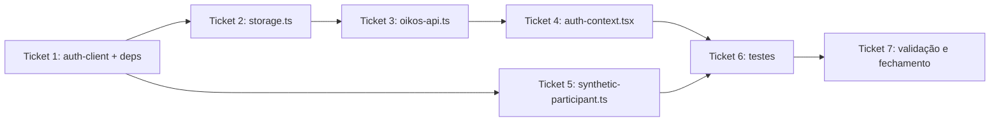

# Ticket Breakdown — Epic 13: Migração de auth para better-auth



Cada item de escopo é uma checkbox: `[x]` feito, `[ ]` pendente. Ao retomar o
trabalho, este arquivo é a fonte de verdade de onde paramos.

**Repo único**: todos os tickets vivem em `mobile`, branch `research/better-auth-v2`
(já criada a partir de `origin/development`, sem commits próprios ainda — só
`package.json`/`package-lock.json` modificados localmente e este `plans/` novo,
tudo não commitado). Um commit por ticket. Issue de tracking:
[mobile#210](https://github.com/oikos-circular-environment/mobile/issues/210),
linkada a [api#115](https://github.com/oikos-circular-environment/api/issues/115).

**Pré-requisito já satisfeito no lado `api`**: plugin `expo()` registrado em
`better-auth.ts`, `basePath: "/auth"`, `better-auth@1.7.3` / `@better-auth/expo@1.7.3`
em produção (ver `api/plans/better-auth/tickets/T03-migrar-clients-web-mobile.md`).

**Achado fora de escopo, não bloqueia**: `BETTER_AUTH_TRUSTED_ORIGINS` não está
setado no `api` (nem `.env`, nem `.env.prod`) — só relevante quando login social
(mobile#66) entrar em cena, o proxy do plugin `expo()` para OAuth exige o scheme
`oikos://` na lista. Registrar como pendência do lado `api` quando aquele epic
começar, não deste.

---

## Ticket 1 — `auth-client.ts` + dependências

**Status:** [ ] Pendente.

**Escopo:**
- [ ] `package.json`: adicionar `better-auth` e `@better-auth/expo` (versão exata,
  alinhada com o `api` — `1.7.3`). `expo-secure-store` já é dependência, não mexer.
  `@oikos-circular-environment/oikos-sdk` já está em `^0.1.0-beta.4` (bump já feito,
  só falta commitar).
- [ ] `src/libs/auth/auth-client.ts` (novo):
  ```ts
  import { expoClient } from "@better-auth/expo/client";
  import { anonymousClient } from "better-auth/client/plugins";
  import { createAuthClient } from "better-auth/react";
  import * as SecureStore from "expo-secure-store";

  export const authClient = createAuthClient({
      baseURL: `${process.env.EXPO_PUBLIC_BASE_URL}/auth`,
      plugins: [
          expoClient({ scheme: "oikos", storagePrefix: "oikos", storage: SecureStore }),
          anonymousClient(),
      ],
  });
  ```
  `baseURL` inclui `/auth` porque o server usa `basePath: "/auth"`, não o default
  `/api/auth`. `scheme: "oikos"` casa com `app.config.ts:14`.

**Testes:** nenhum teste direto — arquivo novo sem lógica própria, coberto
indiretamente pelos tickets seguintes.

**Referências de spec:** `tech-plan.md` → "1. `auth-client.ts` (novo)".

**Dependências:** nenhuma.

---

## Ticket 2 — `storage.ts`: remover par refresh-token

**Status:** [ ] Pendente.

**Escopo:**
- [ ] Remover `REFRESH_TOKEN_KEY`, `saveRefreshToken`, `getRefreshToken`,
  `removeRefreshToken`.
- [ ] `clearTokens()`: passa a limpar só `TOKEN_KEY`.
- [ ] Migração de limpeza: no boot, chamada best-effort e solta pra
  `SecureStore.deleteItemAsync("oikos_refresh_token")` (não falha se a chave já não
  existir) — evita lixo permanente no Keychain/Keystore de quem já tinha o app
  instalado antes desta migração.

**Testes:** nenhum arquivo de teste dedicado a `storage.ts` hoje — validar via
Ticket 6 (mock de `auth-flow.test.tsx` não deve mais referenciar refresh token).

**Referências de spec:** `tech-plan.md` → "2. `storage.ts` — remover refresh token".

**Dependências:** nenhuma (independente de Ticket 1, mas emparelhado na ordem de
execução do tech-plan por afetar o mesmo fluxo de token).

---

## Ticket 3 — `oikos-api.ts`: Bearer do better-auth, sem refresh manual

**Status:** [ ] Pendente.

**Escopo:**
- [ ] `authToken`/`refreshToken` (linhas 30-31 hoje) → só `authToken`.
- [ ] Remover `setRefreshToken`/`getRefreshToken` (linhas 55-66) e os imports deles
  em quem os chama (recai sobre os Tickets 4 e 5).
- [ ] Response interceptor (linhas 129-204): remover todo o bloco de refresh manual
  (`isRefreshing`, `failedQueue`, `processQueue`, `client.instance.patch("/v1/auth/refresh", ...)`).
  Novo comportamento no 401: `authToken = null; await clearTokens(); onUnauthenticated?.()`
  direto, sem tentar renovar.
- [ ] `getAuthenticatedImageHeaders()` (linhas 74-80): assinatura **não muda** — só a
  origem do valor de `authToken` (ver Ticket 4, captura de `set-auth-token`).

**Testes:** nenhum arquivo de teste dedicado — comportamento validado via Ticket 6
(`auth-flow.test.tsx`) e validação manual do Ticket 7 (401 sem tentativa de refresh).

**Riscos:** interceptor global usado por 100% dos requests autenticados — qualquer
erro aqui quebra o app inteiro, não só telas de auth.

**Referências de spec:** `tech-plan.md` → "3. `oikos-api.ts` — Bearer token do
better-auth, sem refresh"; `epic-brief.md` → ponto 3 (race de hidratação, não
corrigir aqui, só não duplicar variável).

**Dependências:** Ticket 1 (nenhuma chamada direta a `authClient` aqui, mas o
arquivo passa a ser o consumidor do token que os Tickets 4/5 vão popular a partir
do `authClient`), Ticket 2.

---

## Ticket 4 — `auth-context.tsx`: signIn/signUp/signOut/changePassword

**Status:** [ ] Pendente.

**Escopo:**
- [ ] Import: trocar `postV1AuthLogin`, `postV1AuthLogout`, `postV1UsersRegister`
  por `import { authClient } from "@/libs/auth/auth-client"`. Manter
  `getV1Profiles`, `getV1UsersMe`, `deleteV1UsersMe`,
  `patchV1UsersMeCancelDeletion`, `patchV1UsersMeChangePassword` (intactos).
- [ ] `signInMutation`: `authClient.signIn.email({ email, password }, { onSuccess:
  ctx => { const token = ctx.response.headers.get("set-auth-token"); if (token)
  setAuthToken(token); } })`. `error` do better-auth não é `AxiosError` — trocar
  `onError` de `error.response?.data.code` para `error.code` direto. **Confirmar
  no ambiente real** o código de credenciais erradas (provável
  `INVALID_EMAIL_OR_PASSWORD`) antes de fechar o ticket.
- [ ] `signUpMutation`: `authClient.signUp.email` exige `name` — enviar
  `name: data.email.split("@")[0]` como placeholder (preenchimento real fica na
  etapa de perfil, sem mudar UX). **Verificar** `REQUIRE_EMAIL_VERIFICATION` no
  ambiente alvo: se `true`, fluxo atual (redireciona pra `/sign-in`) já está
  certo; se `false`, sign-up já autentica e o redirecionamento fica redundante —
  só ajustar se confirmado.
- [ ] `signOut`: trocar `postV1AuthLogout` (com header manual) por
  `await authClient.signOut()`.
- [ ] `changePasswordMutation`: trocar `patchV1UsersMeChangePassword` por
  `authClient.changePassword({ currentPassword, newPassword, revokeOtherSessions: true })`
  direto. Remove o bloco `if (data?.token && data?.refreshToken)` (reemissão de
  token não existe mais nesse fluxo). Mesma troca de `error.response?.data.code`
  → `error.code` do item de signIn; confirmar nomes reais (`INVALID_PASSWORD`/
  algo como `NEW_PASSWORD_MUST_BE_DIFFERENT`) antes de fechar.
- [ ] `requestDeletionMutation`/`cancelDeletionMutation`: sem mudança.

**Achado a registrar (não deste ticket)**: `/v1/users/me/change-password` no
`api` fica órfão após essa troca — candidato a remoção num ticket separado do
backend.

**Testes:** cobertos no Ticket 6 (`auth-flow.test.tsx`).

**Referências de spec:** `tech-plan.md` → "4. `auth-context.tsx`".

**Dependências:** Ticket 3.

---

## Ticket 5 — `synthetic-participant.ts`: plugin `anonymous`

**Status:** [ ] Pendente.

**Escopo:**
- [ ] Trocar `postV1UsersRegister` + `postV1AuthLogin` com credenciais fake
  (`faker`) por `authClient.signIn.anonymous()` — remove o tratamento de 409 de
  colisão de email (linhas 91-103 do arquivo atual somem inteiras). Captura do
  token: mesmo padrão do Ticket 4 (`set-auth-token` no header de resposta).
- [ ] Resto do fluxo (`resolveSyntheticAddress`, `putV1Profiles` com nome
  sintético) não muda.

**Decisão pendente, a confirmar com produto/backend antes de fechar**:
participantes `is_anonymous: true` aparecem corretamente nos painéis de
moderação/dashboard de pesquisa do jeito que os sintéticos atuais (usuários
"reais" com email `@participant.invalid`) aparecem hoje? Se não, manter a
alternativa: `authClient.signUp.email` + `authClient.signIn.email` com
credenciais fake (mesma lógica de 409/retry atual, só trocando SDK → `authClient`,
passando `name` conforme Ticket 4).

**Testes:** `src/tests/unit/survey/synthetic-participant.test.ts` — mockar
`authClient.signIn.anonymous` (ou `signUp.email`/`signIn.email`, conforme decisão
acima).

**Referências de spec:** `tech-plan.md` → "5. `synthetic-participant.ts`";
`epic-brief.md` → "Impacto" (pesquisa/survey).

**Dependências:** Ticket 1.

---

## Ticket 6 — Testes

**Status:** [ ] Pendente.

**Escopo:**
- [ ] `src/tests/integration/auth/auth-flow.test.tsx`: mockar
  `authClient.signIn.email` / `authClient.signUp.email` / `authClient.signOut`
  em vez de `postV1AuthLogin`/`postV1AuthLogout`.
- [ ] `src/tests/unit/survey/synthetic-participant.test.ts`: mockar
  `authClient.signIn.anonymous` (ou equivalente, decisão do Ticket 5).

**Validação:** `npm test` limpo nos dois arquivos.

**Referências de spec:** `tech-plan.md` → "6. Testes"; `epic-brief.md` → ponto 1
(lista dos 4 arquivos que quebram o `tsc`).

**Dependências:** Ticket 4, Ticket 5.

---

## Ticket 7 — Validação e fechamento

**Status:** [ ] Pendente.

**Escopo:**
- [ ] `npx tsc --noEmit`: zero erros nos 4 arquivos do epic-brief (demais erros de
  UI pré-existentes não são critério de aceite aqui).
- [ ] `npm test` na suíte completa (não só os 2 arquivos do Ticket 6).
- [ ] Fluxo manual via `agent-device`: cadastro → login → tela autenticada (ex.:
  perfil, uma das 11 imagens autenticadas) → troca de senha → logout → sessão
  expirada (revogar manualmente e confirmar que o app desloga sem tentar
  refresh) → fluxo de survey criando participante sintético.
- [ ] Conferir os 4 critérios de aceite de
  [mobile#210](https://github.com/oikos-circular-environment/mobile/issues/210):
  login email/senha, sign-up, sessão persistida no SecureStore e restaurada após
  fechar/reabrir o app, logout, listagem básica de organizations na sessão
  (verificar que o campo vem populado nativamente do plugin `organization` — sem
  UI nova, já é fora de escopo do epic-brief construir tela de organizações).
- [ ] Marcar `T03-migrar-clients-web-mobile.md` do repo `api` como concluído pro
  lado mobile (checkbox "Confirmar em cada repo que a migração foi mergeada...").
- [ ] Abrir PR `research/better-auth-v2` → `development` (repo `mobile`), fechar
  mobile#210.

**Referências de spec:** `tech-plan.md` → "Validação"; `epic-brief.md` →
"Objetivo / Resultado esperado".

**Dependências:** Ticket 6.
