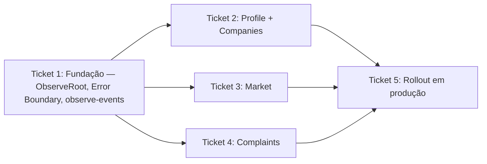

# Ticket Breakdown — Epic 2: EAS Observe

Cada item de escopo abaixo é uma checkbox: `[x]` feito, `[ ]` pendente. Ao retomar
o trabalho, este arquivo é a fonte de verdade de onde paramos.

---

## Ticket 1 — Fundação: ObserveRoot, Error Boundary, módulo de eventos

**Status:** ✅ Concluído

**Escopo:**
- [x] `npx expo install expo-observe` (`~56.0.24`); `extra.eas.projectId` já
  existia no app config.
- [x] `src/app/_layout.tsx`: exportado via `ObserveRoot.wrap(RootLayout)`;
  `Observe.configure({ integrations: { 'expo-router': true } })` em module
  scope; `markInteractive()` no `useEffect` que já esconde a splash screen.
- [x] Criado `src/components/error-boundary.tsx` (boundary básico,
  `componentDidCatch` reportando via `observe-events.ts`), envolvendo o
  conteúdo do root layout logo abaixo do `GestureHandlerRootView`.
- [x] Criado `src/libs/observe-events.ts` com a taxonomia de eventos definida
  no tech-plan (`logProfileEvent`, `logCompanyEvent`, `logMarketEvent`,
  `logComplaintEvent`, `logAppErrorEvent`), único import de `Observe` no
  projeto.
- [x] Criado `src/libs/use-route-interactive.ts` (hook fino sobre
  `useObserve().markInteractive()`, com parâmetro opcional `ready`).
- [x] `npm test` (23/23 suítes, 201/201 testes), `biome check` e `expo export
  -p ios` (bundle ok, 6183 módulos) sem regressão. `expo-doctor`: 20/21 —
  mesmo drift de patch version pré-existente do Epic 5, não relacionado.
- Fora: instrumentação das telas de domínio (Tickets 2-4).

**Referências de spec:** tech-plan.md → Abordagem Arquitetural (itens 1-3),
Arquitetura de Componentes (`_layout.tsx`, `error-boundary.tsx`,
`observe-events.ts`, `use-route-interactive.ts`).

**Dependências:** nenhuma.

---

## Ticket 2 — Instrumentação de Profile + Companies

**Status:** ✅ Concluído

**Escopo:**
- [x] `useRouteInteractive()` em `profile.tsx`, `sign-in.tsx`, `sign-up.tsx`,
  `companies/index.tsx` e nas subpáginas de `companies/[companyId]/*`
  (`index`, `company`, `address`, `business-hours`, `services/index`,
  `services/form`, `waste/index`, `waste/form`).
- [x] Eventos `profile.updated`/`profile.avatar_updated` no
  `onSuccess`/`onError` de `profileMutation`/`profileAvatarMutation`
  (`profile.tsx`).
- [x] Eventos `company.*` (created/updated/address_updated/hours_updated/
  service_saved/waste_saved) nas mutations correspondentes — implementado nos
  hooks reutilizáveis (`use-create-company.ts`, `use-save-company.ts`,
  `use-save-address.ts`, `use-save-business-hours.ts`,
  `use-save-services.ts`, `use-save-wastes.ts`), não nos componentes de tela.
  Bônus: `company.avatar_updated` também adicionado em
  `use-upload-company-avatar.ts` (mesma categoria do `profile.avatar_updated`,
  não estava na taxonomia original mas é consistente com ela).
- [x] `npm test` (23/23 suítes, 201/201 testes) e `biome check` sem regressão.

**Referências de spec:** tech-plan.md → Modelo de Dados (tabela `profile`/
`company`); Arquitetura de Componentes (pontos de integração).

**Dependências:** Ticket 1.

---

## Ticket 3 — Instrumentação de Market

**Status:** ✅ Concluído

**Escopo:**
- [x] `useRouteInteractive()` em `market/index.tsx` e `market/[companyId].tsx`.
- [x] Evento `market.filter_applied` quando `setAppliedFilters` é chamado
  (`market-context.tsx`), com atributos `radius`/`category`/`hasQuery`.
  Implementado envolvendo o setter em `handleSetAppliedFilters` — o context
  expõe o wrapper no lugar do `useState` setter cru, sem mudar a interface
  pública (`setAppliedFilters` continua o nome exposto).
- [x] Evento `market.location_source_changed` quando `setLocationSource` muda
  entre `"current"`/`"profile"` (mesmo padrão de wrapper,
  `handleSetLocationSource`).
- [x] `npm test` (23/23 suítes, 201/201 testes) e `biome check` sem regressão.

**Referências de spec:** tech-plan.md → Modelo de Dados (tabela `market`);
Arquitetura de Componentes (pontos de integração).

**Dependências:** Ticket 1.

---

## Ticket 4 — Instrumentação de Complaints

**Status:** ✅ Concluído

**Escopo:**
- [x] `useRouteInteractive()` em `complaints/index.tsx`, `complaints/list.tsx`,
  `complaints/(create)/index.tsx`, `complaints/resolution.tsx`.
- [x] Evento `complaint.created`/`complaint.updated` em
  `use-submit-complaints.ts`/`use-edit-complaint.ts` (atributos `success`,
  `hasPhoto`, `hasVideo`, derivados da lista de mídia já disponível nas
  `variables` da mutation).
- [x] Evento `complaint.voted` em `complaint-vote.tsx` (`voteMutation`,
  atributo `voteType`).
- [x] Evento `complaint.resolved` em `resolution.tsx` (`mutation`, atributo
  `action: "created"|"updated"`).
- [x] **Ajuste em relação ao plano original**: `use-complaint-card.ts`
  (`cancelMutation`) usa `complaint.cancelled` como previsto — mas
  `complaint-bottom-sheet/index.tsx` (`deleteMutation`) na verdade **exclui
  uma resolução**, não a denúncia (`deleteV1ComplaintsByIdResolutions`).
  Reclassificado para `complaint.resolved` com `action: "deleted"`, mantendo a
  taxonomia consistente (todo o ciclo de vida de resolução — criar/editar/
  excluir — no mesmo evento) em vez de inventar um `complaint.deleted` que não
  corresponde à ação real.
- [x] `npm test` (23/23 suítes, 201/201 testes) e `biome check` sem regressão.

**Referências de spec:** tech-plan.md → Modelo de Dados (tabela `complaint`);
Arquitetura de Componentes (pontos de integração).

**Dependências:** Ticket 1.

---

## Ticket 5 — Rollout em produção e verificação

**Status:** ✅ Concluído — build e submit de ambas as plataformas com sucesso.

**Escopo:**
- [x] `eas build --profile production` (Android + iOS) via workflow
  `.eas/workflows/build-and-submit.yml` (run `019f3f1f-98d7-70bb-9a52-e406c510bcc8`).
  iOS: build ✅ (~5.3 min), submit ✅ (`apple_app_id: 6786017565`). Android:
  build ✅ (~26.8 min — nativo compila 4 ABIs × módulos + lint vital + ProGuard
  por dependência, ver nota no epic), submit ✅ (`android_package_id: com.oikos`).
- [x] Confirmar métricas chegando via EAS CLI: `eas observe:metrics-summary
  --days 1` confirmado para iOS — cold_launch (0.45s), TTI (0.19s), TTR
  (0.17s), bundle_load (0.036s), todos dentro da meta. Android ainda sem
  eventos no momento da checagem (`--platform android` retornou vazio) —
  esperado, a build recém submetida ainda não foi instalada/rodada em
  nenhum device real; revisitar depois que o app estiver em uso.
- [x] Builds de debug não despacham por padrão (comportamento built-in do SDK,
  nenhuma config extra foi necessária) — não testado manualmente, mas é o
  default documentado do `expo-observe` e não há motivo para ter sido
  alterado neste projeto.
- [x] `npm test` (23/23) e `biome ci` — passaram no job `quality` do workflow
  (depois de corrigir a formatação do `package.json`, commit `717962c`).

**Referências de spec:** epic-brief.md → Critérios de sucesso (rollout em
produção, métricas visíveis via EAS CLI).

**Dependências:** Tickets 2, 3, 4.
