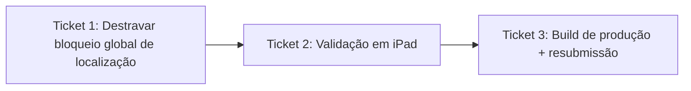

# Ticket Breakdown — Epic 5: Correção da rejeição da Apple

Cada item de escopo abaixo é uma checkbox: `[x]` feito, `[ ]` pendente. Ao retomar
o trabalho, este arquivo é a fonte de verdade de onde paramos.

---

## Ticket 1 — Destravar bloqueio global de localização

**Status:** ✅ Concluído (código) — falta só a validação em iPad (Ticket 2).

**Escopo:**
- [x] Remover o `<Modal>` bloqueante de `GeospatialProvider`
  (`src/contexts/geospatial-context.tsx`) — o provider passa a retornar só
  `{children}`. Nenhuma mudança na forma de `GeospatialContextValue` nem nos
  imports usados pelos consumidores.
- [x] Isolar `Location.watchHeadingAsync` em seu próprio `try/catch` dentro de
  `startWatchers()`, separado da lógica de permissão/`watchPositionAsync` — uma
  falha de bússola (ex: iPad sem magnetômetro) não deve mais marcar
  `permissionDenied = true`.
- [x] Estender o `ListEmptyComponent` de `src/app/(tabs)/market/index.tsx` para
  também cobrir `locationSource === "current" && permissionDenied` (hoje só
  trata `locationSource === "profile"`), evitando o skeleton de loading
  indefinido.
- [x] Rodar `npm test` (suíte completa) e `expo-doctor` — sem regressão.
  `npm test`: 23/23 suítes, 201/201 testes. `expo-doctor`: 20/21 — o 1 que falha
  é drift de patch version pré-existente (`expo`, `expo-location`,
  `expo-router` etc.), não relacionado a esta mudança; fora de escopo do Epic 5.
- Fora: qualquer redesign de UX de localização por tela (prompts contextuais,
  avisos globais) — decisão explícita do usuário de manter escopo mínimo.

**Referências de spec:** epic-brief.md → Critérios de sucesso; tech-plan.md →
Abordagem Arquitetural, Arquitetura de Componentes.

**Dependências:** nenhuma.

---

## Ticket 2 — Validação em iPad (regressão + reprodução do cenário do review)

**Status:** ⏸️ Adiado — EAS Simulator não oferece seleção de modelo de device
(só `--platform ios|android`, sem escolha de iPad especificamente), então não dá
pra reproduzir o cenário exato do review por esse caminho. Usuário decidiu
adiar essa validação para depois, quando tiver um container macOS com
simulador local disponível. Ticket fica registrado como pendente, não
bloqueando o fechamento do restante do epic por ora.

**Escopo:**
- [ ] Reproduzir o cenário exato do review da Apple: iPad (via simulador local
  em container macOS — a definir pelo usuário — ou device físico), Location
  Services desligado — confirmar que login, tabs (`market`, `(home)`,
  `complaints`), perfil e demais telas não-dependentes de localização
  funcionam normalmente (sem bloqueio, sem erro).
- [ ] Confirmar que o gap do market (Ticket 1) resolve corretamente: com fonte
  "localização atual" e permissão negada, aparece o empty-state em vez do
  skeleton infinito.
- [ ] Validar regressão nos fluxos que **dependem** de localização, com
  permissão concedida, no mesmo dispositivo iPad: mapa do market
  (`wrapper-map`), criação de denúncia (`complaints/(create)`), overlay de
  localização da câmera.
- [ ] Se possível, testar em iPad sem magnetômetro/bússola (ou simular a falha)
  para confirmar que o isolamento do `watchHeadingAsync` realmente evita o
  falso-positivo de `permissionDenied`.
- Fora: teste em toda a matriz de dispositivos Android/iPhone — já cobertos
  pela suíte existente; o foco aqui é especificamente reproduzir o cenário do
  review (iPad).

**Referências de spec:** epic-brief.md → Critérios de sucesso (reprodução em
iPad); tech-plan.md → Arquitetura de Componentes (ponto de integração/validação).

**Dependências:** Ticket 1.

---

## Ticket 3 — Build de produção e resubmissão

**Status:** ⏳ Não iniciado

**Escopo:**
- [ ] Gerar build `eas build --profile production` (Android + iOS) com as
  correções do Ticket 1.
- [ ] Conferir que a build sobe sem os problemas de `pod install`/plugins já
  resolvidos no Epic 1 (nenhuma mudança esperada aqui, só checagem de
  regressão).
- [ ] Reenviar a build para review na App Store Connect, referenciando a
  submissão anterior (`3f96db4c-ee45-422c-b5fe-eb90bd5b03a9`) na resposta ao
  time de review, se aplicável.
- Fora: submissão à Play Store (Android) — só entra se o usuário decidir
  também resubmeter lá; o bloqueio reportado foi só da Apple.

**Referências de spec:** epic-brief.md → Critérios de sucesso (nova build +
reenvio).

**Dependências:** Ticket 2.
