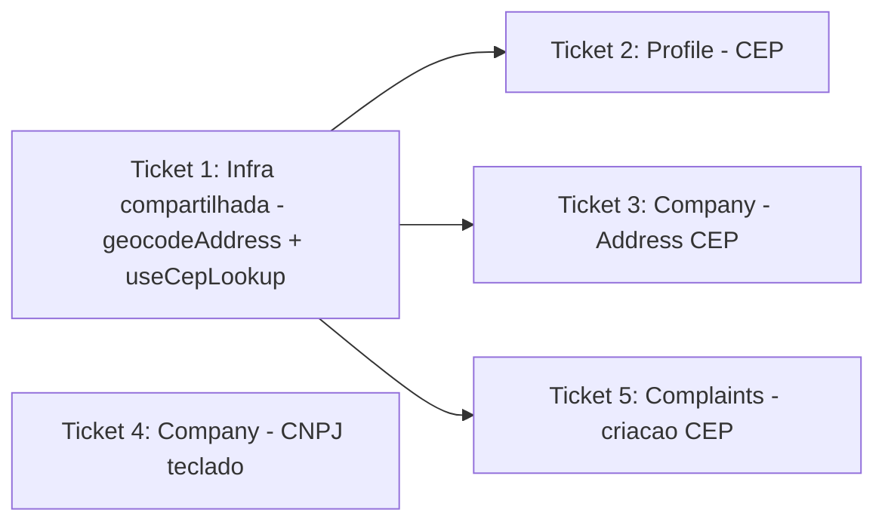

# Ticket Breakdown — Epic 6: UX de formulários de endereço

Cada item de escopo abaixo é uma checkbox: `[x]` feito, `[ ]` pendente. Ao retomar
o trabalho, este arquivo é a fonte de verdade de onde paramos.

---

## Ticket 1 — Infraestrutura compartilhada: geocoding + resolução de CEP

**Status:** ✅ Concluído.

**Escopo:**
- [x] Criar `src/libs/google/geocode-address.ts` com `geocodeAddress(address: string)`
  (forward geocoding via Google Geocoding API, espelhando o padrão de
  `src/libs/google/reverse-geocode.ts` já existente — mesma
  `EXPO_PUBLIC_GOOGLE_MAPS_API_KEY`, nunca lança, retorna `null` em qualquer falha).
- [x] Criar `src/libs/use-cep-lookup.ts` com o hook `useCepLookup()`
  (`useMutation` do React Query), expondo `{ lookupCep, isLookingUpCep }`.
  `lookupCep` chama `getCepV2` (BrasilAPI) e, com o endereço retornado, chama
  `geocodeAddress`; lança se a BrasilAPI não encontrar o CEP ou falhar na
  rede; nunca lança por falha só do geocoding (retorna `latitude`/`longitude`
  como `null` nesse caso).
- [x] Sem validação de formato de CEP nem toast dentro do hook — isso
  permanece em cada tela consumidora (Tickets 2, 3, 5).
- Fora: qualquer integração com as telas (feito nos tickets seguintes); sem
  testes de UI aqui, só a lógica pura do helper/hook (pode ter teste unitário
  se fizer sentido, mas não é obrigatório).

**Validação:** `npx tsc --noEmit` e `npx biome check` limpos nos 2 arquivos novos.

**Achado do `/impl-validate`:** `addressLine` inicialmente concatenava
`street`/`neighborhood` mesmo quando vinham `null` da BrasilAPI, gerando
segmentos vazios na query do Google (`", , Cidade, UF, ..."`). Corrigido para
filtrar campos vazios antes de montar a string.

**Referências de spec:** tech-plan.md → Abordagem Arquitetural (itens 2, 3, 5);
Modelo de Dados (`ResolvedCepAddress`, `GeocodedCoordinates`); Arquitetura de
Componentes (`geocodeAddress`, `useCepLookup`).

**Dependências:** nenhuma.

---

## Ticket 2 — Profile: Enter confirma CEP + coordenadas via geocoding

**Status:** ✅ Concluído.

**Escopo:**
- [x] `src/app/(tabs)/(home)/profile.tsx`: adicionar `returnKeyType="search"` +
  `onSubmitEditing={() => onPressSearchCep({ cep: value })}` no `InputField`
  do campo `address.zip_code` (mesma ação que o `InputSlot` de lupa já
  dispara).
- [x] Substituir o `getCepMutation` atual por `useCepLookup()`; em
  `onPressSearchCep`, após validar os 8 dígitos, chamar `lookupCep` e montar o
  `reset(...)` com `street`/`district`/`city`/`state_code` do resultado,
  mantendo a resolução de `state`/`state_ibge_id` via lista de UFs do IBGE
  (lógica já existente, não entra no hook).
  `setValue("address.latitude", Number(...))` /
  `setValue("address.longitude", Number(...))` quando o geocoding retornar
  coordenadas.
- [x] Trocar `getCepMutation.isPending` por `isLookingUpCep` no spinner do
  ícone de busca.
- [x] Manter o toast de erro existente (`"Erro ao buscar cep"`) no catch da
  chamada a `lookupCep`.
- Fora: navegação `next`/foco entre os demais campos do formulário de perfil.

**Validação:** `npx tsc --noEmit` limpo; `npx biome check` limpo; suíte de
testes de profile (component + integration) 34/34 passando.

**Referências de spec:** tech-plan.md → Modelo de Dados (mapeamento
`profile.address.*`); Arquitetura de Componentes (fluxo de dados ponta a
ponta).

**Dependências:** Ticket 1.

---

## Ticket 3 — Company (Address): Enter confirma CEP + coordenadas via geocoding

**Status:** ✅ Concluído.

**Escopo:**
- [x] `src/app/(tabs)/(home)/companies/[companyId]/address.tsx`: adicionar
  `returnKeyType="search"` + `onSubmitEditing={onPressSearchCep}` no
  `InputField` do campo `zip_code`.
- [x] `src/components/companies/hooks/use-company-address.ts`: chamar
  `useCepLookup()` internamente e usar `lookupCep` dentro do `mutationFn` de
  `resolveCep`, mantendo por cima a cross-referência com
  `listIbgeMunicipios`/`states` para `state_ibge_id`/`city_ibge_id`.
- [x] Adicionar `latitude`/`longitude: number | null` ao tipo
  `ResolvedCepValues` e ao objeto `values` retornado por `resolveCep`.
- [x] Confirmar que `onPressSearchCep` em `address.tsx` (que já faz
  `reset({ ...getValues(), ...resolved })`) propaga `latitude`/`longitude`
  para o mapa sem mudança adicional (o binding `watch("latitude")`/
  `watch("longitude")` → `WrapperMap` já existe).
- [x] Manter o toast de erro existente (`"CEP não encontrado"`).
- Fora: mudanças em `company.tsx` (dados gerais/CNPJ — Ticket 4).

**Validação:** `npx tsc --noEmit` limpo; `npx biome check` limpo; suíte
`address-flow`/`companies-full-flow` (parte da suíte completa) passando.

**Referências de spec:** tech-plan.md → Modelo de Dados (mapeamento
`company.address.*`); Arquitetura de Componentes (`useCompanyAddress`
alterado).

**Dependências:** Ticket 1.

---

## Ticket 4 — Company (CNPJ): Enter confirma busca de CNPJ

**Status:** ✅ Concluído.

**Escopo:**
- [x] `src/app/(tabs)/(home)/companies/[companyId]/company.tsx`: adicionar
  `returnKeyType="search"` + `onSubmitEditing={onPressSearchCnpj}` no
  `InputField` do campo `identity`, apenas quando `identity_type === "CNPJ"`.
  `onPressSearchCnpj` já valida internamente e sai cedo se não for CNPJ,
  então é seguro passar sempre que o campo estiver visível.
- [x] Confirmar que CPF (não-CNPJ) não aciona a busca incorretamente ao
  apertar Enter (guarda existente em `onPressSearchCnpj`, inalterada).
- Fora: qualquer mudança de geocoding — este ticket não envolve endereço/mapa,
  só a busca de dados cadastrais via CNPJ.

**Validação:** `npx tsc --noEmit` limpo; `npx biome check` limpo.

**Achado do `/impl-validate`:** `returnKeyType`/`onSubmitEditing` inicialmente
ficaram no `InputField` sempre ativos (mesmo em modo CPF), mostrando o botão
"buscar" no teclado sem ação correspondente. Corrigido para só aplicar essas
props quando `identity_type === "CNPJ"`.

**Referências de spec:** tech-plan.md → Abordagem Arquitetural (item 1).

**Dependências:** nenhuma (independente dos demais tickets do epic).

---

## Ticket 5 — Complaints (criação): Enter fecha teclado + mapa acompanha o CEP

**Status:** ✅ Concluído (código) — falta validação manual em device/simulador
(item abaixo não pode ser automatizado por teste unitário, não há teste
dedicado de complaints/(create) na suíte atual).

**Escopo:**
- [x] `src/app/(tabs)/complaints/(create)/index.tsx`: adicionar
  `returnKeyType="done"` no `InputField` do campo `postalCode` (a busca já
  dispara em `onBlur`; o comportamento padrão do `TextInput` single-line ao
  apertar "done" já tira o foco, disparando o `onBlur` existente).
- [x] Reescrever `handleCepLookup` para usar `useCepLookup()` (`lookupCep`) em
  vez de chamar `getCepV2` diretamente e usar `data.location?.coordinates`
  (fonte hoje não confiável — costuma vir `null`). Preencher
  `street`/`district`/`city`/`region` (a partir de `stateCode`) e
  `latitude`/`longitude` (`string`, sem conversão de tipo) a partir do
  resultado do hook.
- [ ] Validar manualmente que buscar um CEP de outra região move o pino do
  mapa (`WrapperMap`, via `watch("latitude")`/`watch("longitude")`) — este é
  o bug relatado ("mapa fica fixo na localização atual") que este ticket
  corrige. **Pendente**: sem device/simulador disponível neste ambiente.
- [x] Manter o comportamento de falha silenciosa já existente (não travar a
  tela se `lookupCep` lançar).
- Fora: mudanças em `handleAddressSelect` (Google Places) e `handleMapChange`
  (toque no mapa) — ambos já usam geocoding do Google corretamente e não são
  alterados.

**Validação:** `npx tsc --noEmit` limpo; `npx biome check` limpo. Sem teste
automatizado de `complaints/(create)` na suíte (nenhum arquivo dedicado
encontrado) — a validação funcional do mapa fica pendente de teste manual.

**Referências de spec:** epic-brief.md → Contexto & Problema (fricção 2,
complaints); tech-plan.md → Arquitetura de Componentes (fluxo de dados ponta a
ponta).

**Dependências:** Ticket 1.
