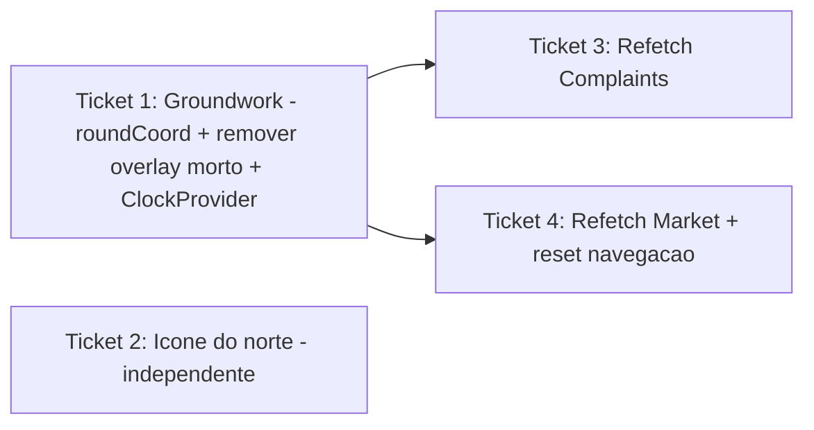

# Ticket Breakdown — Epic 7: Estabilidade de mapa e geolocalização



Cada item de escopo é uma checkbox: `[x]` feito, `[ ]` pendente. Ao retomar o
trabalho, este arquivo é a fonte de verdade de onde paramos.

Branch: `fix/map-geo-stability` (criada a partir de `origin/development`). Todos os
tickets vivem nesta mesma branch, um commit por ticket.

---

## Ticket 1 — Groundwork: coordenadas estáveis + remover overlay morto + ClockProvider

**Status:** ⬜ Pendente.

**Escopo:**
- [ ] Criar `src/libs/geospatial/round-coord.ts`:
  ```ts
  export const roundCoord = (value: number, decimals = 4): number =>
    Math.round(value * 10 ** decimals) / 10 ** decimals;
  ```
  e exportar em `src/libs/geospatial/index.ts` (seguindo o padrão dos `format*`).
- [ ] Remover o overlay morto da câmera:
  - Deletar `src/components/camera/camera-geospatial-overlay.tsx`.
  - Remover a entrada `GeospatialOverlay: CameraGeospatialOverlay` e o import
    correspondente em `src/components/camera/index.tsx`.
- [ ] `src/contexts/geospatial-context.tsx`: remover `currentDate` do state, do
  objeto `value`, do `type GeospatialContextValue` e das deps do `useMemo`;
  remover o `useEffect`/`setInterval` de 1s. Não tocar em `heading`, `location`,
  `addresses`, `permissionDenied`, `isResolving`, `reverseGeocodeError`.
- [ ] Criar `src/contexts/clock-context.tsx` com `ClockProvider` (tick de **60s**
  via `setInterval`, `clearInterval` no cleanup) expondo `useNow(): Date`. Seguir
  o padrão dos contexts existentes (createContext + hook que lança se usado fora
  do provider).
- [ ] Montar `ClockProvider` em `src/app/(tabs)/market/_layout.tsx` (junto do
  `MarketProvider` — só o Market consome).

**Fora:** trocar os consumidores de `currentDate` para `useNow` (Ticket... feito
aqui mesmo, ver abaixo) — na prática este ticket já precisa migrar os 2 arquivos do
Market para não quebrar o build:
- [ ] `src/app/(tabs)/market/index.tsx`: trocar `currentDate` de `useGeospatial()`
  por `useNow()` do clock-context.
- [ ] `src/app/(tabs)/market/[companyId].tsx`: idem.

**Testes:**
- [ ] Remover `currentDate` do mock de `useGeospatial` em
  `src/tests/component/market/market-screen.test.tsx`,
  `src/tests/component/market/market-list-header.test.tsx`,
  `src/tests/integration/market/market-filters.test.tsx`,
  `src/tests/component/home/home.test.tsx`,
  `src/tests/integration/home/home-flow.test.tsx`.
- [ ] Onde o badge aberto/fechado importa (testes de Market), mockar `useNow` para
  retornar a data fixa que antes vinha de `currentDate`, preservando o determinismo.

**Validação:** `npm run lint` limpo; `npm test` verde (suíte de Market/Home
ajustada). Confirmar que nenhum arquivo ainda importa `currentDate` de
`useGeospatial` (`grep`).

**Referências de spec:** tech-plan.md → Groundwork (roundCoord, ClockProvider,
remoção do overlay); epic-brief.md → "Agravante compartilhado".

**Dependências:** nenhuma. Pré-requisito dos Tickets 3 e 4 (usam `roundCoord`).

---

## Ticket 2 — Ícone do norte não escapa do botão (Complaints)

**Status:** ⬜ Pendente.

**Escopo:**
- [ ] `src/app/(tabs)/complaints/index.tsx` (linhas ~370-377): mover o
  `transform: [{ rotate: \`${-mapHeading}deg\` }]` do `Navigation2Icon` para um
  `<View>` que o envolve:
  ```jsx
  <View style={{ transform: [{ rotate: `${-mapHeading}deg` }] }}>
    <Navigation2Icon size={20} color={colors.white} strokeWidth={2.2} />
  </View>
  ```
  `View` já está importado. Não alterar `handleResetNorth` nem
  `handleRegionChangeComplete`.

**Validação:** `npm run lint` limpo. Manual: girar a câmera do mapa de Complaints →
o ícone gira centrado dentro do botão 44×44, sem escapar; tocar reseta para o
norte. Testar Android (PROVIDER_GOOGLE) e iOS.

**Referências de spec:** tech-plan.md → "Ícone do norte"; epic-brief.md → Bug 1.

**Dependências:** nenhuma (independente dos demais).

---

## Ticket 3 — Refetch por drift de GPS no mapa de Complaints

**Status:** ⬜ Pendente.

**Escopo:**
- [ ] `src/components/complaints/hooks/use-complaints-map.ts`: arredondar
  `userLocation.lat`/`lon` com `roundCoord` (do Ticket 1) e usar os valores
  arredondados **tanto na `queryKey`** quanto no payload de `getV1ComplaintsMap`
  (mantendo key e dados consistentes).
- [ ] Adicionar `placeholderData: keepPreviousData` à `useQuery`
  (`import { keepPreviousData } from "@tanstack/react-query"`).

**Validação:** `npm run lint` limpo; `npm test` verde. Manual: com o device parado,
o mapa não recarrega a cada poucos segundos; ao mover-se de verdade os dados
atualizam sem os marcadores piscarem/sumirem.

**Referências de spec:** tech-plan.md → "roundCoord na query key" e
"keepPreviousData"; epic-brief.md → Bugs 2/3.

**Dependências:** Ticket 1 (`roundCoord`).

---

## Ticket 4 — Refetch por drift de GPS no Market + reset de navegação em `[companyId]`

**Status:** ⬜ Pendente.

**Escopo:**
- [ ] `src/contexts/market-context.tsx` (`useInfiniteQuery`, linhas ~110-134):
  arredondar `lat`/`lon` com `roundCoord`, usando os valores arredondados na
  `queryKey: ["market", lat, lon, appliedFilters]` **e** no `queryFn` (payload de
  `getV1Market`).
- [ ] Adicionar `placeholderData: keepPreviousData` ao `useInfiniteQuery`.
- [ ] Nenhuma mudança adicional em `src/app/(tabs)/market/[companyId].tsx` além da
  já feita no Ticket 1 (`useNow`): com `keepPreviousData`, `companies` não zera na
  troca de key, então `getCompanyById(companyId)` segue retornando a empresa e a
  tela não cai para loading/vazio.

**Validação:** `npm run lint` limpo; `npm test` verde. Manual: com o device parado,
a lista do Market não recarrega sozinha; abrir `market/[companyId]`, aguardar e
mover-se levemente — a tela do detalhe permanece (sem "voltar ao início").

**Referências de spec:** tech-plan.md → "roundCoord na query key",
"keepPreviousData" e o mecanismo do reset de navegação; epic-brief.md → Bug 3.

**Dependências:** Ticket 1 (`roundCoord`).

---

## Ordem sugerida de execução

1. **Ticket 1** (Groundwork) — desbloqueia 3 e 4 e resolve o re-render por segundo.
2. **Ticket 2** (ícone do norte) — isolado, pode ir a qualquer momento.
3. **Ticket 3** (refetch Complaints).
4. **Ticket 4** (refetch Market + reset de navegação).

Um commit por ticket, todos na branch `fix/map-geo-stability`; ao final, abrir PR
para `development`.
