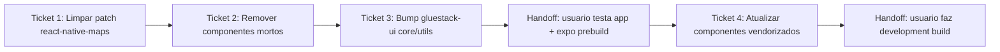

# Ticket Breakdown — Epic 8: upgrade do gluestack-ui (alpha → v5 estável)

Cada item de escopo é uma checkbox: `[x]` feito, `[ ]` pendente. Ao retomar o
trabalho, este arquivo é a fonte de verdade de onde paramos.

Branch: `chore/gluestack-ui-v5-stable` (criada a partir de `origin/development`
já com o PR #80 do epic-7 mergeado). Um commit por ticket.

---

## Ticket 1 — Limpar o patch do react-native-maps

**Status:** ✅ Concluído.

**Escopo:**
- [x] Remover artefatos de build capturados por engano:
  `rm -rf node_modules/react-native-maps/android/build`.
- [x] Confirmar que os 2 arquivos com mudança real
  (`plugin/build/android.js`, `plugin/build/ios.js`) continuam com o fix
  aplicado em `node_modules` (import de `expo/config-plugins`).
- [x] Regenerar: `npx patch-package react-native-maps`.
- [x] Conferir que `patches/react-native-maps+1.27.2.patch` só contém os 2
  arquivos de mudança real (sem `android/build/**`).

**Validação:** patch caiu de 807 para 30 linhas, só os 2 arquivos reais no
diff. `npx patch-package` reaplicou limpo num `npm install` seguinte (Ticket 3).
`tsc`/`lint`/`test` sem regressão.

**Commit:** `e2b83f0` — "chore: limpa patch do react-native-maps de artefatos
de build".

**Referências de spec:** tech-plan.md → "Por que separar limpeza de patch
antes do bump"; epic-brief.md → "Patch... estava sujo".

**Dependências:** nenhuma. Pré-requisito de qualquer `npm install` seguinte.

---

## Ticket 2 — Remover componentes vendorizados sem nenhum uso

**Status:** ✅ Concluído.

**Escopo:**
- [x] Deletar `src/components/ui/avatar/`.
- [x] Deletar `src/components/ui/date-time-picker/` (`index.tsx`,
  `index.web.tsx`, `styles.tsx`).
- [x] Deletar `src/components/ui/tabs/` (`index.tsx`,
  `TabsAnimatedIndicator.tsx`, `animation-config.ts`).
- [x] Confirmar via grep que nenhum arquivo em `src/` referencia esses 3
  diretórios ou os nomes `Avatar`/`DateTimePicker`/`Tabs` (exceto o `Tabs` do
  `expo-router`, sem relação).

**Validação:** `npx tsc --noEmit` confirmou queda de 27 → 21 erros, exatamente
como previsto. `npm run lint` limpo, `npm test` 198/198 sem regressão.

**Commit:** `2621ab1` — "chore: remove componentes ui vendorizados sem uso
(avatar, date-time-picker, tabs)".

**Referências de spec:** tech-plan.md → "Por que remover componentes
vendorizados sem uso antes do bump"; epic-brief.md → "3 componentes
vendorizados confirmados sem nenhum uso".

**Dependências:** nenhuma.

---

## Ticket 3 — Bump de `@gluestack-ui/core` e `@gluestack-ui/utils` para estável

**Status:** ✅ Concluído (código) — ⬜ **aguardando validação manual do
usuário** (app local + `expo prebuild`) antes de iniciar o Ticket 4.

**Escopo:**
- [x] `package.json`: `@gluestack-ui/core: ^5.0.0-alpha.0 → ^5.0.15`,
  `@gluestack-ui/utils: ^5.0.1-alpha.0 → ^5.0.6`.
- [x] `npm install` (atualiza lockfile; roda `postinstall: patch-package` já
  com o patch limpo do Ticket 1 — aplicou sem erro).
- [x] Não tocar em nenhum arquivo de `src/components/ui/` neste ticket.

**Validação:** `npx tsc --noEmit` — **achado**: a contagem de erros ficou
**igual** à baseline pós-Ticket-2 (21, mesma distribuição por arquivo). O bump
sozinho **não eliminou** nenhum dos erros de categoria "tooling alpha"
(`badge`, `modal`, `select-actionsheet`, `spinner`, `toast` — 1 erro cada)
como a hipótese inicial previa; esses erros persistem mesmo na versão estável
e precisam ser investigados na Fase 2, junto da atualização dos componentes.
`npm run lint` limpo, `npm test` 198/198 sem regressão.

**Commit:** `ea67eb6` — "chore: atualiza @gluestack-ui/core e
@gluestack-ui/utils para versão estável".

**Handoff para o usuário** (fora do que executo): rodar o app localmente
(`npm run ios`/`npm run android`) e `expo prebuild`, para confirmar que a
regeneração nativa não quebra. **A Fase 2 (Ticket 4) só começa depois desse
sinal verde.**

**Referências de spec:** tech-plan.md → "Por que a Fase 1 é só os 2 pacotes de
motor"; epic-brief.md → contexto geral.

**Dependências:** Ticket 1 (patch limpo), Ticket 2 (menos código para
revalidar).

---

## Ticket 4 — Atualizar componentes vendorizados (Fase 2)

**Status:** ✅ Concluído.

**Escopo:**
- [x] **Grupo A** (sobrescrita direta, com diff antes de aceitar cada um):
  `alert`, `divider`, `progress`, `spinner`, `switch`, `pressable`, `skeleton`,
  `form-control`, `input`, `icon`, `menu`, `modal`, `toast`, `box`, `card`,
  `heading`, `hstack`, `vstack`, `text`, `gluestack-ui-provider`. `alert`,
  `divider`, `progress`, `box`, `hstack`, `vstack`, `pressable`, `switch`
  ficaram byte-idênticos. Nos demais, quase todo o diff era só estilo do CLI
  (`biome.json` tem `"!**/ui"` — o projeto ignora deliberadamente
  `src/components/ui/` do lint/format, então o estilo single-quote/2-espaços
  do CLI não é normalizado automaticamente; comparação feita ignorando
  aspas/indentação para achar as mudanças reais). Únicas mudanças de conteúdo:
  `skeleton.startColor` default `bg-accent-foreground` → `bg-accent` (maioria
  dos usos já sobrescreve essa prop) e `FormControlLabel` ganhou props opcionais
  aditivas (`htmlFor`, `role`). Paleta (`bg-primary`, `text-foreground`,
  `bg-muted`) confirmada intacta em todos. Removidos `index.next.tsx` e
  `index.uniwind.tsx` que o CLI adicionou em `gluestack-ui-provider/`
  (variantes para Next.js e para o styling engine Uniwind, nenhum usado neste
  projeto — `index.uniwind.tsx` inclusive importava o pacote `uniwind`, não
  instalado).
- [x] **Grupo B** (buscar template novo à parte, mesclar manualmente,
  preservando a lógica customizada): `badge`, `checkbox`, `grid`,
  `select/select-actionsheet`. `grid` e `select` (ambos arquivos) vieram
  byte-idênticos. `badge`/`checkbox` só tiveram diffs cosméticos — a lógica
  customizada (dual-mode de props em `BadgeIcon`, branch
  `Platform.OS === "web"` do checkbox) ficou intacta, verificada linha a linha.
- [x] **Não tocado** (fora do escopo do CLI, confirmado intacto):
  `decimal-input`, `swipeable-card.tsx`, `bottomsheet`.
- [x] Rodado `npx tsc --noEmit` + `npm run lint` + `npm test` após cada grupo.

**Achado**: os erros de TS pré-existentes em `modal`/`spinner`/`toast`/`badge`/
`select-actionsheet` ("union type too complex" / "not assignable to
undefined") persistem **mesmo nos templates mais recentes do CLI (v5.0.3)** —
não era bug de versão alpha, é limitação real da integração gluestack-ui +
`styled()`/`nativewind-utils`. Baseline de 21 erros de TS permanece igual em
todo o Ticket 4 (ver "Fora de escopo").

**Validação:** `tsc` (21 erros, mesma baseline em todos os commits), `lint`
limpo, `test` 198/198 sem regressão em cada um dos 2 commits (Grupo A e
Grupo B).

**Commits:** `d71a571` (Grupo A) e `c1a0da6` (Grupo B).

**Handoff final para o usuário**: development build completo
(`eas build --profile development` ou `npm run ios`/`npm run android` locais)
para validar ponta a ponta.

**Referências de spec:** tech-plan.md → "Por que a Fase 2 tem 3 categorias
(não 2)"; epic-brief.md → seção sobre `bottomsheet`.

**Dependências:** Ticket 3 validado manualmente pelo usuário (app rodando +
`expo prebuild` OK).

---

## Fora de escopo deste epic (registrado, não implementar)

- Dependência fantasma `@react-native-community/datetimepicker` — moot, o
  componente que a usava foi deletado (Ticket 2).
- Os 11 erros de TS do `bottomsheet` (mismatch com `@gorhom/bottom-sheet@5.2.14`)
  — orthogonal ao gluestack, não é tocado aqui.
- Os 10 erros restantes em `badge`/`button`/`checkbox`/`modal`/
  `select-actionsheet`/`spinner`/`toast` ("union type too complex" / "not
  assignable to undefined" / incompatibilidade de ref `Svg`/`IPrimitiveIcon`) —
  confirmado no Ticket 4 que persistem mesmo nos templates mais recentes do
  CLI (v5.0.3), não são causados pela versão alpha. Corrigi-los exigiria
  investigar a integração `styled()`/`nativewind-utils` do gluestack-ui em si
  (upstream) ou a integração com `react-native-svg`/`lucide-react-native` via
  ref — fora do escopo deste epic de upgrade de versão.
- Qualquer teste em device físico/simulador ou build nativo — sem
  device/simulador neste ambiente; fica com o usuário nos dois handoffs.
