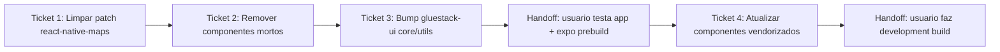

# Ticket Breakdown — Epic 8: upgrade do gluestack-ui (alpha → v5 estável)

Cada item de escopo é uma checkbox: `[x]` feito, `[ ]` pendente. Ao retomar o
trabalho, este arquivo é a fonte de verdade de onde paramos.

Branch: `chore/gluestack-ui-v5-stable` (criada a partir de `origin/development`
já com o PR #80 do epic-7 mergeado). Um commit por ticket.

---

## Ticket 1 — Limpar o patch do react-native-maps

**Status:** ⬜ Pendente.

**Escopo:**
- [ ] Remover artefatos de build capturados por engano:
  `rm -rf node_modules/react-native-maps/android/build`.
- [ ] Confirmar que os 2 arquivos com mudança real
  (`plugin/build/android.js`, `plugin/build/ios.js`) continuam com o fix
  aplicado em `node_modules` (import de `expo/config-plugins`).
- [ ] Regenerar: `npx patch-package react-native-maps`.
- [ ] Conferir que `patches/react-native-maps+1.27.2.patch` só contém os 2
  arquivos de mudança real (sem `android/build/**`).

**Validação:** `git diff patches/react-native-maps+1.27.2.patch` mostrando só 2
arquivos no diff.

**Referências de spec:** tech-plan.md → "Por que separar limpeza de patch
antes do bump"; epic-brief.md → "Patch... estava sujo".

**Dependências:** nenhuma. Pré-requisito de qualquer `npm install` seguinte.

---

## Ticket 2 — Remover componentes vendorizados sem nenhum uso

**Status:** ⬜ Pendente.

**Escopo:**
- [ ] Deletar `src/components/ui/avatar/`.
- [ ] Deletar `src/components/ui/date-time-picker/` (`index.tsx`,
  `index.web.tsx`, `styles.tsx`).
- [ ] Deletar `src/components/ui/tabs/` (`index.tsx`,
  `TabsAnimatedIndicator.tsx`, `animation-config.ts`).
- [ ] Confirmar via grep que nenhum arquivo em `src/` referencia esses 3
  diretórios ou os nomes `Avatar`/`DateTimePicker`/`Tabs` (exceto o `Tabs` do
  `expo-router`, sem relação).

**Validação:** `npx tsc --noEmit` (esperado: baseline cai de 27 para ~21
erros), `npm run lint`, `npm test` (sem regressão nos 198 testes).

**Referências de spec:** tech-plan.md → "Por que remover componentes
vendorizados sem uso antes do bump"; epic-brief.md → "3 componentes
vendorizados confirmados sem nenhum uso".

**Dependências:** nenhuma.

---

## Ticket 3 — Bump de `@gluestack-ui/core` e `@gluestack-ui/utils` para estável

**Status:** ⬜ Pendente.

**Escopo:**
- [ ] `package.json`: `@gluestack-ui/core: ^5.0.0-alpha.0 → ^5.0.15`,
  `@gluestack-ui/utils: ^5.0.1-alpha.0 → ^5.0.6`.
- [ ] `npm install` (atualiza lockfile; roda `postinstall: patch-package` já
  com o patch limpo do Ticket 1).
- [ ] Não tocar em nenhum arquivo de `src/components/ui/` neste ticket.

**Validação:** `npx tsc --noEmit` (comparar contra a baseline pós-Ticket-2 —
anotar quais dos ~8 erros de categoria "tooling alpha" desapareceram),
`npm run lint`, `npm test` (suíte completa).

**Handoff para o usuário** (fora do que executo): rodar o app localmente
(`npm run ios`/`npm run android`) e `expo prebuild`, para confirmar que a
regeneração nativa não quebra. **A Fase 2 (Ticket 4) só começa depois desse
sinal verde.**

**Referências de spec:** tech-plan.md → "Por que a Fase 1 é só os 2 pacotes de
motor"; epic-brief.md → contexto geral.

**Dependências:** Ticket 1 (patch limpo), Ticket 2 (menos código para
revalidar).

---

## Ticket 4 — Atualizar componentes vendorizados (Fase 2)

**Status:** ⬜ Pendente (aguarda validação manual do Ticket 3 pelo usuário).

**Escopo:**
- [ ] **Grupo A** (sobrescrita direta, com diff antes de aceitar cada um):
  `alert`, `divider`, `progress`, `spinner`, `switch`, `pressable`, `skeleton`,
  `form-control`, `input`, `icon`, `menu`, `modal`, `toast`, `box`, `card`,
  `heading`, `hstack`, `vstack`, `text`, `gluestack-ui-provider`. Confirmar
  para cada um que a paleta (`bg-primary`, `text-foreground`, `bg-muted`) não
  regride para a escala numérica do gluestack.
- [ ] **Grupo B** (buscar template novo à parte, mesclar manualmente,
  preservando a lógica customizada): `badge`, `checkbox`, `grid`,
  `select/select-actionsheet`.
- [ ] **Não tocar** (fora do escopo do CLI): `decimal-input`,
  `swipeable-card.tsx`, `bottomsheet` (já é wrapper direto sobre
  `@gorhom/bottom-sheet`, não um componente do template gluestack — rodar
  `add` aqui apagaria a API custom usada em 6+ lugares do app).
- [ ] Rodar `npx tsc --noEmit` + `npm run lint` + `npm test` após cada
  componente/lote, não só no final.

**Validação:** suíte completa (`tsc`/`lint`/`test`) limpa ao fim de todos os
componentes tocados; `git diff` de cada um revisado manualmente antes de
commitar.

**Handoff final para o usuário**: development build completo
(`eas build --profile development` ou `npm run ios`/`npm run android` locais)
para validar ponta a ponta.

**Referências de spec:** tech-plan.md → "Por que a Fase 2 tem 3 categorias
(não 2)"; epic-brief.md → seção sobre `bottomsheet`.

**Dependências:** Ticket 3 validado manualmente pelo usuário (app rodando +
`expo prebuild` OK).

---

## Fora de escopo deste epic (registrado, não implementar)

- Dependência fantasma `@react-native-community/datetimepicker` — moot, o
  componente que a usava foi deletado (Ticket 2).
- Os 9 erros de TS do `bottomsheet` (mismatch com `@gorhom/bottom-sheet@5.2.14`)
  — orthogonal ao gluestack, não é tocado aqui.
- Qualquer teste em device físico/simulador ou build nativo — sem
  device/simulador neste ambiente; fica com o usuário nos dois handoffs.
