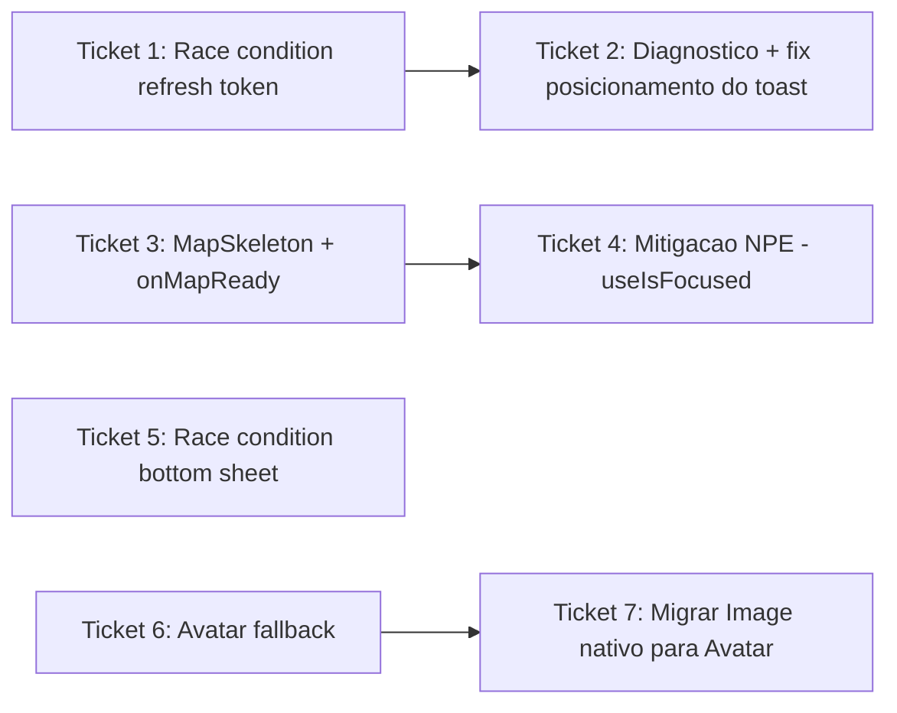

# Ticket Breakdown — Epic 9: Performance/UX em Market e Denúncias

Cada item de escopo é uma checkbox: `[x]` feito, `[ ]` pendente. Ao retomar o
trabalho, este arquivo é a fonte de verdade de onde paramos.

Branch: `fix/market-complaints-hardware-performance` (criada a partir de
`origin/development`). Todos os tickets vivem nesta mesma branch, um commit
por ticket.

---

## Ticket 1 — Race condition de refresh token (causa raiz)

**Status:** ✅ Concluído (falta validação manual em device — ver nota).

**Escopo:**
- [x] `src/libs/api/oikos-api.ts`: tornar `setAuthToken`/`setRefreshToken`
  (linhas 42-62) `async`, aguardando `saveAuthToken`/`saveRefreshToken`/
  `removeAuthToken`/`removeRefreshToken` internamente.
- [x] `grep -rn "setAuthToken\|setRefreshToken" src/` para achar todos os call
  sites antes de mudar a assinatura.
- [x] `src/contexts/auth-context.tsx:126-127` (`signInMutation.mutationFn`):
  `await Promise.all([setAuthToken(token), setRefreshToken(refreshToken)])`
  antes do `Promise.all([getV1Profiles(), getV1UsersMe()])`.
- [x] Demais call sites (`auth-context.tsx:266-267`, `312-313`) — `await` as
  novas versões async (`signOut` virou `async`, tipo do contexto atualizado
  para `signOut: () => Promise<void>`).
- [x] `oikos-api.ts:164` (interceptor 401): trocado
  `await getStoredRefreshToken()` por
  `refreshToken ?? (await getStoredRefreshToken())`.
- [x] Interceptor de refresh (`oikos-api.ts:176-181`) — simplificado para
  chamar `Promise.all([setAuthToken(newToken), setRefreshToken(newRefreshToken)])`
  em vez de duplicar a lógica de save.

**Testes:**
- [x] Novo `src/tests/unit/libs/oikos-api-refresh-race.test.ts` — invoca o
  interceptor de resposta diretamente (mesmo padrão de
  `oikos-api-telemetry.test.ts`), mocka o storage retornando `null` e prova
  que o refresh usa o valor em memória em vez de lançar "No refresh token".
- [x] `auth-flow.test.tsx` (5 testes existentes) segue verde.

**Validação:** `npx tsc --noEmit` limpo nos arquivos tocados (28 erros
pré-existentes no projeto, nenhum relacionado); `npm run lint`/biome só com 1
warning pré-existente (`noNonNullAssertion`, linha não tocada); `npm test` —
2 suítes, 5 testes, todos verdes. **Manual pendente**: reproduzir login no
emulador/SM-A305GT e confirmar ausência de "No refresh token" no logcat.

**Commit:** `f932bd3` — "fix: evita race condition no refresh token que
travava o login".

**Referências de spec:** tech-plan.md → "Por que `refreshToken ?? await
getStoredRefreshToken()` resolve o Bug 1"; epic-brief.md → Bug 1.

**Dependências:** nenhuma. Resolve a maioria dos casos do Bug 1 sozinho.

---

## Ticket 2 — Diagnóstico e correção do posicionamento do toast

**Status:** ⬜ Pendente. **Só executar depois do Ticket 1**, para ver se o
problema ainda ocorre em algum cenário residual (ex. conexão muito lenta).

**Escopo:**
- [ ] Reproduzir via `agent-device` (login com rede lenta simulada) após o
  Ticket 1 já mergeado/testado.
- [ ] Inspecionar via `agent-device help react-devtools`: quantos `Toaster`
  montados, estado do `PortalProvider.items` no momento do toast (se ainda
  ocorrer).
- [ ] Conferir se `AuthModal` (`src/components/auth/auth-modal.tsx`, usa
  `Modal useRNModal` nativo) ainda está com a window nativa viva no momento —
  candidato secundário.
- [ ] Aplicar correção cirúrgica em `src/components/toast.tsx` conforme o
  diagnóstico — **não reescrever o sistema de toast**.

**Validação:** reprodução ao vivo confirmando toast (se disparar) aparece no
topo e some sozinho, sem sobrepor a tab bar.

**Referências de spec:** epic-brief.md → Bug 1, "Mecanismo exato do
posicionamento".

**Dependências:** Ticket 1.

---

## Ticket 3 — `MapSkeleton` + `onMapReady` nas 3 telas com mapa

**Status:** ✅ Concluído (falta validação manual em device — ver nota).

**Escopo:**
- [x] Criado `src/components/ui/map-skeleton.tsx` — usa `Skeleton` de
  `src/components/ui/skeleton`, `StyleSheet.absoluteFill`. Props:
  `className?: string`.
- [x] `src/components/complaints/complaint-map.tsx`: `useState` +
  `onMapReady={() => setIsMapReady(true)}` + overlay `<MapSkeleton />`
  enquanto `!isMapReady`.
- [x] `src/components/wrapper-map.tsx`: mesmo padrão, composto com o branch
  existente de `isResolvingLocation` — o skeleton aparece só dentro do branch
  que já renderiza o `MapView`.
- [x] `src/app/(tabs)/complaints/index.tsx`: `isMapReady` já existia — só
  adicionado o overlay `<MapSkeleton />` (full height) logo após `</MapView>`.

**Testes:**
- [x] `grep -rln "WrapperMap\|ComplaintMap" src/tests/` — só
  `address.test.tsx`, que mocka `WrapperMap` por inteiro; sem cobertura pra
  duplicar. Nenhum teste de componente novo para `MapSkeleton`/telas de mapa
  (mesmo precedente do epic-7: mudanças de mapa validadas manualmente em
  device, não em RNTL/jsdom, que não simula o timing nativo real).

**Validação:** `npx tsc --noEmit` — 28 erros pré-existentes, nenhum nos
arquivos tocados; `npm run lint` limpo; `address.test.tsx` (7/7) segue verde.
**Manual pendente**: abrir Denúncias → skeleton breve antes do mapa aparecer,
nas 3 telas, emulador e SM-A305GT.

**Commit:** `5a72e48` — "fix: adiciona skeleton durante o mount nativo do
MapView".

**Referências de spec:** tech-plan.md → "Por que `onMapReady` + skeleton
resolve a falta de feedback"; epic-brief.md → Bug 2.

**Dependências:** nenhuma.

---

## Ticket 4 — Mitigação da NPE nativa (janela de sobreposição dos `MapView`)

**Status:** ✅ Concluído (falta validação manual em device — ver nota).

**Escopo:**
- [x] `src/app/(tabs)/complaints/(create)/index.tsx`: usar `useIsFocused` —
  **de `expo-router`, não `@react-navigation/native`** (confirmado: é o que
  `complaint-bottom-sheet/index.tsx:8,86` já importa) — para atrasar o mount
  real do `WrapperMap` até a tela estar focada.
- [x] `InteractionManager.runAfterInteractions` antes de marcar
  `shouldMountMap = true`; enquanto falso, renderiza um placeholder
  `<View className="h-96 ..."><MapSkeleton /></View>` do mesmo tamanho do
  container real do `WrapperMap`, evitando salto de layout.
- [x] Deixado explícito no commit: é mitigação de janela de corrida, não
  correção garantida.

**Validação:** `npx tsc --noEmit`/`npm run lint` limpos. **Manual pendente**:
repetir a navegação Denúncias → Criar Denúncia 5-10x no SM-A305GT físico,
comparando frequência da NPE no logcat antes/depois.

**Commit:** `50a2a35` — "fix: atrasa o mount do WrapperMap para reduzir
corrida com o MapView anterior".

**Referências de spec:** tech-plan.md → "Por que atrasar o mount do
`WrapperMap` é uma mitigação"; epic-brief.md → Bug 2.

**Dependências:** Ticket 3.

---

## Ticket 5 — Race condition no `ComplaintsListBottomSheet`

**Status:** ✅ Concluído (falta validação manual em device — ver nota).

**Escopo:**
- [x] `src/components/complaints/complaints-list-bottom-sheet/index.tsx`:
  usada a abordagem (b) — `index` inicial do `BottomSheet` trocado de `0`
  para `1` (declarativo, já reflete o estado "nada selecionado" que o efeito
  tentava alcançar via `ref`), e o `useEffect` de `selectedMapComplaint` passa
  a pular sua primeira execução (`hasMountedRef`), só disparando
  `snapToIndex` em mudanças reais de seleção pós-mount.

**Validação:** `npx tsc --noEmit`/`npm run lint` limpos. Sem teste automatizado
novo — é condição de corrida ligada a timing nativo real, RNTL/jsdom não
reproduz a contenção de main-thread que causa o bug. **Manual pendente**: no
SM-A305GT físico, abrir Denúncias — sheet deve aparecer expandido a 42% sem
precisar tocar em nenhuma denúncia primeiro. Repetir 5x (condição de corrida).

**Commit:** `4e4f58c` — "fix: evita que o bottom sheet de denúncias fique
invisível em hardware lento".

**Referências de spec:** tech-plan.md → "Por que a mesma lógica de gate
resolve o Bug 3"; epic-brief.md → Bug 3.

**Dependências:** nenhuma. Independente dos demais.

---

## Ticket 6 — Expor fallback visual no `Avatar`

**Status:** ✅ Concluído (falta validação manual em device — ver nota).

**Achado que mudou o escopo**: `AvatarFallbackText` do gluestack
(`node_modules/@gluestack-ui/core/lib/esm/avatar/creator/AvatarFallbackText.jsx`)
é **fixo em iniciais de texto** (`getFirstCharacters`, extrai 1-2 letras de
`children` string) — não é icon-capable, não dava pra reaproveitar pro padrão
de ícone (`FactoryIcon`/`UserIcon`) já usado no projeto. Solução adotada: não
mexer no slot `FallbackText` do `createAvatar` — cada consumidor já renderiza
seu próprio ícone de fallback como filho direto de `<Avatar>` (era o padrão
pré-existente pra "sem avatar"); o fix foi tornar esse ícone **sempre**
renderizado (não mais dentro de um ternário que o excluía quando havia URL) e
sobrepor `AvatarImage` por cima via posicionamento absoluto.

**Escopo:**
- [x] `src/components/ui/avatar/index.tsx`: `avatarImageStyle` mudou de
  `"h-full w-full"` para `"absolute inset-0 h-full w-full"` — a imagem passa a
  sobrepor o fallback (que preenche o espaço do `Avatar` normalmente,
  `position: relative` por padrão em `View`) em vez de empilhar abaixo dele.
- [x] Migrados os 4 consumidores existentes de `AvatarImage`
  (`company-card.tsx`, `home-user-card.tsx`, `profile.tsx`, `company.tsx`):
  ternário `avatar ? <AvatarImage/> : <Icon/>` → `<Icon/>` sempre +
  `{avatar && <AvatarImage/>}` condicional por cima.
- [x] Não consultado `design-system-analyst` (agente não disponível nesta
  sessão) — decisão de manter ícone (não iniciais) tomada por ser o padrão já
  estabelecido e único viável dado o achado acima; revisão de design system
  fica como follow-up se questionado.

**Testes:**
- [ ] Teste de componente para `Avatar`/`AvatarImage` simulando falha de
  carregamento — não criado nesta rodada (nenhuma suíte de teste toca
  `Avatar` hoje; adicionar cobertura ficou pendente, ver "Status geral").

**Validação:** `npx tsc --noEmit` — 28 erros pré-existentes, nenhum nos
arquivos tocados; `npm run lint` limpo. **Manual pendente**: com o backend
local retornando 404 pro avatar do usuário logado, abrir a Home e confirmar
visualmente o ícone genérico em vez de espaço em branco.

**Commit:** `63b3d6a` — "fix: mostra fallback visual quando o avatar falha ao
carregar".

**Referências de spec:** tech-plan.md → "Por que `AvatarFallbackText` resolve
o Bug 4" (nome desatualizado pelo achado acima — ler como "fallback via ícone
sempre renderizado"); epic-brief.md → Bug 4.

**Dependências:** nenhuma. Resolve o caso mais visível (avatar do usuário)
sozinho.

---

## Ticket 7 — Migrar usos de `Image` nativo do RN para `Avatar`/`AvatarImage`

**Status:** ✅ Concluído (falta validação manual em device — ver nota).

**Escopo:**
- [x] `src/app/(tabs)/market/index.tsx` (avatar de empresa na listagem) —
  fallback composto (ícone `Sprout` para coletores, iniciais em texto pros
  demais) preservado, agora sempre renderizado com `AvatarImage` por cima.
- [x] `src/app/(tabs)/market/[companyId].tsx` (avatar de empresa no
  detalhe) — mesmo padrão.
- [x] `src/components/complaints/complaint-bottom-sheet/resolution-card.tsx`
  (avatar de quem resolveu a denúncia) — fallback `BuildingIcon`/`UserIcon`
  conforme `isCompanyResolution`.
- [x] `src/components/complaints/company-picker-bottom-sheet.tsx` — arquivo
  usa `style` inline (sem NativeWind) em todo o resto; `Avatar` recebeu
  `style` em vez de `className` pra manter a convenção local do arquivo.
- [x] `src/app/(tabs)/complaints/resolution.tsx`.

Cada um: trocado `Image` do RN pelo `Avatar`/`AvatarImage`, sem reimplementar
`onError` manualmente. `getAuthenticatedImageHeaders()` mantido em todos.
`Image` removido dos imports de `react-native` em cada arquivo onde não
sobrou outro uso.

**Validação:** `npx tsc --noEmit` — 28 erros pré-existentes, nenhum novo;
`npm run lint` limpo. **Manual pendente**: screenshot antes/depois nas 5
telas via `agent-device`; confirmar ausência de flicker/recarregamento
excessivo nas listas (Glide → expo-image pode afetar cache).

**Commit:** `c8e692c` — "fix: migra avatares restantes de Image nativo para
Avatar/AvatarImage".

**Referências de spec:** tech-plan.md → arquitetura de arquivos do Bug 4;
epic-brief.md → Bug 4.

**Dependências:** Ticket 6.

---

## Ordem sugerida de execução

1. **Ticket 1** (race condition refresh token) — menor superfície, maior
   impacto imediato, desbloqueia navegação.
2. **Ticket 3** (MapSkeleton + onMapReady) — resolve o "parece travado" mais
   citado pelo usuário.
3. **Ticket 5** (bottom sheet) — independente, mas mesma família de causa do
   Ticket 3/4; faz sentido em sequência.
4. **Ticket 4** (mitigação NPE) — depende do skeleton do Ticket 3.
5. **Ticket 6** (Avatar fallback) — resolve o caso mais visível do Bug 4.
6. **Ticket 7** (migrar Image nativo) — maior superfície, por último.
7. **Ticket 2** (diagnóstico do toast) — só se o Ticket 1 não resolver 100%.

Um commit por ticket, todos na branch
`fix/market-complaints-hardware-performance`; ao final, abrir PR para
`development`.

## Status geral

**6 de 7 tickets concluídos** (Tickets 1, 3, 4, 5, 6, 7) — commits `f932bd3`,
`5a72e48`, `50a2a35`, `4e4f58c`, `63b3d6a`, `c8e692c`, todos na branch
`fix/market-complaints-hardware-performance`.

- `npx tsc --noEmit`: 28 erros, todos pré-existentes no baseline
  (`origin/development`), nenhum novo introduzido por este epic.
- `npm run lint`/biome: limpo em todos os arquivos tocados (1 warning
  pré-existente não relacionado, `noNonNullAssertion` em `oikos-api.ts:101`).
- `npm test`: suítes tocadas verdes (`oikos-api-refresh-race.test.ts` novo,
  `auth-flow.test.tsx` 5/5, `address.test.tsx` 7/7).

**Pendente:**
- **Ticket 2** (diagnóstico + fix do posicionamento do toast) — não
  iniciado; depende de reproduzir ao vivo se o Ticket 1 já resolveu o
  problema por completo ou se sobra algum cenário residual.
- **Validação manual em device** — todos os 6 tickets concluídos têm essa
  pendência em comum: nenhum foi validado ao vivo no emulador ou no
  SM-A305GT físico nesta sessão (só implementado + validado estaticamente
  via tsc/lint/testes). Próximo passo natural: reinstalar o app
  (`npx expo run:android --device SM_A305GT`, já usado nesta investigação)
  e repetir o roteiro login → Denúncias → Criar Denúncia → tocar numa
  denúncia, conferindo logcat a cada passo.
- Sem PR aberta ainda — branch local, não pushada.
