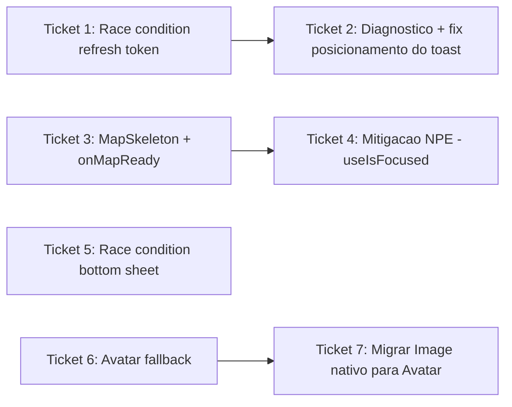

# Ticket Breakdown — Epic 9: Performance/UX em Market e Denúncias

Cada item de escopo é uma checkbox: `[x]` feito, `[ ]` pendente. Ao retomar o
trabalho, este arquivo é a fonte de verdade de onde paramos.

Branch: `fix/market-complaints-hardware-performance` (criada a partir de
`origin/development`). Todos os tickets vivem nesta mesma branch, um commit
por ticket.

---

## Ticket 1 — Race condition de refresh token (causa raiz)

**Status:** ⬜ Pendente.

**Escopo:**
- [ ] `src/libs/api/oikos-api.ts`: tornar `setAuthToken`/`setRefreshToken`
  (linhas 42-62) `async`, aguardando `saveAuthToken`/`saveRefreshToken`/
  `removeAuthToken`/`removeRefreshToken` internamente.
- [ ] `grep -rn "setAuthToken\|setRefreshToken" src/` para achar todos os call
  sites antes de mudar a assinatura.
- [ ] `src/contexts/auth-context.tsx:126-127` (`signInMutation.mutationFn`):
  `await Promise.all([setAuthToken(token), setRefreshToken(refreshToken)])`
  antes do `Promise.all([getV1Profiles(), getV1UsersMe()])`.
- [ ] Demais call sites (`auth-context.tsx:266-267`, `312-313`) — `await` as
  novas versões async.
- [ ] `oikos-api.ts:164` (interceptor 401): trocar
  `await getStoredRefreshToken()` por
  `refreshToken ?? (await getStoredRefreshToken())`.
- [ ] Interceptor de refresh (`oikos-api.ts:176-181`) — avaliar se pode
  chamar `setAuthToken`/`setRefreshToken` (novas versões async) em vez de
  duplicar `Promise.all([saveAuthToken, saveRefreshToken])`.

**Testes:**
- [ ] Ajustar/criar caso em `src/tests/integration/auth/auth-flow.test.tsx`:
  mockar 401 imediatamente após login bem-sucedido, com `getRefreshToken()`
  síncrono já populado — garantir que o interceptor usa o valor em memória e
  não lança "No refresh token".

**Validação:** `npx tsc --noEmit`, `npm run lint`, `npm test` (auth-flow).
Reprodução ao vivo: login → navegar rápido para Denúncias → sem "No refresh
token" no logcat, tap na tab funciona imediatamente.

**Referências de spec:** tech-plan.md → "Por que `refreshToken ?? await
getStoredRefreshToken()` resolve o Bug 1"; epic-brief.md → Bug 1.

**Dependências:** nenhuma. Resolve a maioria dos casos do Bug 1 sozinho.

---

## Ticket 2 — Diagnóstico e correção do posicionamento do toast

**Status:** ⬜ Pendente. **Só executar depois do Ticket 1**, para ver se o
problema ainda ocorre em algum cenário residual (ex. conexão muito lenta).

**Escopo:**
- [ ] Reproduzir via `agent-device` (login com rede lenta simulada) após o
  Ticket 1 já mergeado/testado.
- [ ] Inspecionar via `agent-device help react-devtools`: quantos `Toaster`
  montados, estado do `PortalProvider.items` no momento do toast (se ainda
  ocorrer).
- [ ] Conferir se `AuthModal` (`src/components/auth/auth-modal.tsx`, usa
  `Modal useRNModal` nativo) ainda está com a window nativa viva no momento —
  candidato secundário.
- [ ] Aplicar correção cirúrgica em `src/components/toast.tsx` conforme o
  diagnóstico — **não reescrever o sistema de toast**.

**Validação:** reprodução ao vivo confirmando toast (se disparar) aparece no
topo e some sozinho, sem sobrepor a tab bar.

**Referências de spec:** epic-brief.md → Bug 1, "Mecanismo exato do
posicionamento".

**Dependências:** Ticket 1.

---

## Ticket 3 — `MapSkeleton` + `onMapReady` nas 3 telas com mapa

**Status:** ⬜ Pendente.

**Escopo:**
- [ ] Criar `src/components/ui/map-skeleton.tsx` — segue o padrão de
  `src/components/companies/company-card-skeleton.tsx` (usa `Skeleton` de
  `src/components/ui/skeleton`). Props: `className?: string`.
- [ ] `src/components/complaints/complaint-map.tsx` (linha 37): `useState` +
  `onMapReady={() => setIsMapReady(true)}` + overlay `<MapSkeleton />`
  enquanto `!isMapReady`.
- [ ] `src/components/wrapper-map.tsx`: mesmo padrão, compondo com o branch
  existente de `isResolvingLocation` (linha 140) — o skeleton aparece
  **depois** que esse branch decide renderizar o `MapView`, não o substitui.
- [ ] `src/app/(tabs)/complaints/index.tsx` (linha 337): `isMapReady` já
  existe (linha 192) — só adicionar o overlay `<MapSkeleton />` (full height).

**Testes:**
- [ ] `grep -rln "WrapperMap\|ComplaintMap" src/tests/` antes de criar specs
  novos, para não duplicar cobertura existente.
- [ ] Teste de componente para `MapSkeleton` (renderiza).

**Validação:** `npx tsc --noEmit`, `npm run lint`. Reprodução ao vivo: abrir
Denúncias → skeleton breve antes do mapa aparecer, nas 3 telas.

**Referências de spec:** tech-plan.md → "Por que `onMapReady` + skeleton
resolve a falta de feedback"; epic-brief.md → Bug 2.

**Dependências:** nenhuma.

---

## Ticket 4 — Mitigação da NPE nativa (janela de sobreposição dos `MapView`)

**Status:** ⬜ Pendente. Depende do Ticket 3 (reaproveita o skeleton).

**Escopo:**
- [ ] `src/app/(tabs)/complaints/(create)/index.tsx` (onde `<WrapperMap>` é
  renderizado, linha 527-531): usar `useIsFocused` de
  `@react-navigation/native` (padrão já usado em
  `src/components/complaints/complaint-bottom-sheet/index.tsx`) para atrasar
  o mount real do `MapView` até a tela estar focada.
- [ ] Adicionar `InteractionManager.runAfterInteractions` antes de montar o
  `MapView` de verdade, mostrando o `MapSkeleton` (Ticket 3) nesse meio-tempo.
- [ ] **Deixar explícito no commit**: é mitigação de janela de corrida, não
  correção garantida — a NPE vive dentro do SDK nativo do Google Maps.

**Validação:** reprodução ao vivo repetindo a navegação Denúncias → Criar
Denúncia 5-10x, comparando frequência da NPE no logcat antes/depois. Testar
prioritariamente no SM-A305GT físico (onde a NPE foi capturada).

**Referências de spec:** tech-plan.md → "Por que atrasar o mount do
`WrapperMap` é uma mitigação"; epic-brief.md → Bug 2.

**Dependências:** Ticket 3.

---

## Ticket 5 — Race condition no `ComplaintsListBottomSheet`

**Status:** ⬜ Pendente.

**Escopo:**
- [ ] `src/components/complaints/complaints-list-bottom-sheet/index.tsx`
  (linhas 24-30): evitar o disparo prematuro do `snapToIndex` no mount.
  Avaliar duas abordagens (decidir durante a implementação, documentar qual
  foi usada):
  - (a) Guardar o efeito atrás de um sinal de prontidão do `BottomSheet`
    (`onChange`/callback de layout do `@gorhom/bottom-sheet`), só chamando
    `snapToIndex` depois que o sheet sinalizar que montou.
  - (b) Usar a API declarativa do `@gorhom/bottom-sheet` para o estado inicial
    (`index` controlado por `selectedMapComplaint` via prop, não por
    `ref.current.snapToIndex` imperativo no mount) e reservar o `ref` só para
    mudanças pós-mount.

**Validação:** reprodução ao vivo **no hardware fraco (SM-A305GT)** — é onde o
bug se manifesta; abrir Denúncias, sheet deve aparecer expandido a 42% sem
precisar tocar em nenhuma denúncia primeiro. Repetir 5x para confiança
(condição de corrida).

**Referências de spec:** tech-plan.md → "Por que a mesma lógica de gate
resolve o Bug 3"; epic-brief.md → Bug 3.

**Dependências:** nenhuma. Independente dos demais.

---

## Ticket 6 — Expor fallback visual no `Avatar`

**Status:** ⬜ Pendente.

**Escopo:**
- [ ] `src/components/ui/avatar/index.tsx`: estilizar e exportar
  `AvatarFallbackText` (ou um `AvatarFallbackIcon` customizado, já que o
  padrão do projeto usa ícones `lucide-react-native`, não iniciais — decidir
  com base no que `company-card.tsx:23-32` já faz).
- [ ] Confirmar que a imagem renderiza por cima do fallback (`avatarImageStyle`
  pode precisar `position: absolute` explícito, já que `View` usa
  `flexDirection: column` por padrão).
- [ ] Consultar `design-system-analyst` antes de decidir "ícone genérico" vs.
  "iniciais" como padrão — é decisão de consistência do design system.

**Testes:**
- [ ] Teste de componente para `Avatar`/`AvatarImage` simulando falha de
  carregamento (`src/tests/__mocks__/` — checar mock de `expo-image`
  existente) — garantir que o fallback aparece.

**Validação:** `npx tsc --noEmit`, `npm run lint`. Reprodução ao vivo: com o
backend local retornando 404 pro avatar do usuário logado, abrir a Home e
confirmar visualmente o ícone genérico em vez de espaço em branco.

**Referências de spec:** tech-plan.md → "Por que `AvatarFallbackText` resolve
o Bug 4"; epic-brief.md → Bug 4.

**Dependências:** nenhuma. Resolve o caso mais visível (avatar do usuário)
sozinho.

---

## Ticket 7 — Migrar usos de `Image` nativo do RN para `Avatar`/`AvatarImage`

**Status:** ⬜ Pendente. Depende do Ticket 6.

**Escopo:** (5 arquivos, podem virar commits menores se preferir)
- [ ] `src/app/(tabs)/market/index.tsx:89-96` (avatar de empresa na
  listagem).
- [ ] `src/app/(tabs)/market/[companyId].tsx:185-190` (avatar de empresa no
  detalhe).
- [ ] `src/components/complaints/complaint-bottom-sheet/resolution-card.tsx:60-63`
  (avatar de quem resolveu a denúncia).
- [ ] `src/components/complaints/company-picker-bottom-sheet.tsx:138-142`.
- [ ] `src/app/(tabs)/complaints/resolution.tsx:452-456`.

Cada um: trocar `Image` do RN pelo `Avatar`/`AvatarImage` do design system
(Ticket 6), sem reimplementar `onError` manualmente. Continuar passando
`getAuthenticatedImageHeaders()` (`oikos-api.ts:74-80`) — sem isso a imagem
falha por 401 em vez de 404, mascarando o bug.

**Validação:** `npx tsc --noEmit`, `npm run lint`. Screenshot antes/depois nas
5 telas via `agent-device`. Validar visualmente que não há
flicker/recarregamento excessivo nas listas (mudança de Glide para
expo-image pode afetar cache).

**Referências de spec:** tech-plan.md → arquitetura de arquivos do Bug 4;
epic-brief.md → Bug 4.

**Dependências:** Ticket 6.

---

## Ordem sugerida de execução

1. **Ticket 1** (race condition refresh token) — menor superfície, maior
   impacto imediato, desbloqueia navegação.
2. **Ticket 3** (MapSkeleton + onMapReady) — resolve o "parece travado" mais
   citado pelo usuário.
3. **Ticket 5** (bottom sheet) — independente, mas mesma família de causa do
   Ticket 3/4; faz sentido em sequência.
4. **Ticket 4** (mitigação NPE) — depende do skeleton do Ticket 3.
5. **Ticket 6** (Avatar fallback) — resolve o caso mais visível do Bug 4.
6. **Ticket 7** (migrar Image nativo) — maior superfície, por último.
7. **Ticket 2** (diagnóstico do toast) — só se o Ticket 1 não resolver 100%.

Um commit por ticket, todos na branch
`fix/market-complaints-hardware-performance`; ao final, abrir PR para
`development`.

## Status geral

Nenhum ticket iniciado ainda. Esta seção é atualizada a cada ticket concluído
(commit hash, resultado da validação, o que ficou pendente de validação
manual).
